# Spec ระบบโปรโมชั่น คูปอง พอยท์ แคมเปญ สุ่มรางวัล บริการสั่งทำพิเศษ และเซตร้านยาเปิดใหม่
## Pharmaplex E-Commerce Platform

ฉบับ 1.0 · 6 ตุลาคม 2569 · เอกสารสำหรับนำเสนอและตรวจทาน

---

## 1. ภาพรวมของระบบ

### 1.1 ระบบนี้คืออะไร

Pharmaplex เป็นแพลตฟอร์มซื้อขายยาและเวชภัณฑ์ ทั้งสำหรับร้านค้าที่สั่งซื้อจำนวนมาก (B2B) และลูกค้าทั่วไป (B2C) เอกสารนี้อธิบายว่าระบบมีอะไรบ้าง แต่ละส่วนทำงานอย่างไร ใช้ตอนไหน และมีรูปแบบอะไรให้เลือกใช้

ระบบประกอบด้วยหน้าร้านออนไลน์ หน้าจอแอดมิน และการเชื่อมต่อกับระบบขายหน้าร้าน (POS) และช่องทางชำระเงิน โดยมี 6 โมดูลหลักที่เอกสารนี้อธิบาย

### 1.2 ภาพรวมการเชื่อมต่อ

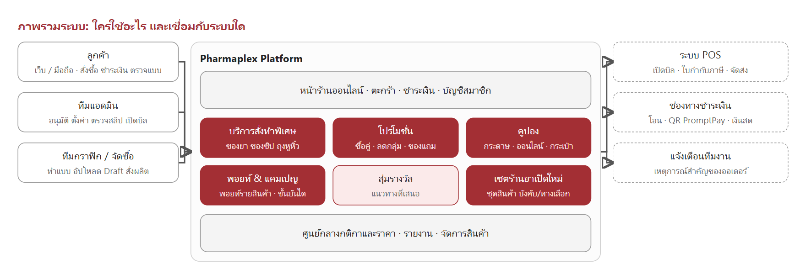

*รูป 1-1 ผู้ใช้งานแต่ละกลุ่มเข้าสู่ระบบผ่านหน้าร้านหรือหน้าแอดมิน ระบบกลางรวบรวมกติกาทุกโมดูลไว้ที่เดียว และส่งข้อมูลการขายไปยัง POS และช่องทางชำระเงิน*

### 1.3 โมดูลทั้งหมดในระบบ

| โมดูล | คืออะไร | ใช้เมื่อไหร่ | มีกี่แบบ |
|---|---|---|---|
| บริการสั่งทำพิเศษ | สั่งผลิตสินค้าตามแบบของร้าน เช่น ซองยาพิมพ์ชื่อร้าน | ร้านต้องการบรรจุภัณฑ์เฉพาะที่ไม่มีในสต็อก | 4 ประเภทสินค้า และทุกประเภทเลือกตัวเลือกได้หลายแบบ |
| โปรโมชั่น | ส่วนลดที่เกิดขึ้นอัตโนมัติตอนซื้อ ไม่ต้องใส่โค้ด | ต้องการกระตุ้นการซื้อสินค้ากลุ่มหนึ่ง | 2 แบบ |
| คูปอง | สิทธิ์ส่วนลดที่ลูกค้าต้องได้รับก่อนจึงใช้ได้ | แจกหน้างาน ส่งเสริมการขายผ่านเว็บ หรือแจกประจำเดือน | 5 แบบ |
| พอยท์และแคมเปญ | สะสมพอยท์ราย SKU และรางวัลปลดล็อกตามยอดสะสม | ให้ลูกค้าสะสมยอดและแลกของ | พอยท์ 1 ระบบ และแคมเปญ 2 แบบ |
| การสุ่มรางวัล | เปลี่ยนพอยท์ ยอดซื้อ หรือโค้ด เป็นสิทธิ์ลุ้นรางวัล | กิจกรรมส่งเสริมการขายที่มีของรางวัลหลากหลาย | 2 โหมดการจับรางวัล |
| เซตร้านยาเปิดใหม่ | ชุดสินค้าเริ่มต้นสำหรับร้านยาที่เพิ่งเปิด ปรับรายการได้ | ผู้ที่ต้องการเปิดร้านยาใหม่ | 2 ประเภทรายการ บังคับและทางเลือก |

### 1.4 ผู้ใช้งานและหน้าที่

| ผู้ใช้งาน | ทำอะไรได้ในระบบ |
|---|---|
| ลูกค้า (สมาชิก / ร้านค้า) | สั่งซื้อ ชำระเงิน ตรวจแบบ อนุมัติหรือขอแก้ไข ใช้คูปองและพอยท์ ติดตามสถานะ |
| แอดมิน (รวมเซลล์) | ตั้งค่าสินค้า โปรโมชั่น คูปอง แคมเปญ ตรวจสลิป อนุมัติคำสั่งซื้อ ปรับจำนวนจริง เปิดบิล และสั่งซื้อแทนลูกค้าได้ในบางกรณี เช่น เซลล์สั่งเซตร้านยาเปิดใหม่แทนลูกค้า |
| ทีมกราฟิก | จัดทำแบบ Mockup อัปโหลดแบบให้ลูกค้าตรวจ |
| ฝ่ายจัดซื้อ / โรงงาน | รับเรื่องผลิตและส่งสินค้าเข้าคลัง |
| ทีมงานภายใน | ได้รับการแจ้งเตือนเมื่อมีเหตุการณ์สำคัญของคำสั่งซื้อ |

### 1.5 หลักการที่ใช้ทั้งระบบ

- **ไม่ต้องใส่โค้ดกับโปรโมชั่น** ส่วนลดเกิดขึ้นเองเมื่อลูกค้าเข้าเงื่อนไข
- **ราคาและส่วนลดคำนวณที่ระบบเสมอ** หน้าจอแสดงตัวอย่างให้ลูกค้าเห็น แต่ยอดที่ชำระจริงคำนวณที่เซิร์ฟเวอร์
- **กติกาปรับได้จากหน้าแอดมิน** ไม่ต้องพัฒนาใหม่เมื่อต้องการเปลี่ยนแบรนด์ หมวด ช่วงเวลา หรือจำนวนที่กำหนด
- **ตรวจย้อนหลังได้** ทุกการใช้คูปอง สิทธิ์ลุ้น และการแลกพอยท์มีประวัติให้ตรวจ

### 1.6 การทำงานร่วมกันระหว่างโมดูลและนโยบายร่วมของระบบ

- **การใช้ร่วมกันในบิลเดียว** แอดมินตั้งค่าได้เองว่าแต่ละโมดูล (โปรโมชั่น คูปอง พอยท์ แคมเปญ สิทธิ์ลุ้น) เปิดหรือปิดใช้งาน และกำหนดได้ว่าโมดูลไหนใช้ร่วมกับโมดูลไหนได้บ้างในตะกร้าเดียวกัน ไม่ได้กำหนดตายตัวไว้ในระบบ
- **ยกเลิก / คืนสินค้า** เมื่อคูปอง พอยท์ หรือของแถมถูกใช้ไปแล้ว การยกเลิกหรือคืนสินค้าภายหลังจะไม่เรียกคืนสิ่งที่ใช้ไปแล้ว ถือว่าใช้สิทธิ์ไปแล้ว (คำขอคืนสินค้าทุกกรณีต้องผ่านการอนุมัติจากแอดมินก่อนอยู่แล้ว)
- **การแจ้งเตือนลูกค้า** ทั้งระบบไม่มีการแจ้งเตือนผ่านอีเมล SMS หรือ LINE ลูกค้าต้องเข้าเว็บเพื่อติดตามสถานะและสิทธิ์ต่าง ๆ ด้วยตนเอง
- **ภาษีมูลค่าเพิ่ม (VAT)** ราคาสินค้า ค่าจัดส่ง และส่วนลดที่แสดงในเอกสารนี้ทั้งหมดเป็นราคารวม VAT แล้ว
- **B2B กับ B2C** ทุกโมดูลใช้กติกาเดียวกันกับลูกค้าทุกกลุ่ม ยกเว้นเซตร้านยาเปิดใหม่ (โมดูล 7) ที่เปิดขายเฉพาะลูกค้าประเภทร้านค้า (B2B) เท่านั้น

---

## 2. บริการสั่งทำพิเศษ

### 2.1 คืออะไร

บริการสั่งทำพิเศษคือการสั่งผลิตสินค้าตามความต้องการของร้าน เช่น ซองยาพิมพ์ชื่อร้าน ซองซิป ถุงหูหิ้วพิมพ์โลโก้ ม่านบังยา และสติ๊กเกอร์ติดขวด สินค้ากลุ่มนี้ไม่มีสต็อกพร้อมส่ง ต้องผลิตตามสั่งใช้เวลาประมาณ 2–4 สัปดาห์

ลูกค้าเลือกตัวเลือกของสินค้า กรอกข้อมูลที่จะพิมพ์ลงบรรจุภัณฑ์ และดูภาพ Mockup ที่เปลี่ยนตามตัวเลือกได้ทันที ก่อนชำระมัดจำและเริ่มกระบวนการออกแบบ สินค้าหนึ่งรายการเปิดขายได้หลายปี (เช่น ฉบับปี 2569 และฉบับปี 2570) โดยคัดลอกตัวเลือก ราคา และแบบ Mockup จากปีก่อนหน้าไปตั้งต้นปีใหม่ได้ ลูกค้าเห็นเฉพาะปีล่าสุดที่เปิดขาย

### 2.2 ใช้เมื่อไหร่ และมีกี่แบบ

| ประเภทสินค้า | ตัวเลือกหลัก | ขนาด / จำนวน | รูปแบบการคิดราคา |
|---|---|---|---|
| ซองซิปยา | ประเภท (ใส, สีชา, สีขาวนม, สีแดง), รูปแบบ, สี | 6×8 ถึง 12×17 ซม. · จำนวนสำเร็จรูป 5,000 ถึง 100,000 ใบ | ต่อใบ |
| ถุงหูหิ้วพลาสติก | ชนิด (HD / PE), ชนิดหูหิ้ว, รูปแบบ, สี | 4×9 ถึง 6×14 นิ้ว · ขั้นต่ำ 50 กก. | ต่อกิโลกรัม |
| ม่านบังยา | รุ่น (ขามาตรฐาน / ขาเหล็กพิเศษ), รูปแบบ, สี | 90×160 ซม. หรือกำหนดขนาดเอง | ต่อตารางเมตร รวมขาตั้ง |
| สติ๊กเกอร์ติดขวด | ขนาด, รูปแบบ, สี | ดวง 3×6, 4×7, 5×8 ซม. หรือกำหนดขนาดเอง | ต่อแผ่น A3 |

สินค้ากลุ่มนี้ต่างจากสินค้า Pre-order ทั่วไปดังนี้

| หัวข้อ | Pre-order ทั่วไป | บริการสั่งทำพิเศษ |
|---|---|---|
| การชำระเงิน | ชำระเต็มจำนวนครั้งเดียว | มัดจำ 50% ก่อน และชำระส่วนที่เหลือเมื่อผลิตเสร็จ |
| การตรวจสอบ | ไม่มี | ตรวจสลิปและอนุมัติโดยแอดมินก่อนเริ่มออกแบบ (ยกเว้นชำระด้วย QR PromptPay ที่อนุมัติอัตโนมัติ) |
| แบบพิมพ์ | ไม่มี | ลูกค้าตรวจแบบและอนุมัติ หรือขอแก้ได้สูงสุด 3 ครั้ง |
| จำนวนผลิต | ตามที่สั่ง | อาจผลิตเกินหรือขาดได้ตามกระบวนการโรงงาน ปรับตามจำนวนจริง |
| การชำระอีกครั้ง | ไม่มี | มีการชำระรอบที่ 2 เมื่อมียอดค้าง หรือได้ใบลดหนี้คืนเมื่อจ่ายเกิน |
| การรับสินค้า | ตามรอบคิว | กดยืนยันรับสินค้าเอง แล้วให้คะแนนและรีวิวได้ |

### 2.3 ตัวเลือกสินค้าและข้อมูลที่ต้องกรอก

แอดมินตั้งค่าตัวเลือกของสินค้าแต่ละรายการเอง และเลือกรูปแบบการแสดงผลได้ 3 แบบ

| รูปแบบตัวเลือก | ใช้แสดงอะไร |
|---|---|
| ปุ่มข้อความ | ตัวเลือกทั่วไป เช่น ประเภท รูปแบบ |
| สี | วงกลมสีให้กด รองรับให้ลูกค้าพิมพ์รหัสสีหรือ Pantone เองได้ |
| ขนาด | กว้าง × ยาว ใช้กับสินค้าที่คิดราคาต่อตารางเมตร เลือกให้ลูกค้ากำหนดขนาดเองได้ |

ตัวเลือกบางรายการกำหนดให้ต้องแนบไฟล์เพิ่ม เช่น เลือก "มีแบบอยู่แล้ว" ต้องแนบไฟล์แบบมาด้วย

นอกจากตัวเลือกสินค้า แอดมินกำหนดช่องข้อมูลที่ลูกค้าต้องกรอกเองได้สูงสุด 20 ช่องต่อสินค้า เช่น ชื่อร้าน ที่อยู่ เบอร์โทรศัพท์ เวลาเปิดทำการ เป็นช่องข้อความ ข้อความหลายบรรทัด หรือช่องแนบไฟล์ ระบบดึงข้อมูลร้านของลูกค้ามาเติมล่วงหน้าให้ได้

### 2.4 ขั้นตอนการสั่งซื้อทั้งหมด

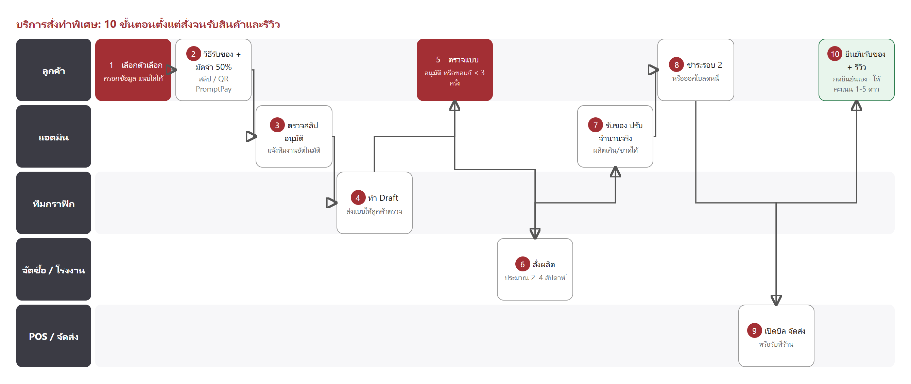

*รูป 2-1 ทั้ง 10 ขั้นตอนแบ่งตามผู้รับผิดชอบ ขั้นที่ 5 และ 7 เป็นจุดที่ลูกค้าและร้านต้องดำเนินการ ขั้นที่ 10 เป็นขั้นใหม่ที่ลูกค้ายืนยันรับสินค้าและให้คะแนนเอง*

### 2.5 รายละเอียดแต่ละขั้นตอน

**ขั้นที่ 1 เลือกตัวเลือกและกรอกข้อมูล**
ลูกค้าเลือกตัวเลือกของสินค้า กรอกข้อมูลตามช่องที่แอดมินกำหนด อัปโหลดโลโก้หรือไฟล์ตัวอย่างงาน (AI, EPS, PDF, SVG ที่แนะนำ และ PNG โปร่งใส / JPG ความละเอียดสูง ไม่เกิน 20 MB) เปิดดูตัวอย่างไฟล์ที่เลือกได้ก่อนส่งจริง และต้องยอมรับเงื่อนไขของสินค้าก่อนดำเนินการต่อ ถ้าเลือกขนาดกำหนดเองในสินค้าที่คิดราคาต่อชิ้น หรือเลือกขนาดที่ยังไม่เคยตั้งราคาไว้ ระบบจะส่งคำสั่งซื้อไปให้เจ้าหน้าที่ตีราคาก่อน ลูกค้าสั่งซื้อได้เสมอไม่ว่ากรณีใด

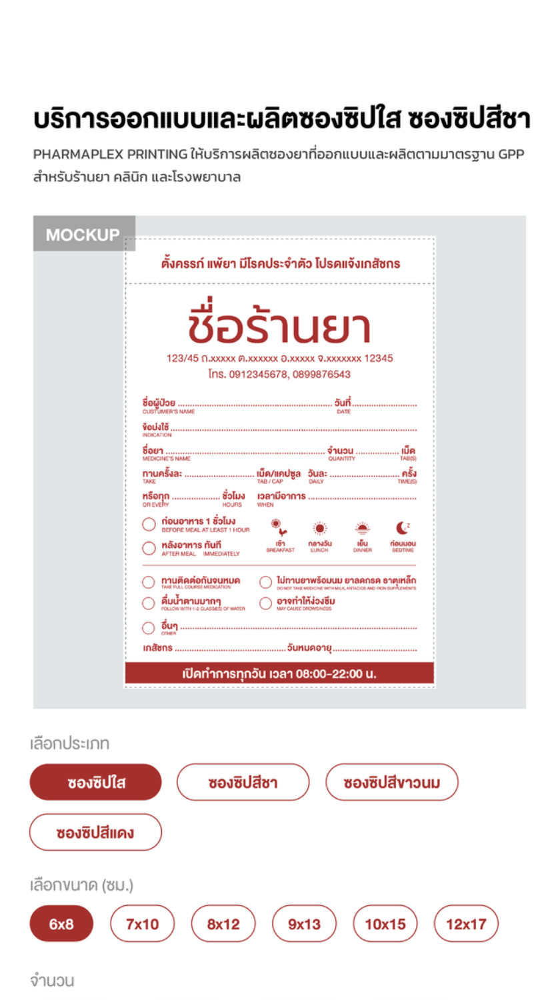

*รูป 2-2 หน้าเลือกตัวเลือกสินค้า ภาพ Mockup ด้านบนเปลี่ยนตามประเภท ขนาด และข้อมูลที่ลูกค้ากรอก*

**ขั้นที่ 2 เลือกวิธีรับสินค้าและชำระมัดจำ 50%**
ลูกค้าเลือกวิธีรับสินค้าและที่อยู่ในขั้นตอนเดียวกับการสรุปยอด (รายละเอียดอยู่ในหัวข้อ 2.9) ระบบคำนวณยอดมัดจำ 50% จาก (ค่าสินค้า + ค่าบล็อค − ส่วนลด) ยังไม่รวมค่าจัดส่ง ลูกค้าชำระด้วยการโอนพร้อมแนบสลิป (รอแอดมินตรวจ) หรือสแกน QR PromptPay (ระบบยืนยันให้อัตโนมัติ ไม่ต้องรอตรวจ) ถ้ามีใบลดหนี้ในบัญชีเลือกใช้ตัดยอดได้ทันที และถอนออกได้ก่อนส่งหลักฐานการชำระเงิน ชำระสะสมหลายครั้งได้ ไม่ต้องจ่ายครบในครั้งเดียว หรือแจ้งเจ้าหน้าที่ให้บันทึกสลิปแทนได้ถ้าส่งหลักฐานมาทางช่องทางอื่น (รายละเอียดอยู่ในหัวข้อ 2.8) วิธีรับสินค้าและที่อยู่จะล็อกแก้ไขไม่ได้หลังชำระมัดจำ

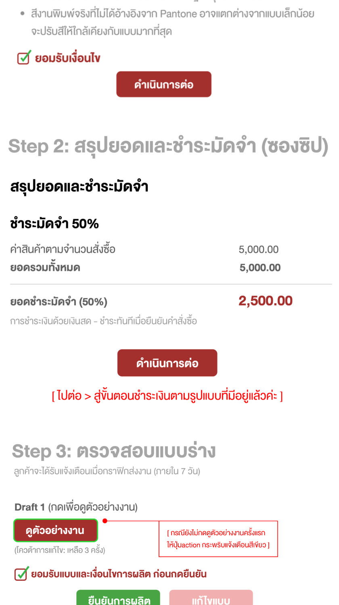

*รูป 2-3 หน้าสรุปยอดและชำระมัดจำ ยอดมัดจำคิดเป็น 50% ของยอดรวมตั้งต้น*

**ขั้นที่ 3 แอดมินตรวจสลิปและอนุมัติ**
เมื่อลูกค้าแนบสลิปโอนเงิน แอดมินตรวจยอดเทียบกับยอดที่ต้องชำระ และตรวจความถูกต้องของข้อมูล (สลิป QR PromptPay ระบบอนุมัติให้อัตโนมัติ ไม่ต้องรอแอดมิน) แอดมินเลือกทำได้ 3 ทาง
- **อนุมัติ** เพื่อเริ่มออกแบบ กำหนดส่งแบบภายใน 7 วัน
- **ส่งกลับให้แก้ไข** ลูกค้าแก้ข้อมูลหรือโลโก้แล้วส่งตรวจใหม่
- **ปฏิเสธสลิป** ลูกค้าเห็นเหตุผลและส่งสลิปใหม่ได้

**ขั้นที่ 4 ทีมกราฟิกจัดทำแบบ**
ทีมกราฟิกพิมพ์ใบสรุปความต้องการของลูกค้าจากระบบ นำไปออกแบบใน Adobe Illustrator แล้วอัปโหลดภาพ Mockup (JPG / PNG) เข้าสู่ออเดอร์ภายใน 7 วันหลังอนุมัติมัดจำ ลูกค้าได้รับแจ้งว่ามีแบบใหม่ให้ตรวจ

**ขั้นที่ 5 ลูกค้าตรวจแบบ**
ลูกค้าเข้าดูแบบในหน้า "คำสั่งซื้อของฉัน" ได้ตลอดเวลา แล้วเลือก **อนุมัติแบบ Final** หรือ **ขอแก้ไข** โดยวงจุดบนภาพแบบตรงตำแหน่งที่ต้องการแก้ (สูงสุด 30 จุด) พร้อมใส่โน้ตอธิบาย ต้องมีจุดหรือโน้ตอย่างน้อย 1 รายการ และต้องยืนยันในหน้าต่างเตือนก่อนส่ง เพราะใช้โควตาแล้วย้อนกลับไม่ได้ การขอแก้ไขทำได้สูงสุด 3 ครั้ง (Draft รวมสูงสุด 4 ฉบับ) รายละเอียดอยู่ในหัวข้อ 2.7

**ขั้นที่ 6 ส่งผลิตที่โรงงาน**
เมื่อลูกค้าอนุมัติแบบ คำสั่งซื้อเข้าสู่การผลิตและฝ่ายจัดซื้อส่งงานไปยังโรงงาน ใช้เวลาประมาณ 2–4 สัปดาห์

**ขั้นที่ 7 รับสินค้าและปรับจำนวนจริง**
โรงงานอาจผลิตได้จำนวนเกินหรือขาดจากที่สั่งได้ตามเงื่อนไขการผลิต เมื่อรับสินค้าแล้ว แอดมินปรับจำนวนจริงในออเดอร์ พร้อมกรอกค่าจัดส่งถ้าเป็นการจัดส่งนอกพื้นที่ ระบบคำนวณยอดรวมใหม่ทันที ส่วนที่ผลิตเกินลูกค้ารับในราคาต่อหน่วยเดิม รายละเอียดอยู่ในหัวข้อ 2.8

**ขั้นที่ 8 ชำระรอบที่ 2 หรือรับใบลดหนี้**
ถ้ายังมียอดค้าง ลูกค้าชำระส่วนที่เหลือผ่านหน้าเว็บ (สะสมหลายครั้งได้เช่นเดียวกับมัดจำ) และแอดมินตรวจสลิปรอบที่ 2 ถ้าไม่มียอดค้าง (ยอดพอดีหรือจ่ายเกิน หรือใบลดหนี้ครอบคลุมพอดี) ข้ามการชำระรอบนี้ไปได้เลย และถ้าลูกค้าจ่ายเกินยอดจริง ระบบออกใบลดหนี้คืนให้โดยอัตโนมัติ

**ขั้นที่ 9 เปิดบิลและจัดส่ง**
เจ้าหน้าที่เปิดบิลใน POS และกรอกเลขที่เอกสาร ออเดอร์เข้าสถานะรอจัดส่งหรือรอรับที่ร้านตามวิธีที่เลือกไว้ เจ้าหน้าที่จะนัดวันจัดส่งหรือวันรับของกับลูกค้าอีกครั้งหลังผลิตเสร็จ เพราะลูกค้าไม่ได้เลือกวันตอนสั่งซื้อ

**ขั้นที่ 10 ยืนยันรับสินค้าและให้คะแนน**
เมื่อได้รับสินค้าแล้ว ลูกค้ากดยืนยันรับสินค้าด้วยตนเองในหน้าออเดอร์ สถานะเปลี่ยนเป็น "รับสินค้าแล้ว" และปิดงาน จากนั้นให้คะแนนสินค้า 1-5 ดาวพร้อมความเห็นได้ 1 ครั้งต่อออเดอร์ รีวิวจะแสดงในหน้าสินค้าแบบสาธารณะโดยย่อชื่อลูกค้าเพื่อความเป็นส่วนตัว เช่น "จ***"

### 2.6 ภาพ Mockup และกลุ่มสี

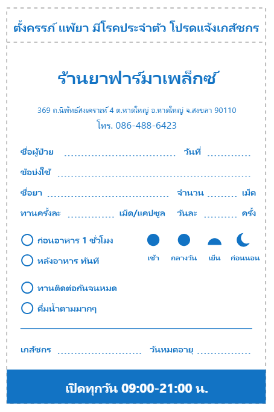

*รูป 2-4 ตัวอย่าง Mockup ที่สร้างจากข้อมูลร้านและโลโก้ของลูกค้า ภาพนี้เป็นตัวอย่างเพื่อตรวจสอบเบื้องต้น แบบจริงกราฟิกจะส่งให้ตรวจก่อนผลิต*

แบบ Mockup แปลงจากไฟล์ .ai หรือ .pdf เป็นภาพเวกเตอร์ หรืออัปโหลดเป็นภาพนิ่งก็ได้ แบบหนึ่งผูกกับตัวเลือกได้หลายแบบ หรือไม่ผูกเลยเพื่อใช้เป็นแบบหลักของสินค้า ช่องในแบบเปลี่ยนตามข้อมูลลูกค้าได้ 3 ชนิด คือข้อความ (ผูกกับช่องข้อมูลที่กรอก) รูปภาพ (ไฟล์โลโก้) และสี

**กลุ่มสี** แอดมินจัดกลุ่มสีในแบบ เช่น "สีหลัก" หรือ "สีพื้นหลัง" แล้วผูกแต่ละกลุ่มกับตัวเลือกสีของสินค้า ลูกค้าเปลี่ยนสีจากตัวเลือกเดิมตอนเลือกสินค้า ไม่มีช่องเลือกสีซ้ำซ้อน กลุ่มที่ผูกตัวเลือกสีเดียวกันจะเปลี่ยนพร้อมกันทั้งหมด ส่วนกลุ่มที่ไม่ได้ผูกจะคงสีเดิมไว้ สีที่ลูกค้าเลือกถูกบันทึกเป็นชื่อกลุ่มและรหัสสี แสดงให้เห็นทั้งหน้าลูกค้า หน้าแอดมิน และใบสรุปความต้องการที่พิมพ์ให้ทีมกราฟิก

### 2.7 การตรวจแบบและแก้ไข

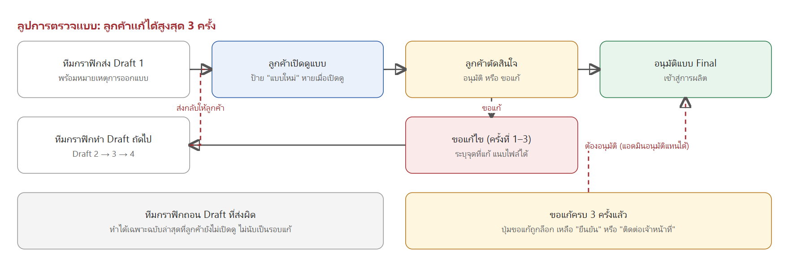

*รูป 2-5 ลูปการตรวจแบบ Draft แต่ละฉบับเก็บไว้ให้ลูกค้าเปิดดูและเทียบย้อนหลังได้*

| กฎ | รายละเอียด |
|---|---|
| วิธีขอแก้ไข | วงจุดบนภาพแบบสูงสุด 30 จุด พร้อมใส่โน้ตอธิบาย ต้องมีอย่างน้อย 1 รายการ |
| จำนวนครั้งที่ขอแก้ | ได้สูงสุด 3 ครั้ง ระบบรองรับ Draft รวมสูงสุด 4 ฉบับ |
| ครบ 3 ครั้งแล้ว | ปุ่มขอแก้ถูกล็อก เหลือเพียง "ยืนยัน" และ "ติดต่อเจ้าหน้าที่" |
| กำหนดส่งแบบ | ภายใน 7 วันนับจากวันที่แอดมินอนุมัติมัดจำ ลูกค้าเห็นกำหนดนี้ตั้งแต่ก่อนชำระ |
| แจ้งว่ามีแบบใหม่ | ลูกค้าเห็นป้าย "แบบใหม่" จนกว่าจะเปิดดู ปุ่มดูตัวอย่างงานกระพริบจนกว่าจะกดดูครั้งแรก |
| ถอนแบบที่ส่งผิด | ทีมกราฟิกถอน Draft ล่าสุดได้ ถ้าลูกค้ายังไม่เปิดดู และการถอนไม่นับเป็นรอบแก้ไข |
| อนุมัติแทนลูกค้า | ถ้าลูกค้ายืนยันผ่านช่องทางอื่น แอดมินอนุมัติแทนได้ และระบบบันทึกไว้ว่าอนุมัติโดยแอดมิน |

### 2.8 การคิดเงินและมัดจำ

**สูตรการคิดราคาสินค้า**

```
ราคาต่อหน่วย (PER_UNIT) = ราคาต่อหน่วย × จำนวน
ราคาต่อตารางเมตร (PER_AREA) = ราคาต่อตารางเมตร × มากกว่าระหว่าง(พื้นที่คิดขั้นต่ำ, กว้าง × ยาว) × จำนวน
```

ตารางราคาอ้างอิงจากตัวเลือกที่ "มีผลต่อราคา" คูณกับระดับราคาตามจำนวน (ใช้ระดับสูงสุดที่ไม่เกินจำนวนที่สั่ง) ค่าบล็อคคิดครั้งเดียวเมื่อลูกค้าติ๊ก "สั่งครั้งแรก" และตั้งแยกตามแถวราคาได้ พื้นที่คิดขั้นต่ำกันไม่ให้สินค้าชิ้นเล็กราคาต่ำเกินไป เช่น ตั้งขั้นต่ำ 1 ตร.ม. ซองขนาด 10×10 ซม. จะคิดราคาเท่ากับ 1 ตร.ม. ถ้าตั้งเป็น 0 ระบบคิดตามพื้นที่จริง

**สูตรการชำระเงิน 2 รอบ**

```
มัดจำรอบแรก = (ค่าสินค้า + ค่าบล็อค − ส่วนลด) × 50%   [ไม่รวมค่าจัดส่ง]
ยอดรวมทั้งหมด = ค่าสินค้าตามจำนวนผลิตจริง + ค่าจัดส่ง − ส่วนลด
ยอดชำระรอบที่ 2 = ยอดรวมทั้งหมด − ยอดที่ชำระแล้ว − ใบลดหนี้ที่เลือกใช้
```

**ตัวอย่างการคำนวณ** (ราคา 1 บาทต่อใบ สั่ง 5,000 ใบ และโรงงานผลิตได้จริง 5,500 ใบ)

| รายการ | จำนวน | ยอดเงิน (บาท) | หมายเหตุ |
|---|---|---|---|
| ค่าสินค้าตามที่สั่ง | 5,000 ใบ × 1 | 5,000.00 | ยอดรวมตั้งต้น |
| มัดจำรอบแรก 50% | | 2,500.00 | ชำระก่อนเริ่มออกแบบ |
| ผลิตได้จริงเกิน | +500 ใบ × 1 | +500.00 | แอดมินปรับจำนวนจริง |
| ยอดรวมหลังปรับ | 5,500 ใบ | 5,500.00 | ยอดที่ลูกค้าต้องชำระทั้งหมด |
| **ยอดค้างชำระรอบที่ 2** | | **3,000.00** | 5,500 − 2,500 |

**ตัวอย่างกรณีโรงงานผลิตขาด** ถ้าผลิตได้จริง 4,800 ใบ (ขาด 200 ใบ) และลูกค้าชำระมัดจำ 2,500 บาทไว้แล้ว ยอดรวมหลังปรับคือ 4,800 บาท ลูกค้าจึงมียอดค้างชำระ 2,300 บาท ถ้าลูกค้าชำระไว้แล้วเกินยอดรวมหลังปรับ ระบบจะออกใบลดหนี้คืนให้ตามส่วนต่างโดยอัตโนมัติ

**ขนาดที่ลูกค้ากำหนดเอง — ใครเป็นคนตีราคา**

| เงื่อนไข | ผล |
|---|---|
| คิดราคาต่อตารางเมตร และแกนขนาดไม่มีผลต่อราคา | ระบบคำนวณราคาเองจากพื้นที่ที่กรอก |
| คิดราคาต่อตารางเมตร แกนขนาดมีผลต่อราคา และตั้งราคาแถวนั้นไว้แล้ว | ระบบคำนวณราคาเองตามราคาแถวนั้น |
| คิดราคาต่อตารางเมตร แกนขนาดมีผลต่อราคา แต่ยังไม่ได้ตั้งราคา | ส่งให้เจ้าหน้าที่ตีราคาก่อนเริ่มกระบวนการ |
| คิดราคาต่อหน่วย (ต่อชิ้น) และกำหนดขนาดเอง | ส่งให้เจ้าหน้าที่ตีราคาเสมอ (คำนวณราคาต่อชิ้นจากขนาดไม่ได้) |
| ขนาดเกินค่าสูงสุดที่สินค้ากำหนดไว้ | ระบบปฏิเสธไม่ให้สั่ง |

ไม่ว่ากรณีใดลูกค้าสั่งซื้อได้เสมอ ไม่มีทางตัน เมื่อแอดมินตีราคาแล้วระบบคำนวณมัดจำ 50% ใหม่ให้อัตโนมัติ

**ข้อกำหนดเพิ่มเติม**
- ส่วนที่ผลิตเกินลูกค้ารับทั้งหมดในราคาต่อหน่วยเดิม ไม่ได้ส่วนลดเพิ่ม
- ส่วนลด (ถ้ามี) เป็นจำนวนเงินคงที่ ไม่เพิ่มตามจำนวนส่วนที่เกิน
- ใบลดหนี้ใช้ตัดยอดได้ทั้งตอนชำระมัดจำและรอบที่ 2 เลือกใช้แล้วตัดยอดทันที ถอนออกได้ก่อนส่งหลักฐานการชำระเงิน
- ชำระได้หลายงวดสะสม ทั้งมัดจำและรอบที่ 2 แต่ละครั้งที่แนบสลิประบบจะเก็บไว้ก่อน ยังไม่ส่งให้แอดมินตรวจจนกว่ายอดสลิปรวมจะครบยอดที่ต้องชำระ (หลังหักใบลดหนี้) ยอดรวมเกินยอดที่ต้องชำระจะบันทึกไม่ได้ ถ้าใบลดหนี้ครอบคลุมยอดพอดี ไม่ต้องแนบสลิปเพิ่ม
- เจ้าหน้าที่บันทึกการชำระแทนลูกค้าได้ เช่น กรณีลูกค้าส่งสลิปมาทางโทรศัพท์หรือ LINE โดยรับเฉพาะสลิปโอนเงิน ไม่รองรับ QR PromptPay ในกรณีนี้

### 2.9 วิธีรับสินค้าและค่าจัดส่ง

ลูกค้าเลือกวิธีรับสินค้าตอนสรุปยอด (ขั้นที่ 2) มี 3 แบบ

| วิธีรับสินค้า | ค่าใช้จ่าย | หมายเหตุ |
|---|---|---|
| มารับที่ร้าน | ฟรี | — |
| จัดส่งภายในพื้นที่ | ฟรี | ที่อยู่ต้องอยู่ในพื้นที่รอบจัดส่งที่ร้านกำหนดไว้ |
| จัดส่งนอกพื้นที่ | ตามระยะทาง | แอดมินกรอกค่าจัดส่งตอนปรับจำนวนผลิตจริง เก็บในยอดรอบที่ 2 |

ที่อยู่ที่เลือกถูกบันทึกเป็นสำเนา ณ วันที่สั่งซื้อ และล็อกแก้ไขไม่ได้หลังชำระมัดจำ (แก้ไขได้เฉพาะช่วงรอตีราคาหรือรอชำระมัดจำ) ไม่มีการเลือกวันหรือรอบจัดส่งล่วงหน้า เพราะสินค้ายังไม่ผลิต เจ้าหน้าที่จะนัดวันจัดส่งหรือวันรับของกับลูกค้าอีกครั้งหลังผลิตเสร็จ

### 2.10 สถานะคำสั่งซื้อ

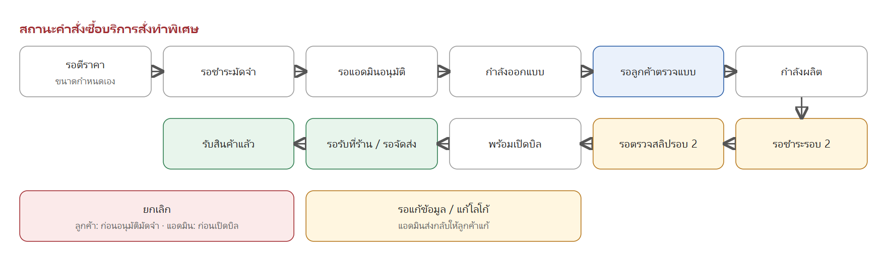

*รูป 2-6 สถานะหลักของคำสั่งซื้อ ลูกค้าติดตามสถานะได้ที่ "คำสั่งซื้อของฉัน" ในหน้าสมาชิก*

### 2.11 การยกเลิก การคืนเงิน และใบลดหนี้

| ช่วงสถานะ | ใครยกเลิกได้ | ผลที่เกิดขึ้น |
|---|---|---|
| รอตีราคา / รอชำระมัดจำ / รอแอดมินอนุมัติ / รอแก้ข้อมูล | ลูกค้าหรือแอดมิน | ยกเลิกได้ทันที ถ้าชำระเงินไว้แล้วคืนเป็นใบลดหนี้ |
| กำลังออกแบบ จนถึง รอตรวจสลิปรอบ 2 | แอดมินเท่านั้น | ยอดที่ชำระแล้วคืนเป็นใบลดหนี้ทั้งหมด |
| ตั้งแต่เปิดบิลขายแล้ว | ไม่สามารถยกเลิกผ่านระบบได้ | ติดต่อเจ้าหน้าที่โดยตรง |
| ชำระเกินยอดจริงหลังปรับจำนวนผลิต | ระบบทำให้อัตโนมัติ | ออกใบลดหนี้คืนส่วนต่าง |

ใบลดหนี้ใช้ตัดยอดได้ทั้งตอนชำระมัดจำและชำระรอบที่ 2 ของคำสั่งซื้อครั้งถัดไป การชำระเงินทำได้ด้วยการโอนพร้อมแนบสลิป หรือสแกน QR PromptPay เท่านั้น ไม่รับบัตรเครดิต และไม่รับเครดิตร้านค้าเป็นวิธีชำระ

### 2.12 การตั้งค่าของแอดมินต่อสินค้า

| หัวข้อที่ตั้งค่า | รายละเอียด |
|---|---|
| ข้อมูลสินค้า | ชื่อ คำอธิบาย เงื่อนไขการใช้งาน (terms) ระยะเวลาผลิต เปิด/ปิดการขาย และลำดับการแสดงผล |
| โหมดราคา | เลือกคิดราคาต่อหน่วยหรือต่อตารางเมตร พร้อมตั้งพื้นที่คิดขั้นต่ำ (เฉพาะโหมดต่อตารางเมตร) |
| ตัวเลือกสินค้า (แกนตัวเลือก) | สร้างได้หลายแกน เลือกรูปแบบแสดงผล (ปุ่มข้อความ / สี / ขนาด) และตั้งว่าแกนไหน "มีผลต่อราคา" |
| ตารางราคา | กำหนดราคาตามชุดตัวเลือก คูณกับระดับราคาตามจำนวน ช่องว่าง = ไม่ขายชุดนั้น |
| ค่าบล็อค | เปิดหรือปิดค่าบล็อค และตั้งราคาแยกตามแถวราคาได้ |
| ช่องข้อมูลลูกค้า (infoFields) | สร้างได้สูงสุด 20 ช่อง เลือกชนิดช่อง (ข้อความ / ข้อความหลายบรรทัด / ไฟล์) และตั้งให้เติมค่าจาก POS ล่วงหน้า |
| แบบ Mockup | อัปโหลดไฟล์ .ai / .pdf หรือภาพนิ่ง ผูกกับตัวเลือกที่ต้องการ จัดกลุ่มสีในแบบ และผูกแต่ละกลุ่มกับแกนสี |
| จำนวนสั่งซื้อ | ตั้งปุ่มจำนวนสำเร็จรูป และเปิด/ปิดให้ลูกค้ากรอกจำนวนเอง |
| ปีของสินค้า | คัดลอกตัวเลือก ราคา และแบบ Mockup จากปีก่อนหน้าไปตั้งต้นปีใหม่ได้

### 2.13 หน้าจอทั้งหมด (ลูกค้าและแอดมิน)

ภาพชุดนี้แสดงหน้าจอของบริการสั่งทำตามลำดับขั้นที่ 1-10 ในหัวข้อ 2.5 ตั้งแต่เลือกตัวเลือกจนถึงรับสินค้าและรีวิว วงกลม/กรอบสีแดงบนภาพชี้จุดที่ต้องกดหรือจุดที่ควรสังเกตของขั้นตอนนั้น

**ก่อนเริ่มขาย — แอดมินตั้งค่าบริการ**

แอดมินสร้างบริการใหม่จากหน้ารายการบริการ (2.12) กดปุ่ม "เพิ่มบริการ" จะเปิดฟอร์มเปล่าให้กรอกชื่อ คำอธิบาย และตั้งค่าต่อในแท็บย่อย (การสั่งซื้อ / ตัวเลือก / ราคา / แบบ Mockup) บริการที่ใช้สาธิตชุดนี้ตั้งค่าไว้ล่วงหน้าแล้ว ภาพด้านล่างจึงเปิดจากปุ่มแก้ไขของบริการเดิมเพื่อให้เห็นตัวเลือกและแบบ Mockup ที่กรอกจริง


**ขั้นที่ 1-2 (ฝั่งลูกค้า) — เลือกตัวเลือกและชำระมัดจำ**

ลูกค้าเข้าหน้า "บริการอื่นๆ" เลือกบริการที่ต้องการ เลือกตัวเลือกสินค้า กรอกข้อมูลสำหรับพิมพ์ลงบรรจุภัณฑ์ แนบไฟล์โลโก้ถ้ามี และติ๊กยอมรับเงื่อนไขก่อนกดปุ่ม "ดำเนินการต่อ" ไปหน้าตรวจสอบและยืนยัน จากนั้นกด "ยืนยันคำสั่งซื้อและชำระมัดจำ" เพื่อสร้างออเดอร์ หน้าชำระเงินเริ่มที่ QR PromptPay ตามค่าเริ่มต้นของระบบ แต่ลูกค้าเลือกแนบสลิปแทนได้ (กรณีนี้ใช้แสดงขั้นตรวจสลิปของแอดมินในขั้นถัดไป) กรอกข้อมูลผู้โอนและแนบไฟล์แล้วกด "ส่ง"


**ขั้นที่ 3 — แอดมินตรวจสลิปและอนุมัติ**

หลังลูกค้าส่งสลิป ออเดอร์เข้าคิว "ตรวจการชำระเงิน" ในหน้า `/admin/service-orders` แอดมินกดปุ่ม "ดำเนินการ" ที่แถวออเดอร์เพื่อเปิดหน้าต่างตรวจสอบ ตรวจยอดกับสลิปแล้วกด "อนุมัติ" เพื่อเริ่มขั้นตอนทำแบบ ฝั่งลูกค้าระหว่างนี้จะเห็นสถานะ "รอตรวจสอบการชำระเงิน" ที่หน้าออเดอร์ และติดตามออเดอร์ทั้งหมดของตัวเองได้จากแท็บ "บริการสั่งทำ" ในหน้าระบบสมาชิก


**ขั้นที่ 4-5 — ทีมกราฟิกส่งแบบ แล้วลูกค้าตรวจ**

เมื่ออนุมัติมัดจำแล้ว หน้าต่างเดิมจะโผล่ฟอร์ม "ส่งแบบให้ลูกค้าตรวจ" ให้แอดมิน/กราฟิกแนบภาพแบบและหมายเหตุ กด "ส่งแบบให้ลูกค้า" ออเดอร์เข้าสถานะรอลูกค้าตรวจแบบ ฝั่งลูกค้าเปิดดูแบบที่หน้าออเดอร์ เลือกได้ว่าจะ "อนุมัติแบบนี้ เข้าสู่การผลิต" หรือ "ขอแก้ไข (วงจุดในแบบ)" — ถ้าขอแก้ไข ใช้เครื่องมือวงกลม/ตีกรอบ/ปักหมุดชี้จุดที่ต้องการแก้พร้อมพิมพ์รายละเอียด แล้วกด "ส่งให้กราฟิกแก้ไข" (ใช้โควตาแก้ไข 1 ใน 3 ครั้ง ย้อนกลับไม่ได้)


**ขั้นที่ 6-7 — ส่งผลิตแล้วปรับจำนวนจริงตอนสินค้าเข้า**

เมื่อลูกค้ากด "อนุมัติแบบนี้" ออเดอร์เข้าสถานะอยู่ระหว่างผลิตทันที ระหว่างรอผลิต (2-4 สัปดาห์) ทีมกราฟิก/จัดซื้อพิมพ์ "ใบสรุปความต้องการลูกค้า" จากไอคอนเครื่องพิมพ์บนหน้าต่างออเดอร์ไปใช้อ้างอิงกับโรงงาน เมื่อสินค้าเข้าสต็อกจริง แอดมินกลับมาเปิดออเดอร์เดิมเพื่อแก้ไขจำนวนในช่อง "จำนวนจริง" ของแต่ละรายการ (ปกติผลิตเกิน/ขาดจากที่สั่งได้ตามเงื่อนไขโรงงาน) แล้วกด "ยืนยัน และแจ้งลูกค้า" ระบบคำนวณยอดใหม่และเปลี่ยนสถานะเป็นรอชำระเงินรอบ 2 ให้อัตโนมัติ


**ขั้นที่ 8 — ชำระเงินรอบที่ 2**

ลูกค้าเห็นยอดค้างชำระส่วนเกินที่หน้าออเดอร์และกดปุ่ม "ชำระเงิน" เพื่อจ่ายส่วนที่เหลือเองได้ตามปกติ ตัวอย่างชุดนี้สาธิตอีกช่องทางหนึ่งคือกรณีลูกค้าโอนเงินและแจ้งเจ้าหน้าที่ทางโทรศัพท์/LINE แทน: แอดมินกดปุ่ม "ชำระเงินแทนลูกค้า" ในหน้าต่างออเดอร์ กรอกธนาคาร ยอดโอน วันเวลา และแนบสลิปแทนลูกค้า แล้วกด "บันทึกการชำระเงิน" สลิปจะเข้าคิวให้แอดมินตรวจและกด "อนุมัติ" เหมือนขั้นที่ 3 อีกครั้งก่อนปลดล็อกไปขั้นเปิดบิล


**ขั้นที่ 9 — เปิดบิลขายและจัดส่ง**

เมื่อชำระรอบ 2 ครบแล้ว ออเดอร์เข้าสถานะรอเปิดบิลขาย แอดมินกรอก "เลขที่เอกสาร POS" แล้วกด "เปิดบิลแล้ว" เพื่อยิงเข้าสู่ขั้นจัดส่ง/รอรับสินค้า (สาธิตนี้ลูกค้าเลือกมารับที่ร้าน) ฝั่งลูกค้าเห็นสถานะรอรับสินค้าที่หน้าออเดอร์ และกด "ได้รับสินค้าแล้ว" เองเมื่อมารับของจริง


**ขั้นที่ 10 — ยืนยันรับสินค้าและให้คะแนน**

หลังยืนยันรับสินค้า (มีหน้าต่างให้ยืนยันอีกครั้งก่อนปิดงาน) ออเดอร์เปลี่ยนเป็นสถานะเสร็จสิ้น และฟอร์มให้คะแนนจะปรากฏทันที ลูกค้าให้ดาว 1-5 พร้อมความเห็น (ให้ได้ครั้งเดียว แก้ไขภายหลังไม่ได้) แล้วกด "ส่งรีวิว" ฝั่งแอดมินเปิดออเดอร์เดิมดูได้ว่าไทม์ไลน์ครบทั้ง 7 ขั้นแล้ว พร้อมสวิตช์ "แสดงรีวิวนี้ในหน้าบริการ" ไว้เปิดให้รีวิวแสดงต่อสาธารณะเมื่อตรวจสอบแล้วว่าเหมาะสม ซึ่งเป็นจุดปิดงานของออเดอร์นี้


---

## 3. โปรโมชั่น

### 3.1 คืออะไร และใช้เมื่อไหร่

โปรโมชั่นคือส่วนลดที่เกิดขึ้นเองเมื่อลูกค้าใส่สินค้าลงตะกร้าและเข้าเงื่อนไข ลูกค้าไม่ต้องกรอกโค้ดหรือติ๊กขอส่วนลด แอดมินใช้โปรโมชั่นเมื่อต้องการกระตุ้นการซื้อสินค้ากลุ่มใดกลุ่มหนึ่ง เช่น ซื้อคู่กันให้ถูกลง ซื้อครบยอดแบรนด์ที่กำหนดเพื่อรับส่วนลดหรือฟรีค่าจัดส่ง หรือจัดลดราคาเฉพาะวันพิเศษ

### 3.2 มีกี่แบบ

| แบบ | ทำงานอย่างไร |
|---|---|
| โปรโมชั่นแบบเงื่อนไข (Bundle) | ตั้งเงื่อนไขการซื้อ แล้วเลือกผลตอบแทนอย่างใดอย่างหนึ่ง: ของแถม ส่วนลด หรือฟรีค่าจัดส่ง |
| โปรโมชั่นตามวันพิเศษ | ลดราคาสินค้าเฉพาะกลุ่มที่เลือกไว้ตามช่วงเวลาที่ตั้ง พร้อมโควตาจำนวนจำกัด |

### 3.3 โปรโมชั่นแบบเงื่อนไข (Bundle)

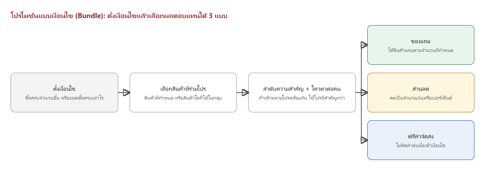

*รูป 3-1 ใช้การตั้งค่าชุดเดียวกับระบบ Bundle ที่ใช้งานอยู่ เพิ่มเติมคือเลือกได้ว่าผลตอบแทนจะเป็นของแถม ส่วนลด หรือฟรีค่าจัดส่ง*

| หัวข้อที่ตั้งค่า | รายละเอียด |
|---|---|
| เงื่อนไข | ซื้อครบจำนวนชิ้นที่กำหนด หรือยอดซื้อครบจำนวนเงินที่กำหนด (เลือกอย่างใดอย่างหนึ่ง) |
| สินค้าที่ร่วมโปร | เลือกสินค้าที่กำหนดไว้ หรือเปิดให้สินค้าชนิดใดก็ได้ในกลุ่มที่ตั้งไว้นับรวมกัน |
| ลำดับความสำคัญ (Priority) | ถ้าตะกร้าเข้าเงื่อนไขหลายโปรพร้อมกัน ใช้โปรที่ตั้งลำดับสำคัญกว่า |
| โควตาต่อคน | จำกัดจำนวนครั้งที่ลูกค้าคนเดียวรับสิทธิ์ได้ (ไม่ระบุ = ไม่จำกัด) |
| ช่วงเวลาที่มีผล | กำหนดวันเริ่มต้นและสิ้นสุด |

ผลตอบแทนเลือกได้ 1 อย่างต่อโปรโมชั่น

| ผลตอบแทน | ตัวอย่าง |
|---|---|
| ของแถม | ซื้อนมผงสูตร 3 คู่กับขวดนม PP รับของแถมตามจำนวนที่กำหนด ถ้าของแถมหมดสต็อกระหว่างโปรโมชั่น active ระบบจะแจ้งเตือนแอดมินและปิดโปรโมชั่นนั้นชั่วคราวให้อัตโนมัติ |
| ส่วนลด | ซื้อสินค้าแบรนด์ที่กำหนดครบ 1,000 บาท ลดทันที 100 บาท ถ้าตั้งเป็นส่วนลด % ตั้งเพดานส่วนลดสูงสุดได้ เช่น ลด 15% สูงสุดไม่เกิน 100 บาท |
| ฟรีค่าจัดส่ง | ซื้อสินค้าในกลุ่มที่กำหนด ไม่เสียค่าจัดส่ง |

ส่วนลดท้ายบิลตามแบรนด์และส่งฟรีตามกลุ่มสินค้าที่เคยแยกเป็นกติกาต่างหาก แท้จริงคือโปรโมชั่นแบบเงื่อนไขที่ตั้งเงื่อนไขเป็น "ยอดซื้อครบจำนวนเงิน" แล้วเลือกผลตอบแทนเป็นส่วนลดหรือฟรีค่าจัดส่งนั่นเอง จบในหน้าตั้งค่าเดียวกันได้ทั้งหมด ไม่ต้องมีหน้าตั้งค่าแยก

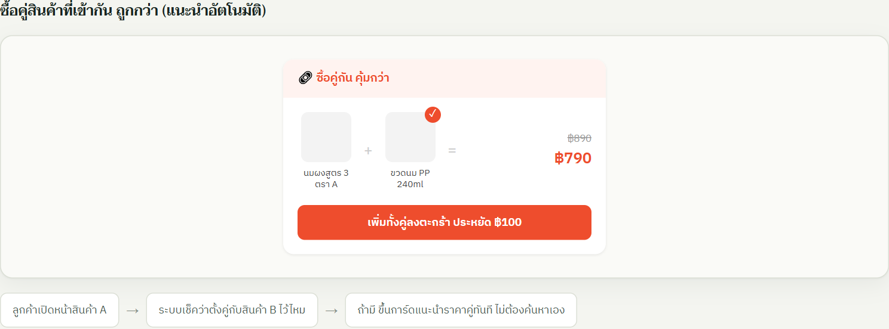

*รูป 3-2 ตัวอย่างหน้าจอ: เงื่อนไขซื้อครบ 2 ชิ้นที่กำหนด ผลตอบแทนเป็นราคาพิเศษเมื่อซื้อคู่ ระบบแนะนำให้ทันทีเมื่อลูกค้าเปิดดูสินค้าตัวแรก*

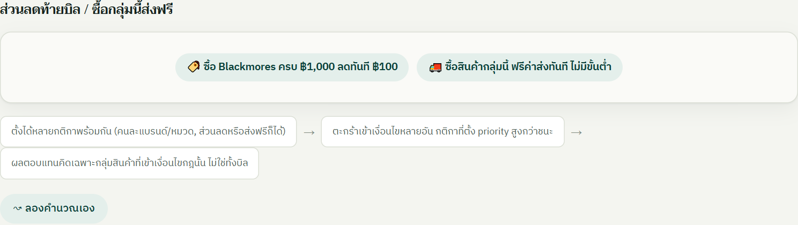

*รูป 3-3 ตัวอย่างหน้าจอ: เงื่อนไขยอดซื้อครบตามแบรนด์ ผลตอบแทนเป็นส่วนลดท้ายบิลหรือฟรีค่าจัดส่งแสดงขึ้นในหน้าสรุปยอดทันทีเมื่อเข้าเงื่อนไข*

### 3.4 โปรโมชั่นตามวันพิเศษ

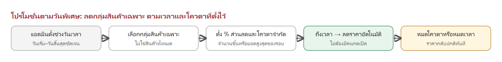

*รูป 3-4 ลดราคาเฉพาะกลุ่มสินค้าที่เลือกไว้ ไม่ใช่ทุกสินค้า และมีโควตาจำนวนจำกัดในแต่ละรอบ*

แอดมินกำหนดวันและเวลา เลือกกลุ่มสินค้าเฉพาะที่เข้าร่วม (ไม่ใช่สินค้าทั้งหมด) ตั้งเปอร์เซ็นต์ส่วนลดและโควตาจำนวนจำกัดของรอบ ถึงเวลาที่ตั้งไว้ราคาเปลี่ยนให้อัตโนมัติ เมื่อหมดโควตาหรือหมดเวลา ราคาจะกลับเป็นปกติทันทีโดยไม่ต้องมีคนกดปิด

| หัวข้อที่ตั้งค่า | รายละเอียด |
|---|---|
| ช่วงเวลา | วันและเวลาเริ่มต้น–สิ้นสุด |
| กลุ่มสินค้าที่ร่วมรายการ | เลือกเฉพาะบางหมวดหรือบางรายการ ไม่ใช่สินค้าทั้งหมด |
| เปอร์เซ็นต์ส่วนลด | ตั้งแยกแต่ละกลุ่มสินค้าได้ เช่น กลุ่มหนึ่งลด 50% อีกกลุ่มลด 30% |
| โควตาของรอบ | จำกัดจำนวนชิ้นหรือยอดสูงสุดที่ขายได้ในราคาพิเศษ หมดโควตาราคากลับปกติทันที |

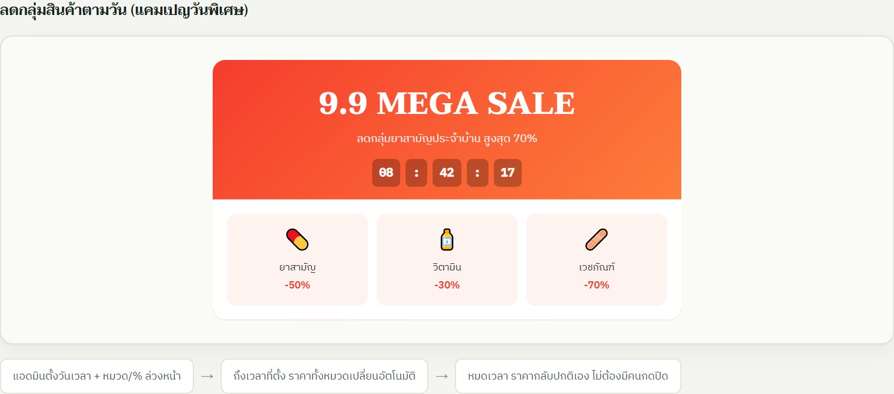

*รูป 3-5 ตัวอย่างหน้าจอ: แคมเปญวันพิเศษลดราคาเฉพาะกลุ่มสินค้า เช่น ยาสามัญ วิตามิน และเวชภัณฑ์ คนละเปอร์เซ็นต์กัน*

### 3.5 การแสดงผลหน้าเว็บ

- **ป้ายโปรโมชั่น** เช่น "ซื้อคู่ถูกกว่า", "ลดกลุ่มสินค้า" หรือ "ส่งฟรี" บนการ์ดสินค้า
- **ตัวกรองโปรโมชั่น** ลูกค้ากดดูเฉพาะสินค้าที่มีโปรโมชั่นได้จากหน้าค้นหา
- **รายละเอียดบนหน้าสินค้า** เงื่อนไขโปรโมชั่นแสดงในหน้าหลักของสินค้า ไม่ต้องกดเข้าแท็บย่อย

### 3.6 หน้าจอและ flow การใช้งาน

หน้าจอทั้งหมดของโมดูลนี้เรียงตามลำดับ flow การใช้งาน แต่ละภาพมีเลขกำกับบนจอ และคำอธิบายของแต่ละเลขอยู่ใต้ภาพ ตามด้วยกติกา ข้อยกเว้น และสถานะที่ต้องรองรับ หน้าแอดมินใช้โครงเดียวกับหน้า "เซตของแถม" ที่ใช้งานอยู่ เพราะเป็นแนวคิดเดียวกัน ส่วนที่เพิ่มจากเดิมมีป้าย "ใหม่" กำกับ

#### ภาพรวม · ภาพรวม Flow โปรโมชั่น

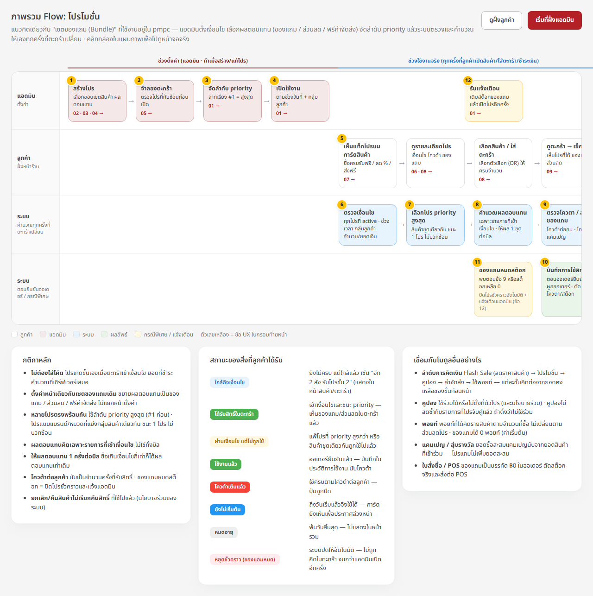

**คำอธิบายแต่ละส่วนในหน้าจอ**

1. สร้างโปร เริ่มจากกล่องเดียว ใช้ฟอร์มเดียวกับ Bundle เดิม — ส่วนที่เพิ่มใหม่มีป้าย "ใหม่": ผลตอบแทน 3 แบบ ขอบเขตแบรนด์/หมวด ใช้ร่วมกับสิทธิ์อื่น (หน้า 02) · กลุ่มขั้นบันไดแยกหน้า 03 · ลดตามวันพิเศษแยกหน้า 04
2. จำลองตะกร้า เป็นขั้นแนะนำ ไม่บังคับ — ใช้ตรวจว่าโปรใหม่ไปชนโปรเดิมหรือไม่ก่อนเปิดใช้งาน (ทดสอบโปรที่ยังปิดอยู่ได้)
3. จัดลำดับ ลากแถวในตาราง ตัวเลข #1 = สูงสุด ระบบบันทึกทันที (เหมือน Bundle เดิม) — แนะนำจัดหลังสร้างโปรใหม่ทุกครั้ง เพราะโปรใหม่ถูกวางท้ายสุดโดยค่าเริ่มต้น
4. เปิดใช้งาน สถานะแสดงตามวันที่เริ่ม–สิ้นสุด (ใช้งาน / ยังไม่เริ่มต้น / หมดอายุ) บันทึกเป็น "ใช้งาน" ไม่ได้ถ้ายังไม่มีสินค้าที่ต้องมีและผลตอบแทน
5. แท็กบนการ์ดสินค้า ป้ายเดียวต่อประเภทผลตอบแทนของโปรที่ชนะ/ใกล้ถึง ไม่แสดงตัวเลข priority ให้ลูกค้าเห็น
6. ตรวจเงื่อนไข ทำใหม่ทุกครั้งที่จำนวนหรือรายการในตะกร้าเปลี่ยน ไม่ใช้ผลที่จำไว้จากหน้าก่อน
7. เลือกโปร จัดกลุ่มตามสินค้าที่ใช้ร่วมกัน — ภายในกลุ่มเดียวกัน priority สูงสุดที่ผ่านเงื่อนไขชนะ 1 โปร โปรที่แพ้ถูกบันทึกเหตุผลไว้โชว์ในตะกร้า/จำลองตะกร้า
8. คำนวณ ผลตอบแทนอิงเฉพาะบรรทัดที่เข้าเงื่อนไข · ให้ผลตอบแทน 1 ชุดต่อบิล (ต่อออเดอร์ที่เข้าเงื่อนไข)
9. ตรวจโควตา/สต็อก ถ้าโควต้าต่อคนเต็ม โปรไม่ถูกใช้ (ปุ่มหน้าลูกค้าแสดง "โควต้าเต็มแล้ว") · ถ้าของแถมไม่พอสำหรับชุดที่ได้ ระบบให้เท่าที่สต็อกพอ ถ้าเหลือ 0 ไปข้อ 11
10. บันทึกการใช้สิทธิ์ เกิดตอนออเดอร์ยืนยัน/ชำระสำเร็จ ไม่ใช่ตอนใส่ตะกร้า — จึงไม่ต้องมีการพักโควตา (ต่างจากแคมเปญโควตา)
11. ของแถมหมดสต็อก ระบบปิดโปรชั่วคราวทันที ตะกร้าที่มีโปรนี้อยู่จะไม่ได้ของแถมและแสดงข้อความอธิบาย (หน้า 09)
12. รับแจ้งเตือน แอดมินเห็นป้ายแดง "ปิดชั่วคราว: ของแถมหมด" ที่แถวโปรในหน้ารายการ (หน้า 01) เติมสต็อกแล้วกดเปิดใช้งานเอง

**กติกา / ข้อยกเว้น / สถานะ**

- โปรที่ถูกปิดชั่วคราวเพราะของแถมหมดจะไม่เปิดคืนเอง แม้เติมสต็อกแล้ว แอดมินต้องกดเปิดเอง (ค่าเริ่มต้น)
- แก้ไขโปรที่มีผู้ใช้สิทธิ์ไปแล้ว มีผลกับตะกร้า/ออเดอร์ใหม่เท่านั้น ประวัติเดิมไม่เปลี่ยน
- ลูกค้าเห็นโปรเฉพาะที่ active และอยู่ในช่วงเวลา · โปร "ยังไม่เริ่มต้น" แสดงเป็นการ์ดเทาและกดไม่ได้

**ข้อที่ต้องตัดสินใจกับลูกค้า**

- โปรที่ถูกปิดชั่วคราวเพราะของแถมหมด: ให้เปิดคืนอัตโนมัติเมื่อมีสต็อก หรือให้แอดมินเปิดเอง (ค่าเริ่มต้นในมอคอัพ = แอดมินเปิดเอง)
- ยอดที่ใช้นับเงื่อนไขโปรคิดจากราคาก่อนหรือหลังลด Flash Sale (ค่าเริ่มต้น = หลังลด คือราคาที่ลูกค้าจ่ายจริง)

#### แอดมิน · รายการโปรโมชั่น (ลำดับ priority)

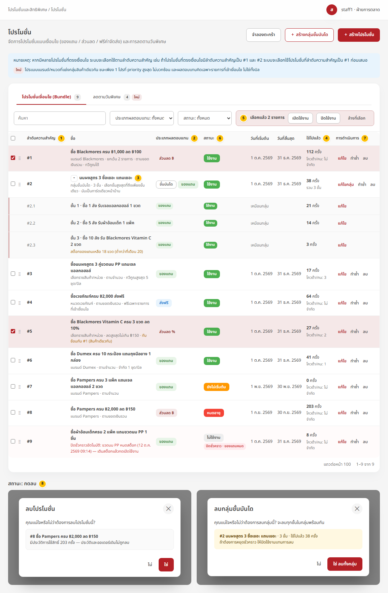

**คำอธิบายแต่ละส่วนในหน้าจอ**

1. ลำดับความสำคัญ เรียงจากบนลงล่าง #1 = สูงสุด ลากที่จับ ⋮⋮ เพื่อสลับ ระบบบันทึกทันทีและแสดง toast "อัปเดตลำดับโปรโมชั่นสำเร็จ" (เหมือน Bundle เดิม) · เลข # คือตำแหน่งในรายการ ไม่ใช่ค่าที่พิมพ์เอง · ขณะกรอง/ค้นหาจะลากไม่ได้ (กันสลับผิดตำแหน่ง)
2. ประเภทผลตอบแทน ใหม่ chip สีบอกชนิด: ของแถม / ส่วนลด (฿ หรือ %) / ส่งฟรี / ขั้นบันได · กรองได้จาก dropdown ด้านบน
3. แถวกลุ่มขั้นบันได ใหม่ กดสามเหลี่ยมเพื่อพับ/ขยาย 3 ขั้น · ลากได้ทั้งกลุ่ม (ไม่ลากแยกขั้น) · แก้ไขทั้งกลุ่มที่หน้า 03 · แต่ละขั้นเก็บเป็นแถวโปรปกติในฐานข้อมูล
4. ใช้ไปแล้ว ใหม่ จำนวนครั้งที่ลูกค้ารับสิทธิ์ทั้งหมด (นับจากออเดอร์ที่ยืนยันแล้ว) ใต้ตัวเลขคือโควต้า/คน ที่ตั้งไว้ · กดตัวเลขเพื่อดูประวัติ (ออเดอร์ ลูกค้า วันที่) · กลุ่มขั้นบันไดแสดงยอดรวมของทุกขั้น
5. เปิด/ปิดใช้งานหลายรายการ ใหม่ ติ๊กแถวแล้วแถบนี้ปรากฏ · เปิดใช้งานแถวที่ยังไม่มีสินค้าที่ต้องมีหรือผลตอบแทนไม่ได้ ระบบข้ามแถวนั้นและแจ้งรายชื่อที่ข้าม
6. สถานะ คำนวณจากวันที่ + สวิตช์ใช้งาน (เหมือนเดิม): ใช้งาน / ยังไม่เริ่มต้น / หมดอายุ / ไม่ใช้งาน · ป้ายแดงเสริม "ปิดชั่วคราว · ของแถมหมด" ที่ระบบตั้งให้เอง พร้อมเวลา และไม่เปิดคืนเอง
7. การดำเนินการ แก้ไข / ทำซ้ำ ใหม่ / ลบ · ทำซ้ำสร้างสำเนา "(สำเนา)" สถานะไม่ใช้งาน วางท้ายสุดของลำดับ · แก้ไขโปรที่ถูกใช้แล้วมีผลกับตะกร้าใหม่เท่านั้น
8. ยืนยันลบ ใช้ dialog เดิม ใช่/ไม่ · ถ้ามีประวัติการใช้สิทธิ์ แสดงจำนวนใน dialog และแนะนำให้ "ปิดใช้งาน" แทน · ลบกลุ่มขั้นบันไดลบทุกขั้นพร้อมกัน

**กติกา / ข้อยกเว้น / สถานะ**

- แท็บ "ลดตามวันพิเศษ" ใช้ข้อมูลคนละชุดกับโปรเงื่อนไข ไม่มีลำดับ priority — ราคาลด Flash ถูกคิดก่อน แล้วจึงตรวจโปรเงื่อนไข
- แถวที่หมดอายุ/ยังไม่เริ่มยังลากเรียงได้ (เพื่อเตรียมลำดับก่อนถึงวันเริ่ม)
- สิทธิ์จัดการ: ROLE_MARKETING, ROLE_PRODUCT (เหมือนหน้าเซตของแถมเดิม) — บทบาทอื่นเห็นข้อความ "คุณไม่มีสิทธิ์เข้าถึง"
- โปรเดิมที่เป็นเซตของแถมอยู่แล้ว ถูกย้ายเข้ารายการนี้ตามเดิม (ผลตอบแทน = ของแถม ขอบเขต = เลือกรายสินค้า) ไม่ต้องตั้งค่าใหม่

**ข้อที่ต้องตัดสินใจกับลูกค้า**

- ลบโปรที่มีประวัติใช้สิทธิ์แล้ว: ค่าเริ่มต้น = ซ่อนจากรายการและเก็บประวัติไว้ (soft delete) หรือห้ามลบ ให้ปิดใช้งานอย่างเดียว
- โปรที่ระบบปิดชั่วคราวเพราะของแถมหมด: เปิดคืนอัตโนมัติเมื่อมีสต็อก หรือให้แอดมินกดเปิดเอง (ค่าเริ่มต้น = แอดมินเปิดเอง)
- กลุ่มขั้นบันไดควรลากเรียงทั้งกลุ่ม (ค่าเริ่มต้น) หรือให้ลากแยกขั้นได้

#### แอดมิน · สร้าง/แก้ไขโปรโมชั่น

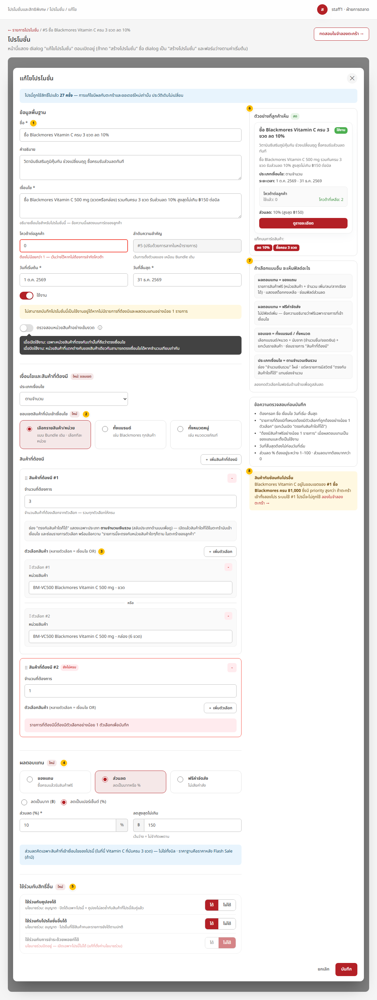

**คำอธิบายแต่ละส่วนในหน้าจอ**

1. ข้อมูลพื้นฐาน ใช้ฟิลด์เดิมของเซตของแถมทุกตัว (ชื่อ คำอธิบาย เงื่อนไข โควต้า วันที่ ใช้งาน ตรวจหน่วยอย่างเข้มงวด) · ตรวจแบบ inline ใต้ช่อง (ตัวอย่างโควต้า = 0 ขึ้นขอบแดง) · กด Enter ในฟอร์มเท่ากับบันทึก (หน่วงกันกดซ้ำ 0.5 วินาที) · ลำดับความสำคัญเป็นแบบอ่านอย่างเดียว ปรับที่หน้ารายการ
2. ขอบเขตสินค้า ใหม่ ค่าเริ่มต้น = "เลือกรายสินค้า/หน่วย" (พฤติกรรมเดิมทั้งหมด) · เลือกแบรนด์/หมวดแล้วช่อง "สินค้าที่ต้องมี" ถูกแทนที่ด้วยตัวเลือกแบรนด์/หมวด + ยกเว้นรายสินค้า · เปลี่ยนขอบเขตหลังกรอกแล้ว ระบบถามยืนยันก่อนล้างรายการเดิม
3. ตัวเลือก (OR) หลายตัวเลือกในรายการเดียว = ลูกค้าเลือกตัวใดก็ได้ รวมกันให้ครบ "จำนวนที่ต้องการ" · เพิ่มตัวเลือกใหม่ไม่ได้ถ้ามีตัวเลือกที่ยังว่างอยู่ (toast "กรุณาเติมข้อมูลตัวเลือกให้ครบถ้วน…") · ลากเรียงลำดับตัวเลือกได้
4. ผลตอบแทน ใหม่ เลือกได้ 1 อย่างต่อโปร · สลับแล้วข้อมูลของแบบเดิมถูกเก็บไว้ในฟอร์มจนกว่าจะบันทึก (กลับมาเลือกได้ไม่หาย) · ส่วนลด % ตั้งเพดานบาทได้
5. ใช้ร่วมกับสิทธิ์อื่น ใหม่ ค่าเริ่มต้นตามนโยบายร่วมของระบบ โปรนี้ "ปิด" ให้เข้มกว่าได้ แต่ "เปิด" เกินนโยบายร่วมไม่ได้ (แถวสีจางพร้อมเหตุผล)
6. ตัวอย่างที่ลูกค้าเห็น เปลี่ยนตามฟอร์มทันที (ชื่อ เงื่อนไข ช่วงวันที่ ผลตอบแทน แท็กบนการ์ดสินค้า) ใช้ component เดียวกับหน้า 06 — เห็นสถานะ "ยังไม่เริ่มต้น/ใช้งาน" ตามวันที่กรอก
7. ฟิลด์ที่เปลี่ยนตามตัวเลือก แผงสรุปให้ทีมพัฒนาและลูกค้าเห็นภาพรวมว่าแต่ละตัวเลือกเปิดฟิลด์อะไร โดยไม่ต้องคลิกทดลองทีละแบบ
8. เตือนสินค้าทับซ้อน ตรวจตอนเปิดฟอร์มและเมื่อเปลี่ยนขอบเขต: ถ้าสินค้าอยู่ในขอบเขตของโปรที่ priority สูงกว่า จะแสดงชื่อโปรนั้นและลิงก์ไปจำลองตะกร้า — เป็นคำเตือน ไม่บล็อกการบันทึก

**กติกา / ข้อยกเว้น / สถานะ**

- บันทึกเป็นใช้งานได้เมื่อมี "สินค้าที่ต้องมี"/ขอบเขต และผลตอบแทนครบ (ของแถมต้องมีสินค้าฟรีอย่างน้อย 1 รายการ) — บันทึกเป็นไม่ใช้งานได้เสมอ
- ปุ่ม "บันทึก" แสดง toast สำเร็จ แล้วกลับหน้ารายการ · เกิดข้อผิดพลาดจากเซิร์ฟเวอร์ = dialog ไม่ปิด แสดง toast แดง
- แก้โปรที่ใช้ไปแล้ว: ประวัติการใช้สิทธิ์เก็บ snapshot เงื่อนไข/ผลตอบแทนตอนใช้ ไม่เปลี่ยนตาม
- โปรเดิม (Bundle) เปิดแล้วเห็นขอบเขต = เลือกรายสินค้า, ผลตอบแทน = ของแถม, ใช้ร่วม = ตามนโยบายร่วม

**ข้อที่ต้องตัดสินใจกับลูกค้า**

- โปร "เลือกรายสินค้า" ที่สินค้าซ้ำกับโปรแบบแบรนด์/หมวดที่ priority สูงกว่า ให้แพ้ทั้งโปร (ค่าเริ่มต้น) หรือแพ้เฉพาะสินค้าที่ชนกัน
- ของแถมได้พอยท์หรือไม่ (ค่าเริ่มต้น = 0 พอยท์ เพราะราคา ฿0)

#### แอดมิน · กลุ่มขั้นบันได (GiftSetGroup)

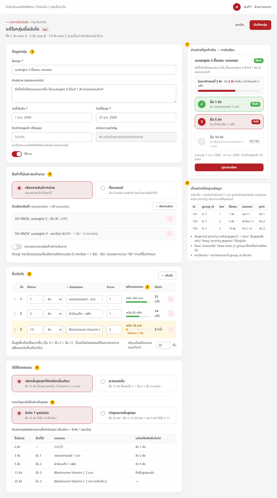

**คำอธิบายแต่ละส่วนในหน้าจอ**

1. ข้อมูลกลุ่ม ชื่อ/คำอธิบาย/ช่วงเวลา/สถานะใช้ร่วมกันทุกขั้น (ตั้งครั้งเดียว) · โควต้าต่อลูกค้านับระดับกลุ่ม: รับขั้น 1 แล้วกลับมารับขั้น 2 ในบิลถัดไป นับเป็น 2 ครั้ง
2. สินค้าที่นับสะสม ใช้ตัวเลือก OR แบบเดียวกับ Bundle · "ตรวจหน่วยอย่างเข้มงวด" ปิด = แปลงหน่วยเป็นลังให้ (5 กระป๋อง = 1 ลัง) · หน่วยของ "ซื้อครบ" ในแต่ละขั้นต้องเป็นหน่วยเดียวกันทั้งกลุ่ม
3. ตารางขั้น แถวละ 1 ขั้น: "ซื้อครบ [จำนวน][หน่วย] → รับ [ของแถม][จำนวน]" · เพิ่ม/ลบ/ลากเรียง · ระบบเรียงตามจำนวนซื้อครบให้เสมอ และเตือนถ้าจำนวนซ้ำหรือลดลง (ขั้นต้องมากขึ้นเรื่อยๆ) · ต้องมีอย่างน้อย 2 ขั้น ไม่เช่นนั้นให้ใช้โปรธรรมดา
4. สต็อกของแถมรายขั้น แสดงคงเหลือและแถบ · ต่ำกว่าเกณฑ์ (ตั้งได้ ค่าเริ่มต้น 20) ขึ้นเหลืองและแจ้งเตือนในหน้ารายการ · เหลือ 0 = ปิดเฉพาะขั้นนั้นชั่วคราว (ขั้นอื่นยังใช้ได้) ลูกค้าที่ถึงขั้นนั้นจะได้ขั้นที่ต่ำลงมาแทน
5. ขั้นสูงสุดขั้นเดียว vs สะสมทุกขั้น ค่าเริ่มต้น = ขั้นสูงสุดขั้นเดียว (ลูกค้าเข้าใจง่าย ของแถมไม่บานปลาย) · คำอธิบายตัวอย่างใต้ตัวเลือกใช้เลข 12 ลัง ให้เห็นความต่างทันที
6. การ์ดเดียวหน้าบ้าน ลูกค้าเห็น 1 การ์ดต่อกลุ่ม แสดงบันไดทุกขั้นและ "อีก N ลัง รับขั้นถัดไป" ตามตะกร้าจริง — ไม่แสดงเป็น 3 โปรแยก
7. โครงสร้างข้อมูล ทีมพัฒนาไม่ต้องสร้างเอนจินใหม่ — เพิ่มคอลัมน์ group_id / tier_no / stack_in_group ในตารางโปรเดิม และหน้ารายการจัดกลุ่มแถวตาม group_id

**กติกา / ข้อยกเว้น / สถานะ**

- แก้จำนวนซื้อครบของขั้นที่มีผู้ใช้แล้ว: มีผลกับตะกร้าใหม่เท่านั้น · ลบขั้นที่มีประวัติ: ไม่ลบประวัติ
- ของแถมทุกขั้นถูกกันสต็อกตอนยืนยันออเดอร์เท่านั้น ไม่กันตอนอยู่ในตะกร้า
- ลูกค้าที่ซื้อกระป๋องปนลัง นับรวมเป็นลังตามอัตราแปลงเมื่อปิดตรวจหน่วยอย่างเข้มงวด (เศษกระป๋องไม่ปัดขึ้น)

**ข้อที่ต้องตัดสินใจกับลูกค้า**

- โหมดการให้ของแถม: ค่าเริ่มต้นที่เสนอ = "เลือกขั้นสูงสุดที่ถึงเพียงขั้นเดียว" หรือต้องการ "สะสมทุกขั้น"
- เมื่อของแถมขั้นสูงสุดหมด ให้ตกลงมาให้ขั้นต่ำกว่า (ค่าเริ่มต้น) หรือปิดทั้งกลุ่ม
- นับเศษกระป๋องเป็นลังหรือไม่ (ค่าเริ่มต้น = ไม่ปัดขึ้น)

#### แอดมิน · แคมเปญลดตามวันพิเศษ

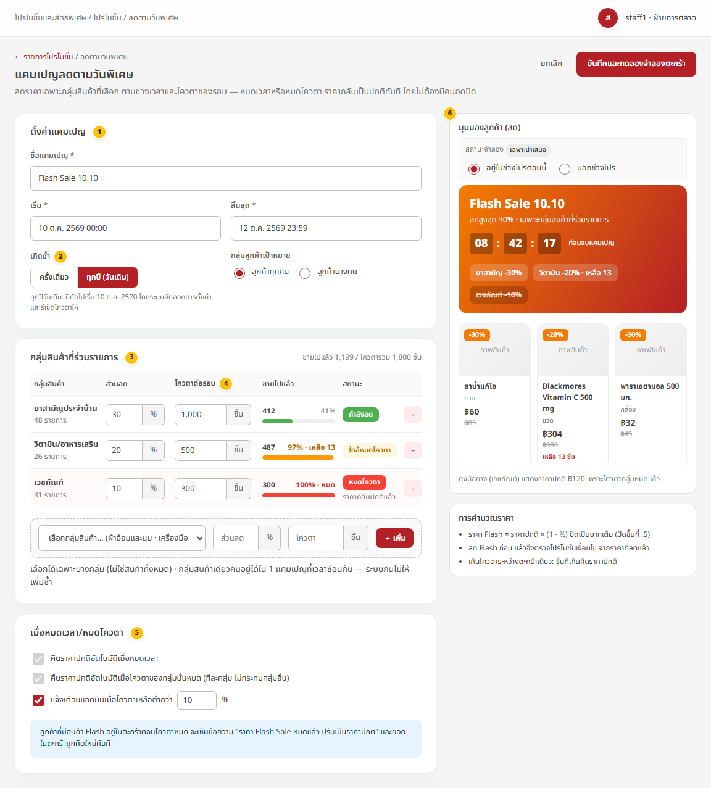

**คำอธิบายแต่ละส่วนในหน้าจอ**

1. ตั้งค่าแคมเปญ ชื่อ + วันเวลาเริ่ม–สิ้นสุด (ระดับนาที) · สิ้นสุดต้องหลังเริ่ม · ช่วงเวลาซ้อนกับแคมเปญอื่นที่มีกลุ่มสินค้าเดียวกัน ระบบเตือนและไม่ให้บันทึก
2. เกิดซ้ำ "ครั้งเดียว" หรือ "ทุกปี (วันเดิม)" — ทุกปีคัดลอกการตั้งค่าไปปีถัดไปอัตโนมัติและรีเซ็ตโควตา (แอดมินแก้ได้ก่อนถึงวัน)
3. กลุ่มสินค้า เลือกได้เฉพาะบางหมวด/กลุ่ม ตั้ง % ต่อกลุ่ม (เช่น 30% / 20% / 10%) · เพิ่ม/ลบแถวได้ระหว่างแคมเปญกำลังทำงาน (เพิ่มกลุ่มมีผลทันที)
4. โควตาต่อรอบและความคืบหน้า นับเป็นชิ้นที่ขายได้ในราคาพิเศษ · แถบเขียว < 90% / เหลือง ≥ 90% / แดงเมื่อหมด · หมดโควตา = ราคากลับปกติเฉพาะกลุ่มนั้นทันที (ไม่รอหมดเวลา)
5. คืนราคาอัตโนมัติ ล็อกเปิดไว้ ไม่ให้ปิด (เป็นหลักของโปรประเภทนี้) · ตั้งแจ้งเตือนแอดมินเมื่อโควตาใกล้หมดได้
6. มุมมองลูกค้า + สถานะจำลอง ปุ่มสลับ "อยู่ในช่วงโปร / นอกช่วงโปร" ใช้เพื่อนำเสนอเท่านั้น ไม่เปลี่ยนข้อมูลจริง (ระบบจริงเช็คจากวันเวลาที่ตั้ง) · แบนเนอร์มีนาฬิกานับถอยหลัง การ์ดสินค้าขีดฆ่าราคาเดิม และป้าย "เหลือ N ชิ้น" เมื่อโควตาต่ำกว่า 20%

**กติกา / ข้อยกเว้น / สถานะ**

- สถานะแคมเปญ: ตั้งเวลาไว้ → กำลังจัดอยู่ → จบแล้ว (หมดเวลา/หมดโควตาทุกกลุ่ม) · แก้ % ระหว่างจัดอยู่มีผลกับตะกร้าใหม่ ตะกร้าที่ค้างอยู่คิดใหม่ทุกครั้งที่โหลด
- ใช้ได้กับลูกค้าที่กำหนดเท่านั้น (ทุกคน / บางคน) · ลูกค้านอกกลุ่มเห็นราคาปกติ ไม่เห็นแบนเนอร์
- ถ้าสินค้าอยู่ทั้งในแคมเปญ Flash และโปรโมชั่นเงื่อนไข ลด Flash ก่อน แล้วโปรเงื่อนไขคิดจากราคาที่ลดแล้ว

**ข้อที่ต้องตัดสินใจกับลูกค้า**

- โควตาต่อรอบนับ "ชิ้น" (ค่าเริ่มต้น) หรือ "ยอดเงิน" — spec ระบุได้ทั้งสองแบบ
- ปัดเศษราคา Flash เป็นบาทเต็ม (ค่าเริ่มต้น) หรือเก็บสตางค์
- ยอดที่ใช้นับเงื่อนไขโปรเงื่อนไขคิดจากราคาหลังลด Flash (ค่าเริ่มต้น) หรือราคาก่อนลด
- มีโควตาต่อลูกค้า/ร้านด้วยหรือไม่ (ตอนนี้โควตาเป็นของทั้งรอบเท่านั้น)

#### แอดมิน · จำลองตะกร้า ตรวจโปรที่ชนะ

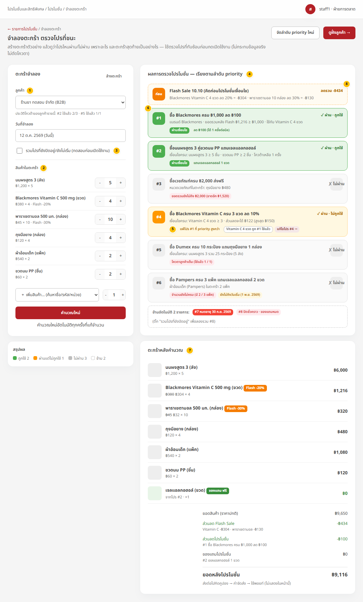

**คำอธิบายแต่ละส่วนในหน้าจอ**

1. ลูกค้า + วันที่ เลือกประเภทลูกค้า (B2B/B2C) หรือค้นหาลูกค้าจริงเพื่อใช้ประวัติโควต้าจริง · วันที่จำลองเปลี่ยนได้เพื่อทดสอบโปรที่ยังไม่เริ่ม (เหตุผลที่แสดงเปลี่ยนตาม) · ไม่มีการตัดโควตาหรือสร้างประวัติ
2. ตะกร้า เพิ่มสินค้าแล้วปรับจำนวนด้วยปุ่ม −/+ หรือพิมพ์ · ผลทางขวาคำนวณใหม่ทันที (ดีเลย์ 300 มิลลิวินาที) · ค้นหาสินค้าระดับ "หน่วยสินค้า" เหมือนช่องค้นหาในหน้าตั้งค่า
3. รวมโปรที่ยังปิดอยู่ ติ๊กเพื่อทดสอบโปรที่ยังไม่เปิดใช้งาน/ยังไม่ถึงวันเริ่ม ก่อนกดเปิดจริง · แถวพวกนี้ติดป้าย "ทดสอบ" เพื่อไม่ให้สับสนกับสถานะจริง
4. เรียงตาม priority เหมือนลำดับในหน้ารายการ (#1 บนสุด) · ทุกโปรที่ active ปรากฏหนึ่งแถวเสมอ ไม่ว่าผ่านหรือไม่ เพื่อให้เห็นว่า "ทำไมโปรนี้ไม่ทำงาน" · โปรที่หมดอายุ/ปิดอยู่ถูกรวมเป็นแถวเดียวท้ายรายการ
5. ป้ายเหตุผล ผ่าน (เขียว) / ผ่านแต่ไม่ถูกใช้ (เหลือง) / ไม่ผ่าน (เทา) · เหตุผลมาตรฐาน: ยอดรวมยังไม่ถึง ฿X (บอกขาดอีกเท่าไร) · จำนวนยังไม่ครบ · แพ้โปร #N ที่ priority สูงกว่า · โควตาลูกค้าเต็ม · ยังไม่ถึงวันเริ่ม/หมดอายุ · ของแถมหมด · กลุ่มลูกค้าไม่ตรง (กดป้ายที่มีลิงก์ไปแก้ไขโปรได้)
6. โปรที่ชนะ แถวเขียว = ถูกใช้จริงในตะกร้า (อาจมีหลายโปรถ้าใช้คนละสินค้า) · โปรที่ผ่านเงื่อนไขแต่แพ้บอกชัดว่าแพ้ใคร และใช้สินค้าไหนร่วมกัน เพื่อให้แอดมินตัดสินใจจัดลำดับใหม่
7. ตะกร้าหลังคำนวณ แสดงบรรทัดของแถม (เขียว ฿0) และส่วนลดแยกบรรทัด + ยอดหลังโปรโมชั่น · ตรงกับที่ลูกค้าเห็นในหน้า 09 ใช้ฟังก์ชันคำนวณเดียวกับเช็คเอาต์
8. Flash Sale ก่อนเสมอ ลดราคาสินค้าด้วย Flash แล้วจึงตรวจโปรเงื่อนไขจากราคาที่ลดแล้ว — จึงเห็นว่ายอด Blackmores หลัง Flash ฿1,216 (ก่อน Flash ฿1,520)

**กติกา / ข้อยกเว้น / สถานะ**

- โปรแบบแบรนด์/หมวดที่แย่งกลุ่มสินค้าเดียวกัน: ชนะเฉพาะ priority สูงสุดที่ผ่านเงื่อนไข ไม่บวกซ้อน · ผลตอบแทนคิดเฉพาะบรรทัดที่เข้าเงื่อนไข
- ตะกร้าว่าง: แสดงข้อความ "เพิ่มสินค้าในตะกร้าจำลองเพื่อดูผล" ฝั่งขวา · ไม่มีโปร active เลย: แสดง "ยังไม่มีโปรโมชั่นที่ใช้งานอยู่"
- หน้านี้เป็นเครื่องมืออ่านอย่างเดียว ไม่แก้ข้อมูลโปร (ลิงก์แก้ไขเปิดหน้า 02)
- เก็บตะกร้าจำลองไว้ในเบราว์เซอร์ของแอดมินได้ (ไม่แชร์ข้ามผู้ใช้)

**ข้อที่ต้องตัดสินใจกับลูกค้า**

- โปรแบบเลือกรายสินค้าที่ใช้สินค้าซ้ำกับโปรที่ priority สูงกว่า: ค่าเริ่มต้น = แพ้ทั้งโปร (ไม่แบ่งสินค้า) หรือให้ใช้เฉพาะชิ้นที่เหลือ
- ควรแจ้งเตือนอัตโนมัติตอนกดเปิดใช้งานโปรใหม่ว่า "โปรนี้จะไม่เคยชนะ เพราะทับกับ #N" หรือไม่ (ตอนนี้เป็นการเตือนในหน้าแก้ไข)
- เก็บ "สถานการณ์ทดสอบ" ไว้ใช้ซ้ำหลังแก้โปรหรือไม่ (ตอนนี้ไม่เก็บ)

#### ลูกค้า · หน้ารวมโปรโมชั่น

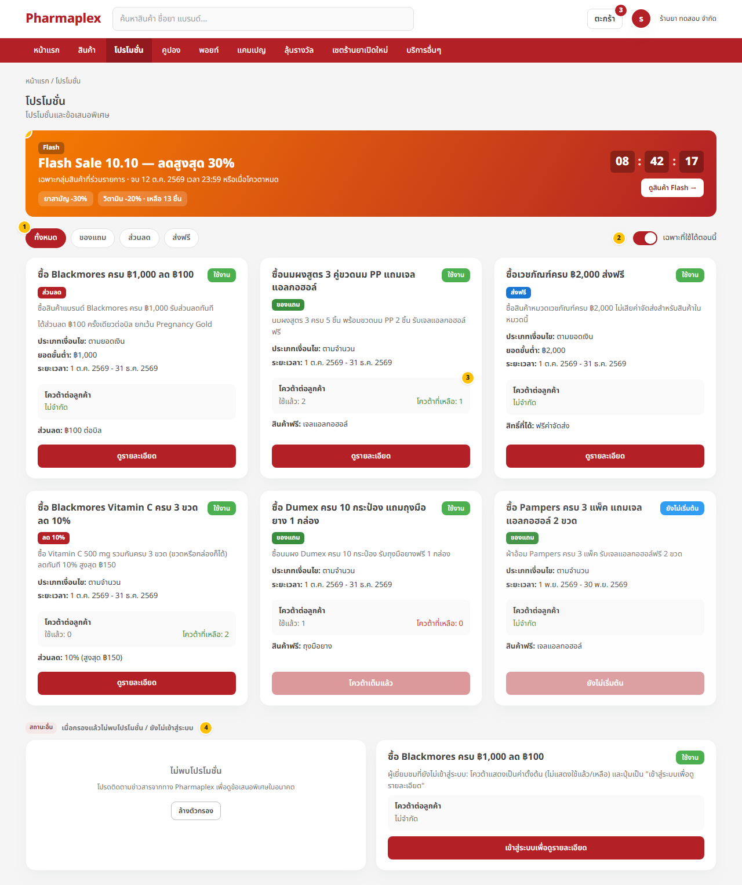

**คำอธิบายแต่ละส่วนในหน้าจอ**

1. ตัวกรองประเภท ใหม่ ทั้งหมด / ของแถม / ส่วนลด / ส่งฟรี / ขั้นบันได — หน้าเดิมแสดงทุกเซตในหน้าเดียวไม่มีตัวกรอง · เลือกได้ทีละประเภท ค่าเริ่มต้น "ทั้งหมด"
2. เฉพาะที่ใช้ได้ตอนนี้ ใหม่ เปิดอยู่ = ซ่อนโปรที่ยังไม่เริ่มและที่โควต้าเต็ม · ปิด = เห็นทั้งหมด (โปรที่ยังไม่เริ่มแสดงปุ่มเทา "ยังไม่เริ่มต้น" ตามหน้าเดิม) · จำค่าไว้ในเบราว์เซอร์
3. การ์ดกลุ่มขั้นบันได ใหม่ 1 การ์ดต่อกลุ่ม กว้าง 2 ช่อง แสดงบันไดทุกขั้น พร้อมสถานะจากตะกร้าปัจจุบัน ("เพิ่มอีก 1 ลัง รับขั้น 2") · ลูกค้าที่ไม่มีของในตะกร้าเห็นบันไดเป็นสถานะรอทุกขั้น
4. โควต้าต่อลูกค้า กล่องเทาตามหน้าเดิม: ไม่จำกัด (เขียว) หรือ ใช้แล้ว / เหลือ — เหลือ > 0 เขียว, = 0 แดง และปุ่มเปลี่ยนเป็น "โควต้าเต็มแล้ว" (ปิดการกด) · ค่า "ใช้แล้ว" นับจำนวนครั้งที่รับสิทธิ์จากออเดอร์ที่ยืนยันแล้ว
5. สถานะว่าง / ยังไม่ล็อกอิน ไม่พบโปร: ข้อความ "ไม่พบโปรโมชั่น" + คำอธิบายเดิม · ผู้เยี่ยมชม: ปุ่ม "เข้าสู่ระบบเพื่อดูรายละเอียด" (เปิด popup ล็อกอิน) ไม่นับโควต้า
6. แบนเนอร์ Flash ใหม่ แสดงเมื่อมีแคมเปญลดตามวันพิเศษที่กำลังจัดอยู่และลูกค้าอยู่ในกลุ่มเป้าหมาย · นับถอยหลังถึงเวลาสิ้นสุด · กลุ่มที่โควตาหมดไม่แสดงใน chip · ปุ่มพาไปรายการสินค้าที่ร่วมรายการ

**กติกา / ข้อยกเว้น / สถานะ**

- แสดงเฉพาะโปรที่ใช้งานและอยู่ในช่วงวันที่ (เรียงตาม priority เหมือนเดิม) — ยกเว้นโปร "ยังไม่เริ่มต้น" ที่แสดงเป็นการ์ดประกาศล่วงหน้า · โปรหมดอายุหรือปิดชั่วคราว (ของแถมหมด) ไม่แสดง
- ตัวเลข priority ไม่แสดงให้ลูกค้าเห็น · สถานะ chip ตามหน้าเดิม: ใช้งาน / ยังไม่เริ่มต้น / หมดอายุ
- คลิกทั้งการ์ดหรือปุ่ม "ดูรายละเอียด" ไปหน้า 08 · ถ้าโควต้าเต็มปุ่มกดไม่ได้
- ข้อความ "ของแถม/ส่วนลด/ส่งฟรี" ที่ท้ายการ์ดสร้างจากผลตอบแทนที่ตั้งไว้ (เดิมมีเฉพาะ "สินค้าฟรี")

**ข้อที่ต้องตัดสินใจกับลูกค้า**

- แบนเนอร์ Flash อยู่บนหน้า "โปรโมชั่น" นี้ด้วย หรือแสดงเฉพาะหน้าแรก/หน้าสินค้า
- โปรที่โควต้าเต็ม: ยังแสดงการ์ดเทา (ค่าเริ่มต้น เหมือนหน้าเดิม) หรือซ่อนทันที

#### ลูกค้า · การ์ดสินค้า + หน้าสินค้าที่มีโปร

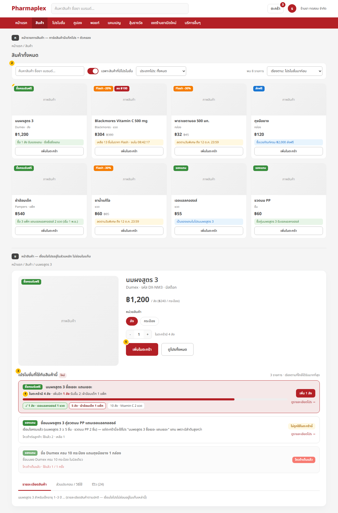

**คำอธิบายแต่ละส่วนในหน้าจอ**

1. แท็กบนการ์ดสินค้า ใหม่ ซื้อครบรับฟรี (แดง) / ของแถม (เขียว) / ส่งฟรี (น้ำเงิน) / ลด % หรือ ลด ฿ (แดง) / Flash (ส้ม) · สูงสุด 2 แท็กต่อการ์ด (เกินเป็น "+1") เรียงตามความสำคัญ · ข้อความบรรทัดล่างสรุปโปรที่ใกล้ที่สุด สั้นไม่เกิน 1 บรรทัด
2. ตัวกรองและการเรียง ใหม่ "เฉพาะสินค้าที่มีโปรโมชั่น" + ประเภทโปร + "เรียงตาม: โปรโมชั่นมาก่อน" (ดันสินค้าที่มีโปรขึ้นก่อน แล้วค่อยเรียงตามเดิม) · ตัวกรองคงอยู่ใน URL
3. โปรโมชั่นที่ใช้กับสินค้านี้ ใหม่ อยู่ในส่วนหลักของหน้าสินค้า เหนือแท็บรายละเอียด (ตาม spec 3.5 ไม่ซ่อนในแท็บย่อย) · แสดงทุกโปรที่สินค้านี้เข้าร่วม ทั้งที่ลูกค้าได้ ใกล้ได้ ไม่ถูกใช้ และโควต้าเต็ม
4. ความคืบหน้าจากตะกร้าจริง "ในตะกร้ามี 4 ลัง · เพิ่มอีก 1 ลัง รับขั้น 2" ใช้ข้อมูลตะกร้าปัจจุบันของลูกค้า · ปุ่ม "เพิ่ม 1 ลัง" เพิ่มจำนวนที่ขาดให้ทันที · ผู้เยี่ยมชมที่ยังไม่ล็อกอินเห็นเงื่อนไขแต่ไม่มีแถบความคืบหน้า
5. CTA "เพิ่มในตะกร้า" ตามปกติ · "ดูโปรทั้งหมด" ไปหน้า 06 · ลิงก์ "ดูรายละเอียดโปร" ในแต่ละแถวไปหน้า 08

**กติกา / ข้อยกเว้น / สถานะ**

- ราคาบนการ์ด/หน้าสินค้า: ขีดฆ่าราคาปกติเมื่อมี Flash เท่านั้น — ส่วนลดจากโปรเงื่อนไขแสดงในตะกร้า ไม่ปรับราคาบนการ์ด เพราะขึ้นกับตะกร้าทั้งใบ
- โปรที่ยังไม่เริ่มต้นแสดงเป็นแถวเทา "เริ่ม 1 พ.ย. 2569" (ไม่มีปุ่ม) · โปรหมดอายุ/ปิดชั่วคราวไม่แสดง
- แสดงสูงสุด 5 โปรต่อสินค้า เกินนั้นมีลิงก์ "ดูโปรทั้งหมด"
- สินค้าที่เป็น "ของแถม" ของโปรใด แสดงข้อความ "เป็นของแถมในโปร …" แต่ไม่ลดราคาเมื่อซื้อเอง

**ข้อที่ต้องตัดสินใจกับลูกค้า**

- จำนวนแท็กสูงสุดต่อการ์ด (เสนอ 2) และลำดับความสำคัญของแท็ก (Flash > ซื้อครบรับฟรี > ส่งฟรี)
- ต้องการแท็ก "ใกล้ได้รับโปร" บนการ์ดสินค้าในหน้ารายการด้วยหรือไม่ (ตอนนี้แสดงเฉพาะหน้าสินค้า/ตะกร้า)

#### ลูกค้า · รายละเอียดโปร + เลือกสินค้า

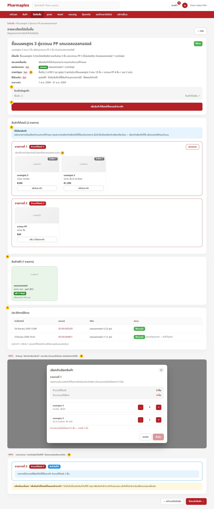

**คำอธิบายแต่ละส่วนในหน้าจอ**

1. โควต้า ตามหน้าเดิม (กล่องเทา ใช้แล้ว / โควต้าที่เหลือ เขียว–แดง) · เหลือ 0: ปุ่มเพิ่มสินค้าทั้งหมดและปุ่มเลือกสินค้าถูกปิด พร้อมข้อความ "โควต้าเต็มแล้ว" · ผู้เยี่ยมชมถูกพาไปล็อกอินก่อนเปิดหน้านี้
2. ผลตอบแทน / ใช้ร่วมกับ ใหม่ สองแถวใต้ "ประเภทเงื่อนไข" อธิบายด้วยตัวอย่างตัวเลขจริงของโปรนั้น · ผลตอบแทนเป็นส่วนลดแสดงเป็น "ลด 10% สูงสุด ฿150"
3. วิธีเลือกสินค้า ข้อความเดิม + คำอธิบาย OR: เลือกตัวเลือกใดก็ได้ในรายการ แล้วรวมกันให้ครบจำนวน (ไม่ต้องเป็นตัวเลือกเดียวกัน)
4. การ์ดตัวเลือก ใช้ ProductUnitCard เดิม + ป้าย "ตัวเลือก N" มุมขวาบน · มีปุ่มเพิ่มในตะกร้าต่อใบได้ตามปกติ · สินค้าหมดสต็อกแสดงป้ายแดงและปิดปุ่ม
5. ปุ่มหลัก "เพิ่มสินค้าที่ต้องมีทั้งหมดเข้าตะกร้า": ถ้าทุกรายการมีตัวเลือกเดียว เพิ่มเข้าตะกร้าทันทีแล้วไปตะกร้า · ถ้ามีรายการที่ต้องเลือก (หลายตัวเลือก) เปิด dialog ทีละรายการ · ถ้ามีรายการ "สินค้าใดก็ได้" แจ้งเตือนว่าต้องเพิ่มเอง
6. สินค้าฟรี การ์ดสินค้าไม่มีปุ่ม พร้อมป้าย "ฟรี ×จำนวนต่อชุด" และมูลค่า · ของแถมหมด: ป้ายแดง "หมดชั่วคราว" และโปรถูกปิดตามกติกา
7. ประวัติการใช้งาน เพิ่มคอลัมน์ ออเดอร์ (ลิงก์ไปรายละเอียดออเดอร์) และของที่ได้รับ · ออเดอร์ถูกยกเลิกยังนับว่าใช้สิทธิ์แล้ว (นโยบายร่วม) พร้อมข้อความบอก
8. Dialog เลือกตัวเลือก ตัวคูณจำนวนต่อตัวเลือก (−/พิมพ์/+) · แสดงจำนวนที่ต้องมี และจำนวนรวมที่เลือก (แดงเมื่อไม่ครบ เขียวเมื่อครบ) · ปุ่มยืนยันกดไม่ได้จนกว่าจะครบ (ถ้ากดเมื่อไม่ครบ toast "จำนวนรวมต้องไม่น้อยกว่า 5 ชิ้น") · ยืนยันแล้วไปรายการถัดไปที่ต้องเลือก ครบแล้วเพิ่มลงตะกร้าและไปหน้าเช็คเอาต์/ตะกร้า
9. "ตรงกับสินค้าใดก็ได้" การ์ดขอบฟ้า ไม่มีรายการสินค้า มีป้าย "สินค้าใดก็ได้" และข้อความอธิบาย — ไม่สามารถเพิ่มล่วงหน้าได้ ต้องไปเลือกสินค้าเองแล้วดูผลที่ตะกร้า

**กติกา / ข้อยกเว้น / สถานะ**

- จำนวนรวมที่เลือกในรายการ นับเป็นชิ้นตามหน่วยที่เลือก (ลัง 1 = 1 ชิ้น) · ถ้าโปรเปิด "ตรวจหน่วยอย่างเข้มงวด" การ์ดตัวเลือกแสดงเฉพาะหน่วยที่ตรงเงื่อนไข
- โปรหมดอายุ/ยังไม่เริ่ม: ปุ่มเพิ่มสินค้าถูกปิด แสดงสถานะบนหัวการ์ด · เปิดหน้าโปรที่ไม่มีอยู่/ถูกปิด = "ไม่พบโปรโมชั่นที่ต้องการ" + ปุ่มกลับ
- ไม่มีปุ่ม "รับสิทธิ์" — สิทธิ์เกิดอัตโนมัติเมื่อตะกร้าเข้าเงื่อนไขและยืนยันออเดอร์

**ข้อที่ต้องตัดสินใจกับลูกค้า**

- ปุ่ม "เพิ่มสินค้าที่ต้องมีทั้งหมดเข้าตะกร้า" ในระบบจริงถูกซ่อนไว้ (comment) — เปิดใช้งานในหน้านี้หรือคงซ่อนต่อ
- หลังเพิ่มสินค้าลงตะกร้าแล้ว ไปหน้าตะกร้า/เช็คเอาต์ทันที (พฤติกรรมเดิม) หรืออยู่หน้าเดิมพร้อม toast
- การ์ดตัวเลือกบังคับให้เลือกจากกลุ่ม "กระป๋อง/ลัง" แยกหรือรวมกันได้ (ค่าเริ่มต้น = รวมกันได้)

#### ลูกค้า · ตะกร้า: โปรที่ได้รับ

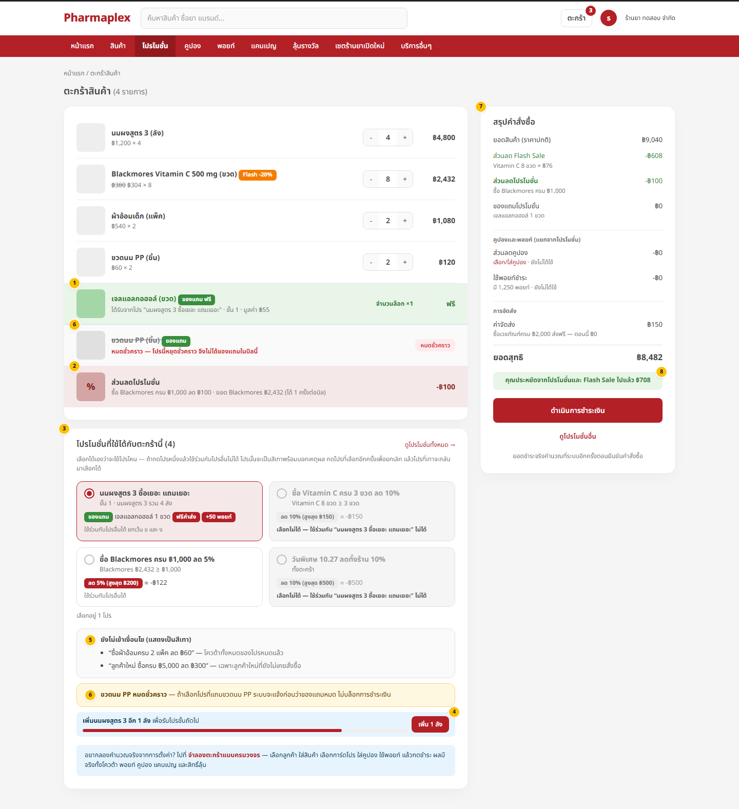

**คำอธิบายแต่ละส่วนในหน้าจอ**

1. บรรทัดของแถม พื้นเขียว ป้าย "ของแถม ฟรี" ราคาแสดงว่า "ฟรี" · จำนวนล็อก ลูกค้าแก้/ลบเองไม่ได้ (จำนวนมาจากโปร) — เมื่อลูกค้าลดสินค้าที่ต้องมี ของแถมหายไปเองพร้อม toast "ของแถมถูกนำออก เพราะไม่เข้าเงื่อนไขแล้ว" · ของแถมแสดงมูลค่าไว้เป็นข้อมูล ไม่รวมในยอด
2. บรรทัดส่วนลด แยกเป็นบรรทัดพื้นแดงอ่อน บอกโปรและฐานที่คำนวณ (เฉพาะสินค้าที่เข้าเงื่อนไข ไม่ใช่ทั้งบิล) · ได้ส่วนลดครั้งเดียวต่อบิล ไม่ว่าซื้อเกินเงื่อนไขกี่เท่า
3. โปรโมชั่นที่ได้รับ การ์ดต่อโปรที่ถูกใช้ แสดงสิ่งที่ได้และเหตุที่ได้ · เรียงตามลำดับ priority · ลูกค้าไม่เห็นเลข priority
4. ข้อความชวนซื้อเพิ่ม "เพิ่มอีก N …" แสดงเมื่อใกล้ถึงขั้น/ยอดถัดไป (ขาดไม่เกิน 1 ขั้นหรือ 30% ของเงื่อนไข) · ปุ่มเพิ่มจำนวนที่ขาดให้ทันที · ถ้าเปลี่ยนโปรที่ได้ (ขั้น 1 → ขั้น 2) บอกว่าของแถมเดิมจะถูกแทน
5. โปรที่ไม่ถูกใช้ แจ้งแบบข้อความสั้นว่าโปร Z ไม่ถูกใช้ เพราะโปร X ลำดับสูงกว่า — เพื่อไม่ให้ลูกค้าสงสัยว่าทำไมไม่ได้ · แสดงเฉพาะโปรที่ผ่านเงื่อนไขครบแต่แพ้ (ไม่แสดงโปรที่ลูกค้าไม่ได้เข้าใกล้เลย)
6. ของแถมหมดสต็อก ค่าเริ่มต้นที่เสนอ: โปรถูกปิดชั่วคราวตามกติกา → บรรทัดของแถมขึ้นเทา ขีดฆ่า ป้าย "หมดชั่วคราว" และข้อความอธิบาย · ไม่แปลงเป็นส่วนลดอัตโนมัติ · ไม่บล็อกการชำระเงิน
7. สรุปยอดแยกกลุ่ม ส่วนลดโปรโมชั่น (และ Flash) อยู่แยกจากส่วนลดคูปองและการใช้พอยท์ เพื่อให้ตรวจสอบง่ายและสอดคล้องลำดับการคิดเงิน: Flash → โปรโมชั่น → คูปอง → ส่ง → พอยท์ · แต่ละบรรทัดมีคำอธิบายย่อยบอกที่มา
8. ยอดที่ประหยัด รวม Flash + โปรโมชั่น (ไม่รวมมูลค่าของแถม และคูปองที่ยังไม่ใช้) · ปุ่มชำระเงินพาไปหน้าเช็คเอาต์เดิม ซึ่งคำนวณโปรซ้ำอีกครั้งที่เซิร์ฟเวอร์

**กติกา / ข้อยกเว้น / สถานะ**

- คำนวณใหม่ทุกครั้งที่จำนวนเปลี่ยน · สถานะโหลด: แสดงบรรทัดสรุปเป็น skeleton ไม่แสดงตัวเลขเก่า
- ถ้าสต็อกของแถมไม่พอสำหรับจำนวนที่ต้องให้ (เช่น ต้องให้ 3 ชิ้นแต่เหลือ 2) ระบบให้เท่าที่มีและแจ้งข้อความ "ของแถมเหลือเพียง N ชิ้น"
- โควต้าต่อลูกค้าเต็ม: โปรไม่ถูกคิดและแสดงในกลุ่ม "ไม่ถูกใช้" พร้อมเหตุผล "โควต้าเต็มแล้ว"
- ยกเลิกออเดอร์/คืนสินค้าภายหลัง ไม่เรียกคืนของแถมหรือส่วนลดที่ใช้ไปแล้ว (นโยบายร่วม)

**ข้อที่ต้องตัดสินใจกับลูกค้า**

- ของแถมหมดสต็อกตอนลูกค้ามีโปรในตะกร้า: ค่าเริ่มต้นในมอคอัพ = ไม่ให้ของแถม ไม่ชดเชย แจ้งข้อความ · ทางเลือก: แปลงเป็นส่วนลดเท่ามูลค่าของแถม (เช่น ฿60 — ต้องเพิ่มฟิลด์ "มูลค่าชดเชย" ในโปร) หรือให้ลูกค้าเลือกของแถมอื่นในโปรเดียวกัน
- แสดง "โปรที่ไม่ถูกใช้" ให้ลูกค้าเห็นหรือไม่ (ค่าเริ่มต้น = แสดงเฉพาะที่ผ่านเงื่อนไขครบ)
- ลูกค้าเลือกไม่ใช้โปรบางตัวได้หรือไม่ (ค่าเริ่มต้น = ไม่ได้ ระบบเลือกให้)
- แสดงมูลค่าของแถมในสรุปยอดและในยอด "ประหยัดไปแล้ว" หรือไม่ (ค่าเริ่มต้น = แสดงมูลค่าในบรรทัด ไม่รวมในยอดประหยัด)

#### สรุปข้อที่ต้องตัดสินใจกับลูกค้า

- ของแถมหมดตอนที่ลูกค้ามีโปรในตะกร้า: ไม่ให้ของแถม (ค่าที่ใช้ในต้นแบบ) หรือแปลงเป็นส่วนลดเท่ามูลค่า
- ยอดที่นับเข้าเงื่อนไขโปรคิดหลังหักส่วนลดวันพิเศษ (ค่าที่ใช้) หรือก่อน
- กลุ่มขั้นบันไดให้เลือกขั้นสูงสุดที่ถึงเพียงขั้นเดียว (ค่าที่ใช้) หรือสะสมของแถมทุกขั้น
- โปรแบบเลือกรายสินค้าที่ชนกับโปรแบรนด์/หมวดที่ priority สูงกว่า แพ้ทั้งโปรหรือแพ้เฉพาะสินค้าที่ชน
- ลบโปรที่มีประวัติการใช้แล้ว: ซ่อนแล้วเก็บประวัติ หรือห้ามลบ
- ของแถมได้พอยท์หรือไม่ (ค่าที่ใช้: 0 พอยท์)

---

## 4. คูปอง

### 4.1 คืออะไร และใช้เมื่อไหร่

คูปองคือสิทธิ์ส่วนลดที่ลูกค้าต้อง "รับ" มาก่อนจึงใช้ได้ ต่างจากโปรโมชั่นที่เกิดขึ้นเอง คูปองเหมาะกับการแจกหน้างาน ส่งเสริมการขายผ่านช่องทางออนไลน์ ให้สิทธิ์ประจำเดือนแก่ลูกค้า หรือต้อนรับลูกค้าใหม่

### 4.2 มีกี่แบบ

| แบบ | วิธีรับสิทธิ์ | การกันการใช้ซ้ำ | เหมาะกับ |
|---|---|---|---|
| คูปองกระดาษ | พิมพ์เป็นใบ ทุกใบรหัสเหมือนกันทั้งชุด | ตัวกระดาษที่ร้านฉีกเก็บไว้เป็นหลักฐาน ใช้ได้เฉพาะหน้าร้าน/POS เท่านั้น ไม่รองรับการกรอกใช้งานบนเว็บ | แจกหน้างานและบูท |
| คูปองออนไลน์ (โค้ดแชร์ได้) | ใส่โค้ดตอนเช็คเอาต์ | ระบบตรวจประวัติการใช้ของบัญชีทุกครั้ง | แคมเปญที่แชร์ได้ เช่น โพสต์หรือ Influencer |
| คูปองเก็บเอง (เหมือน Shopee) | ลูกค้าเข้าดูคูปองที่เปิดให้เก็บแล้วกดเก็บเอง | ได้รหัสเฉพาะตัว 1 คน 1 รหัส ตัดโควตาทันที | สิทธิ์ที่เปิดให้ลูกค้าเลือกเก็บเอง |
| แจกอัตโนมัติทุกเดือน | ระบบออกสิทธิ์ให้ทุกคนเองทุกวันที่ 1 | ใช้ได้ถึงสิ้นเดือน ไม่ทบไปเดือนถัดไป | สิทธิ์ประจำเดือนที่ให้ลูกค้าทุกคน |
| คูปองลูกค้าใหม่ | ได้อัตโนมัติเมื่อเป็นบัญชีที่ยังไม่เคยสั่งซื้อ | ใช้ได้ครั้งเดียวต่อบัญชี | ต้อนรับลูกค้าใหม่ |

### 4.3 คูปองกระดาษ

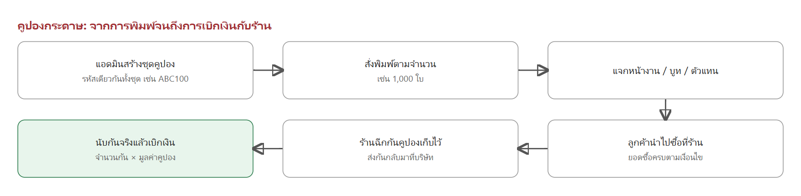

*รูป 4-1 ตั้งแต่แอดมินสร้างชุดคูปองจนถึงการเบิกเงินกับร้านที่ร่วมรายการ*

**ระบบไม่ได้สั่งพิมพ์** แอดมินตั้งค่าชุดคูปองและดูตัวอย่างหน้า-หลังในระบบเท่านั้น ทีมการตลาดนำแบบไปพิมพ์และแจกหน้างานเอง ระบบไม่ส่งไฟล์เข้าโรงพิมพ์และไม่ออกเลขรันรายใบ (ทุกใบรหัสเดียวกันทั้งชุด) คูปองกระดาษมี 2 ด้านที่ต้องกำหนดและแสดงให้ตรงกันทุกที่ ทั้งหน้าตั้งค่า หน้าตัวอย่าง และหน้าตรวจสอบของลูกค้า

| ด้าน | ข้อมูลที่แสดง |
|---|---|
| หน้า | แบรนด์และหัวคูปอง มูลค่าส่วนลด เงื่อนไขย่อ (ยอดขั้นต่ำ / ใช้ที่ร้านที่ร่วมรายการ / ใช้ออนไลน์ไม่ได้ / กี่ใบต่อบิล) รหัสชุดและ QR สำหรับ POS วันที่ใช้ได้ และก้นคูปองที่ร้านฉีกเก็บ |
| หลัง | ร้าน/สาขาที่ใช้ได้ ช่องทางที่ใช้ได้ (หน้าร้าน/POS ใช้ได้ ออนไลน์ใช้ไม่ได้) สิทธิ์และเงื่อนไข (ยอดขั้นต่ำ จำนวนใบต่อบิล ใช้ร่วมกับโปรโมชั่น คูปองอื่น พอยท์ได้หรือไม่ สินค้ายกเว้น ใครใช้ได้ ไม่ทอนเงินสด วันที่ใช้ได้) ข้อความเพิ่มเติมไม่เกิน 160 ตัวอักษร และข้อความที่ก้นคูปองว่าร้านต้องส่งก้นเบิกภายในกี่วัน |

กติกาของคูปองกระดาษ

- ร้าน/สาขาที่ร่วมรายการเลือกได้จาก "รายชื่อร้านที่ลงทะเบียนไว้ล่วงหน้า" เท่านั้น ห้ามพิมพ์ชื่อร้านอิสระ เพื่อกันคนนอกอ้างชื่อมาเบิกเงิน ตั้งได้ว่าทุกร้านที่ลงทะเบียนหรือเลือกเฉพาะบางร้าน และตั้งจำนวนใบสูงสุดต่อร้านได้ (ไม่ตั้ง = ไม่จำกัด)
- ช่องทางหน้าร้าน/POS ใช้ได้เสมอ ส่วนช่องทางออนไลน์แอดมินเลือกเอง ค่าเริ่มต้นคือใช้ไม่ได้ เพราะรหัสเหมือนกันทั้งชุดจึงไม่มีตัวโค้ดที่ไม่ซ้ำให้ตรวจ หากเปิดให้ใช้ออนไลน์ ระบบต้องนับประวัติต่อบัญชีเหมือนคูปองออนไลน์ และด้านหลังคูปองจะเปลี่ยนเป็นแสดงว่าใช้ออนไลน์ได้ (ต้องตัดสินใจกับลูกค้า ดูหัวข้อ 4.8)
- ข้อความด้านหลังคูปองสร้างจากค่าที่ตั้งไว้ทั้งหมด เมื่อแอดมินแก้ค่า ตัวอย่างหน้า-หลังเปลี่ยนตามทันที ตัวอย่างหน้าตั้งค่าอยู่ด้านขวาของฟอร์มตลอด
- ชุดที่เผยแพร่และใช้งานแล้วแก้ได้เฉพาะชื่อภายใน ข้อความหมายเหตุ และรายชื่อร้าน (เพิ่มร้านได้ ถอดได้เฉพาะร้านที่ยังไม่เคยเบิก) ส่วนรหัส มูลค่า และยอดขั้นต่ำแก้ไม่ได้ ต้อง "ทำซ้ำชุด" เป็นชุดใหม่

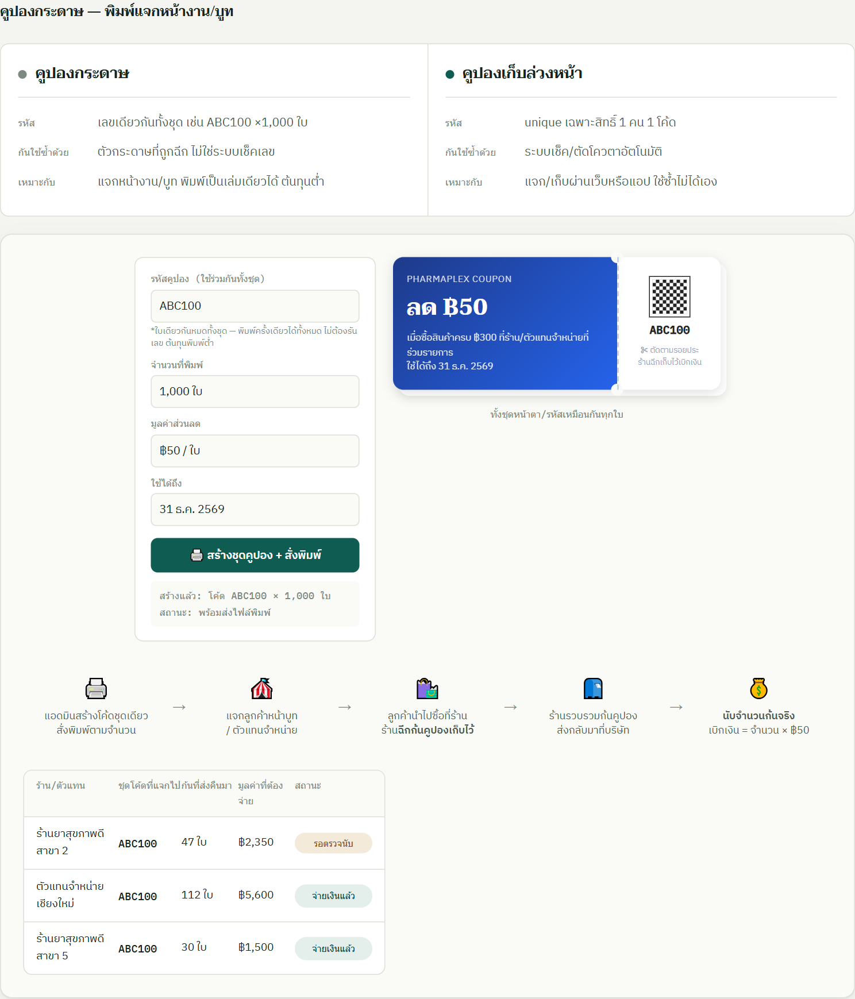

*รูป 4-2 ภาพจาก prototype รุ่นแรก ใช้ประกอบแนวคิดการสร้างชุดและด้านหน้าคูปองเท่านั้น ปุ่มสั่งพิมพ์ในภาพไม่มีในระบบจริง หน้าจอล่าสุดที่มีทั้งหน้าและหลังอยู่ในหัวข้อ 4.8*

ร้านที่ร่วมรายการฉีกก้นคูปองเก็บไว้เป็นหลักฐาน ส่งกลับมาที่บริษัท และระบบนับจำนวนก้นที่ได้รับจริงเพื่อคำนวณยอดเบิกเงิน **เบิกเงิน = จำนวนก้นที่นับได้ × มูลค่าต่อใบ** ระบบแสดงสถานะของแต่ละร้าน เช่น รอตรวจนับ หรือจ่ายเงินแล้ว คูปองกระดาษใช้ได้เฉพาะหน้าร้านหรือที่ POS เท่านั้น ไม่สามารถนำรหัสไปกรอกใช้ในเว็บได้ เพราะรหัสเหมือนกันทั้งชุดและกันการใช้ซ้ำด้วยวิธีฉีกกระดาษเท่านั้น

### 4.4 คูปองออนไลน์ (โค้ดแชร์ได้)

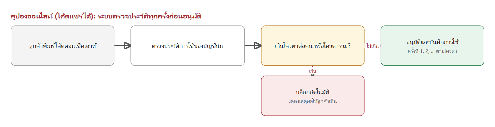

*รูป 4-3 โค้ดเดียวแจกได้ทุกคน ระบบตรวจประวัติการใช้ของบัญชีนั้นทุกครั้งก่อนอนุมัติ*

แนวคิดหลักคือไม่พึ่งความไม่ซ้ำของตัวโค้ด แต่ตรวจการใช้จริงของบัญชีทุกครั้ง ถ้าเกินโควตาต่อคนหรือโควตารวมที่ตั้งไว้ ระบบจะบล็อกอัตโนมัติและแสดงเหตุผลให้ลูกค้าเห็น

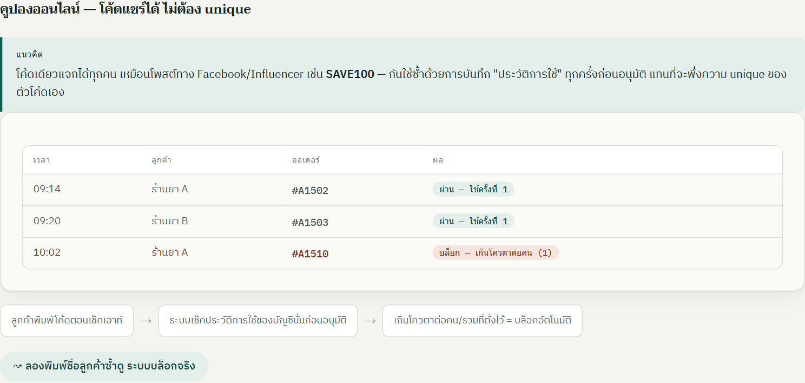

*รูป 4-4 ตัวอย่างประวัติการใช้: ครั้งแรกผ่าน ครั้งที่สองของบัญชีเดียวกันถูกบล็อกเมื่อเกินโควตาต่อคน*

### 4.5 คูปองเก็บเอง (เหมือน Shopee) และแจกอัตโนมัติทุกเดือน

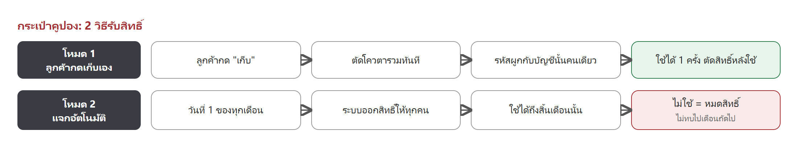

*รูป 4-5 โหมดเก็บเองและโหมดแจกอัตโนมัติใช้การตั้งค่าเดียวกัน ต่างกันที่วิธีรับสิทธิ์*

ตั้งค่าเงื่อนไขส่วนลด สินค้าที่ยกเว้น โควตา และวันหมดอายุครั้งเดียว แล้วเลือกโหมดแจก
- **โหมดเก็บเอง (เหมือน Shopee)** ลูกค้าเข้าดูคูปองที่เปิดให้เก็บในกระเป๋าคูปอง กดเก็บเอง ระบบตัดโควตารวมทันที และรหัสผูกกับบัญชีนั้นคนเดียว ใช้ได้ 1 ครั้ง
- **โหมดแจกอัตโนมัติ** ระบบออกสิทธิ์ให้ทุกคนทุกวันที่ 1 ของเดือน ใช้ได้ถึงสิ้นเดือนนั้น ถ้าไม่ใช้จะหมดสิทธิ์

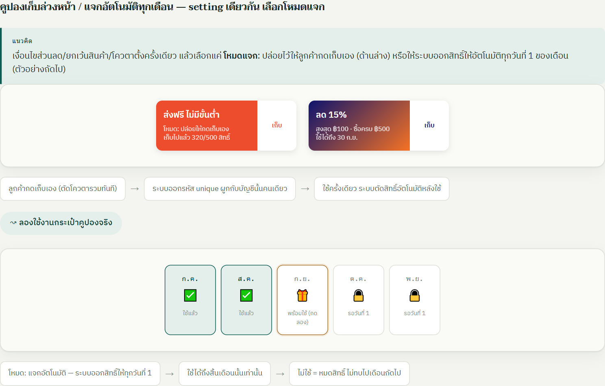

*รูป 4-6 ตัวอย่างหน้ากระเป๋าคูปอง: แต่ละเดือนแสดงสถานะว่าใช้แล้ว พร้อมใช้ หรือรอวันที่ 1*

### 4.6 คูปองสำหรับลูกค้าใหม่

- ใช้ได้เฉพาะลูกค้าที่ยังไม่เคยสั่งซื้อ (ตรวจจากประวัติการสั่งซื้อของบัญชี)
- เมื่อซื้อครบยอดที่กำหนด ได้ส่วนลดต้อนรับ เช่น ลด 300 บาท เมื่อซื้อครบ 5,000 บาท
- สิทธิ์ใช้ได้ครั้งเดียวต่อบัญชีผู้ใช้ใหม่

### 4.7 การตั้งค่าของแอดมิน

| แบบคูปอง | ตั้งค่าอะไรได้ |
|---|---|
| คูปองกระดาษ | รหัสชุด จำนวนที่ออก มูลค่าส่วนลด ยอดซื้อขั้นต่ำ วันที่ใช้ได้ **ร้าน/สาขาที่ร่วมรายการ** (เลือกจากรายชื่อที่ลงทะเบียน + ใบสูงสุดต่อร้าน) **ช่องทางที่ใช้ได้** (หน้าร้าน/POS, ออนไลน์) **สิทธิ์ต่อบิล** (จำนวนใบ ใช้ร่วมกับโปร/คูปอง/พอยท์ สินค้ายกเว้น ใครใช้ได้) ข้อความหลังคูปองไม่เกิน 160 ตัวอักษร และกำหนดส่งก้นเบิก (ระบบไม่มีการสั่งพิมพ์) |
| คูปองออนไลน์ (โค้ดแชร์ได้) | โค้ด มูลค่าหรือรูปแบบส่วนลด โควตาต่อคน โควตารวม ช่วงเวลาที่ใช้ได้ และสินค้าที่ยกเว้น |
| คูปองเก็บเอง / แจกอัตโนมัติ | เงื่อนไขส่วนลด สินค้าที่ยกเว้น โควตารวม วันหมดอายุ และเลือกโหมดแจก (เก็บเองหรือแจกอัตโนมัติทุกเดือน) |
| คูปองลูกค้าใหม่ | ยอดซื้อขั้นต่ำ และมูลค่าส่วนลดต้อนรับ |
| เพดานส่วนลดสูงสุด (ทุกแบบที่เป็นส่วนลด %) | ตั้งเพดานบาทสูงสุดได้ เช่น ลด 15% สูงสุดไม่เกิน 100 บาท |

### 4.8 หน้าจอและ flow การใช้งาน

หน้าจอทั้งหมดของโมดูลนี้เรียงตามลำดับ flow การใช้งาน แต่ละภาพมีเลขกำกับบนจอ และคำอธิบายของแต่ละเลขอยู่ใต้ภาพ ตามด้วยกติกา ข้อยกเว้น และสถานะที่ต้องรองรับ คูปองกระดาษแสดงทั้งด้านหน้าและด้านหลัง ระบุร้าน/สาขาที่ใช้ได้ ช่องทางออนไลน์ และสิทธิ์ให้ชัดเจน โดยไม่มีการสั่งพิมพ์ในระบบ

#### ภาพรวม · ภาพรวม Flow คูปอง

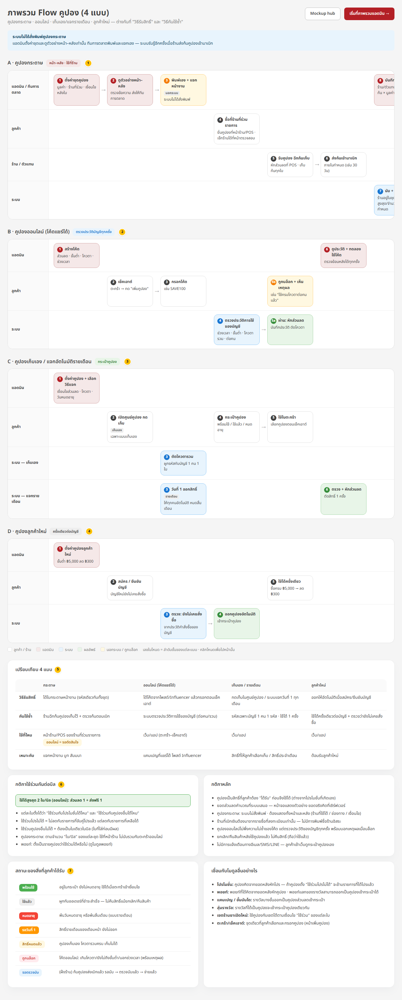

**คำอธิบายแต่ละส่วนในหน้าจอ**

1. คูปองกระดาษ: ระบบเข้ามามีส่วนตอนตั้งค่า/ดูตัวอย่าง และตอนร้านส่งก้นเข้ามาเบิก — ส่วนพิมพ์และแจกอยู่นอกระบบ (โหนดสีเหลือง)
2. คูปองออนไลน์: ทุกครั้งที่กรอกโค้ดระบบตรวจประวัติของบัญชี ถ้าไม่ผ่านจะบล็อกพร้อมบอกเหตุผลที่ลูกค้าอ่านเข้าใจ
3. เก็บเอง = ลูกค้ากดเก็บ (ตัดโควตารวมทันที) · รายเดือน = ระบบออกให้วันที่ 1 และหมดอายุสิ้นเดือน — ทั้งคู่อยู่ในกระเป๋าเดียวกัน
4. ลูกค้าใหม่: ออกให้ครั้งเดียวต่อบัญชีที่ยังไม่เคยสั่งซื้อ ใช้ได้ครั้งเดียว
5. ตารางเปรียบเทียบ: วิธีรับสิทธิ์ / กันใช้ซ้ำ / ใช้ที่ไหน / เหมาะกับ — ใช้อธิบายลูกค้าว่าทำไมคูปองกระดาษใช้ออนไลน์ไม่ได้ในค่าเริ่มต้น
6. กติกาใช้ร่วมกัน: ส่วนลด 1 + ส่งฟรี 1 ต่อบิลสำหรับออนไลน์ และการตั้ง "ใช้ร่วมโปร/คูปองอื่น" ต่อใบ
7. สถานะที่ลูกค้า/ร้านเห็นและความหมาย — ใช้เป็นชุดชิปเดียวกันทุกหน้าของโมดูล

**กติกา / ข้อยกเว้น / สถานะ**

- ลำดับคิดเงินในตะกร้า: ราคาสินค้า → โปรโมชั่น → คูปอง → ค่าจัดส่ง → พอยท์ที่ได้
- คูปองลดได้ไม่เกินยอดของรายการที่เข้าเงื่อนไข (ไม่ติดลบ ไม่ทอนเงินสด)
- ทุกการใช้/ถูกบล็อก/ตรวจนับ มีประวัติให้ตรวจย้อนหลังในหน้าแอดมิน

**ข้อที่ต้องตัดสินใจกับลูกค้า**

- คูปองกระดาษจะให้ใช้ออนไลน์ได้หรือไม่ — ค่าเริ่มต้นที่เสนอคือ "ไม่ได้" เพราะรหัสเหมือนกันทั้งชุด ถ้าเปิดต้องนับประวัติต่อบัญชีและกำหนดโควตา
- นโยบายก้นที่ส่งเกินกำหนดหรือเกินใบสูงสุดต่อร้าน (ปฏิเสธ / จ่ายเฉพาะส่วนที่ไม่เกิน / อนุมัติพิเศษ)
- จำนวนคูปองสูงสุดต่อบิลออนไลน์ (เสนอ 2 ใบ: ส่วนลด 1 + ส่งฟรี 1)

#### แอดมิน · ภาพรวมคูปอง 4 แบบ

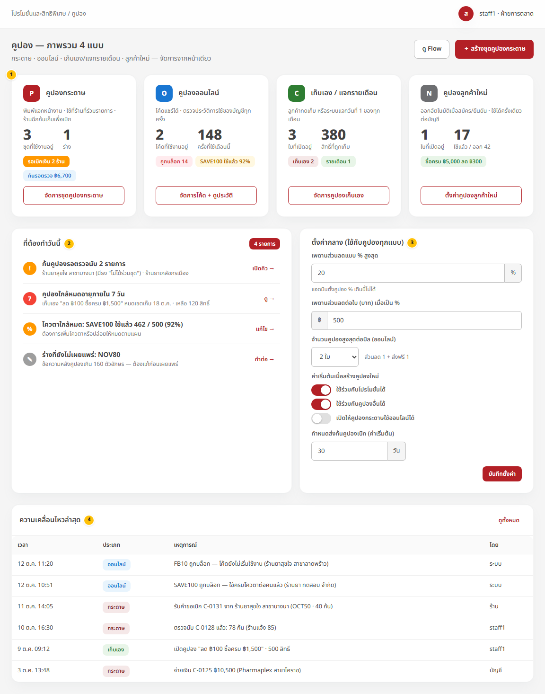

**คำอธิบายแต่ละส่วนในหน้าจอ**

1. การ์ด 4 แบบ: ตัวเลขหลัก 2 ค่า + ป้ายสถานะที่ต้องรู้ทันที — กดปุ่มเข้าหน้าจัดการของแบบนั้น (ลูกค้าใหม่ใช้หน้าเดียวกับเก็บเอง/รายเดือน แท็บที่ 3)
2. "ที่ต้องทำวันนี้" เรียงตามความเร่งด่วน: ก้นรอตรวจนับ / ใกล้หมดอายุ ≤ 7 วัน / โควตาเหลือ ≤ 10% / ร่างค้าง — ว่างทั้งหมดแสดง "ไม่มีงานค้าง"
3. ตั้งค่ากลาง: เพดานส่วนลด % / บาท ใช้กับทุกแบบที่เป็นส่วนลด · จำนวนคูปองต่อบิล · ค่าเริ่มต้นการใช้ร่วม/ช่องทางออนไลน์ของกระดาษ/กำหนดส่งก้น
4. ความเคลื่อนไหวล่าสุด: ย้อนดูเหตุการณ์สำคัญทั้งระบบคูปอง (ใช้ตรวจย้อนหลัง) แยกประเภทด้วยชิปสี

**กติกา / ข้อยกเว้น / สถานะ**

- ค่าเพดานที่เปลี่ยนมีผลกับการสร้าง/แก้คูปอง "ต่อไป" — คูปองที่ตั้งไว้แล้วเกินเพดานใหม่ยังใช้ค่าเดิมจนกว่าจะถูกแก้
- จำนวนคูปองต่อบิลใช้กับช่องทางออนไลน์ — คูปองกระดาษใช้ที่หน้าร้านตามจำนวน "ใบ/บิล" ที่ตั้งในแต่ละชุด
- ตัวเลขในการ์ดนับตามเวลาจริง ไม่รวมคูปองที่หมดอายุหรือปิดแล้ว

**ข้อที่ต้องตัดสินใจกับลูกค้า**

- ค่าเริ่มต้น "ส่วนลด 1 + ส่งฟรี 1 ต่อบิล" และเพดาน 20% / ฿500 เป็นข้อเสนอ — ลูกค้าต้องยืนยันตัวเลขจริง
- สิทธิ์ผู้ใช้: ใครแก้ตั้งค่ากลางได้ (ข้อเสนอ: เฉพาะผู้ดูแลระบบ) และใครบันทึกจ่ายก้นคูปอง

#### แอดมิน · คูปองกระดาษ: รายการชุด

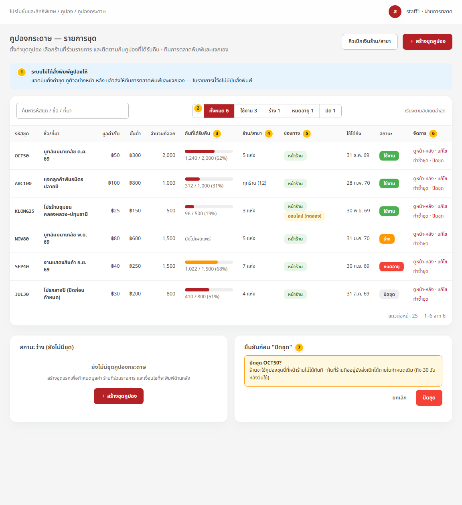

**คำอธิบายแต่ละส่วนในหน้าจอ**

1. ข้อความย้ำว่าระบบไม่ได้สั่งพิมพ์ — ตารางนี้ไม่มีคอลัมน์หรือปุ่มสั่งพิมพ์/ดาวน์โหลดไฟล์พิมพ์
2. ตัวกรองสถานะพร้อมจำนวน (ร่าง / ใช้งาน / หมดอายุ / ปิด) + ค้นหาตามรหัสหรือชื่อที่มา
3. ก้นที่ได้รับคืน = ก้นที่ตรวจนับแล้วรวมทุกร้าน ÷ จำนวนที่ออก — ใช้ดูว่าชุดถูกใช้ไปเท่าไร (แถบเหลืองเมื่อเกิน 60%)
4. ร้าน/สาขา: "n แห่ง" = เลือกเฉพาะ, "ทุกร้าน (12)" = ทุกร้านที่ลงทะเบียน (ตัวเลขเปลี่ยนเมื่อมีร้านใหม่ลงทะเบียน)
5. ช่องทางแสดงเป็นชิป: หน้าร้านเสมอ · ออนไลน์ปรากฏเมื่อแอดมินเปิดเท่านั้น (ค่าเริ่มต้นไม่มี) พร้อมป้าย "ทดลอง" จนกว่าลูกค้ายืนยันนโยบาย
6. การจัดการ: ดูหน้า-หลัง / แก้ไข / ทำซ้ำชุด (สร้างร่างใหม่จากค่าเดิม ใช้รหัสใหม่) / ปิดชุด — ไม่มีปุ่มสั่งพิมพ์
7. ปิดชุดต้องยืนยัน: ปิดแล้วร้านใช้ที่หน้าร้านไม่ได้ แต่ก้นที่ค้างอยู่ยังเบิกได้ตามกำหนด

**กติกา / ข้อยกเว้น / สถานะ**

- สถานะ ร่าง: ยังไม่มีผลกับร้าน · ใช้งาน: ร้านที่อยู่ในรายชื่อรับคูปองได้ · หมดอายุ: ระบบเปลี่ยนเองเมื่อพ้นวันสิ้นสุด (ยังเบิกก้นได้ภายในกำหนด) · ปิด: แอดมินสั่งปิดก่อนกำหนด
- รหัสชุดไม่ซ้ำกันทั้งระบบ แม้ชุดที่หมดอายุ/ปิดแล้ว
- ลบชุดไม่ได้ถ้ามีก้นที่ส่งเบิกแล้ว (ปิดชุดแทน)
- ชุดที่ปิดหรือหมดอายุแล้วยัง "ทำซ้ำ" ได้เพื่อออกชุดใหม่

**ข้อที่ต้องตัดสินใจกับลูกค้า**

- จะแสดงป้าย "ออนไลน์" ของคูปองกระดาษหรือไม่ ขึ้นกับการตัดสินใจเรื่องให้คูปองกระดาษใช้ออนไลน์ (ดูหน้าสร้างชุด)

#### แอดมิน · สร้างชุดคูปองกระดาษ (หน้า/หลัง/สาขา/สิทธิ์)

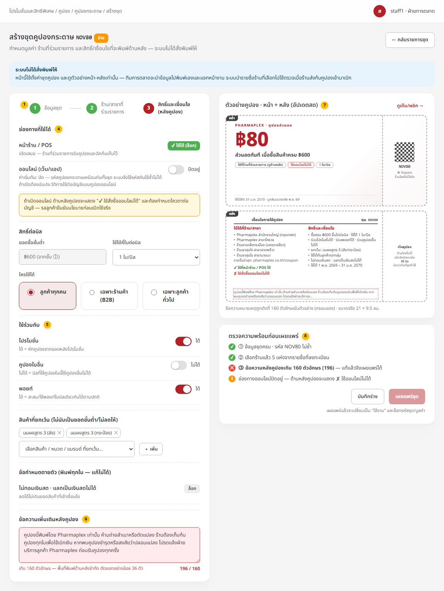

**คำอธิบายแต่ละส่วนในหน้าจอ**

1. ตัวนำทางสามขั้นอยู่ในหน้าเดียว กดสลับขั้นได้ ขั้นที่ผ่านแล้วเป็นสีเขียว · ฟอร์มซ้ายเปลี่ยนตามขั้น ส่วนตัวอย่างขวาคงอยู่และอัปเดตสดทุกครั้งที่แก้
2. (ขั้น ①) รหัสชุดตรวจไม่ซ้ำแบบสด เป็นรหัสเดียวทั้งชุดที่พิมพ์ลงใบและก้นคูปอง · แก้ไม่ได้หลังเผยแพร่
3. (ขั้น ②) ตารางร้านที่ลงทะเบียน: ค้นหา/กรองจังหวัด/ประเภท เลือกทั้งหมดที่กรองอยู่ได้ และตั้ง "ใบสูงสุดที่รับได้" ต่อร้าน (ว่าง = ไม่จำกัด) — ห้ามพิมพ์ชื่อร้านเองเพื่อกันคนนอกอ้างสิทธิ์
4. ช่องทาง: หน้าร้าน/POS เปิดเสมอ · ออนไลน์เป็นสวิตช์ที่แอดมินเลือกเอง ค่าเริ่มต้นปิด พร้อมเหตุผลที่แสดงให้เห็นในหน้า (รหัสเหมือนกันทั้งชุดจึงกันซ้ำด้วยรหัสไม่ได้)
5. เงื่อนไขการใช้ร่วม 3 ข้อ (โปรโมชั่น/คูปองอื่น/พอยท์) พิมพ์ลงด้านหลังคูปองตามค่าที่ตั้ง — ถ้าแอดมินเปลี่ยนค่า ข้อความด้านหลังเปลี่ยนตามทันที
6. ข้อความเพิ่มเติมหลังคูปองจำกัด 160 ตัวอักษร มีตัวนับสด เกินแล้วตัวนับ/กรอบเป็นแดงและเผยแพร่ไม่ได้
7. ตัวอย่างหน้าและหลังจริงสองด้านเสมอ (ไม่มีปุ่มสั่งพิมพ์/ดาวน์โหลดไฟล์พิมพ์) · ลิงก์ไปหน้าดูเต็มแบบพลิก
8. สรุปความพร้อมต่อขั้น: ✓ ผ่าน ✕ ต้องแก้ (บล็อกการเผยแพร่) ! คำเตือน (เผยแพร่ได้) · ปุ่ม "เผยแพร่ชุด" จะกดได้เมื่อไม่มี ✕

**กติกา / ข้อยกเว้น / สถานะ**

- สถานะชุด: ร่าง → ใช้งาน → หมดอายุ (อัตโนมัติเมื่อพ้นวันสิ้นสุด) หรือ ปิดชุด (แอดมินสั่ง) · ชุดที่ใช้งานแล้วแก้ได้เฉพาะ ชื่อภายใน/ข้อความหมายเหตุ/รายชื่อร้าน (เพิ่มร้านได้ ถอดร้านที่ยังไม่เคยเบิกได้) — รหัส มูลค่า ขั้นต่ำ แก้ไม่ได้
- ผลรวมใบสูงสุดของร้านที่ระบุตัวเลขต้องไม่เกินจำนวนที่ออก · ร้านที่เว้นว่างไม่จำกัดแต่รวมทุกร้านไม่เกินจำนวนที่ออก
- ข้อความด้านหลังสร้างจากค่าที่ตั้งทั้งหมดอัตโนมัติ — แอดมินเพิ่มได้เฉพาะ "ข้อความเพิ่มเติม" บรรทัดเดียวท้ายใบ
- ปุ่ม "บันทึกร่าง" บันทึกได้แม้ยังมี ✕ (แสดงเป็นร่างในรายการ) แต่เผยแพร่ไม่ได้

**ข้อที่ต้องตัดสินใจกับลูกค้า**

- เปิดให้คูปองกระดาษใช้ออนไลน์ได้หรือไม่ — ถ้าเปิด ต้องนับประวัติใช้ต่อบัญชีและจำกัดต่อบัญชี (ค่าเริ่มต้นที่เสนอ: ปิด)
- กำหนดส่งก้นเบิก 30 วัน และเพดานใบสูงสุดต่อร้าน — ถ้าร้านส่งเกินกำหนด/เกินเพดานจะ "ปฏิเสธ" หรือ "ให้แอดมินอนุมัติพิเศษ"

#### แอดมิน · ตัวอย่างคูปองกระดาษ หน้า-หลัง

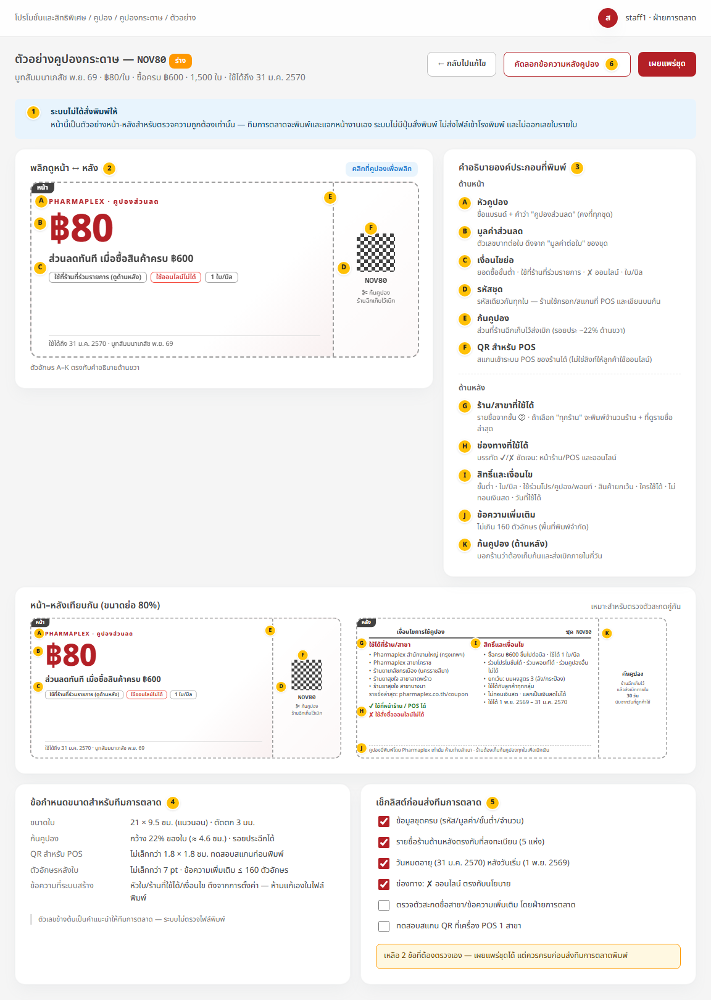

**คำอธิบายแต่ละส่วนในหน้าจอ**

1. ข้อความย้ำชัดว่าระบบไม่ได้สั่งพิมพ์ — ไม่มีปุ่มสั่งพิมพ์/ส่งโรงพิมพ์/ดาวน์โหลดไฟล์พิมพ์ในหน้านี้ ทีมการตลาดพิมพ์เองจากข้อมูลที่เห็น
2. คูปองแบบพลิกได้ (คลิกพลิกหน้า ↔ หลัง) ขนาดเท่าของจริงที่ 100% ใช้ตรวจข้อความทีละด้าน
3. ตัวอักษร A–K บนใบคือจุดอ้างอิงถึงรายการอธิบาย — ใช้ตอนคุยกับทีมการตลาดว่า "จุด G ต้องตรงกับรายชื่อร้าน"
4. ข้อกำหนดขนาดพิมพ์เป็นคำแนะนำ (21 × 9.5 ซม. ก้นคูปอง 22%) ระบบไม่ตรวจไฟล์ของทีมการตลาด
5. เช็กลิสต์ 4 ข้อแรกระบบติ๊กให้จากข้อมูลที่ตรวจได้ · 2 ข้อท้ายเป็นของคนตรวจเอง (ไม่บล็อกการเผยแพร่)
6. ปุ่มคัดลอกข้อความหลังคูปอง (ร้าน/ช่องทาง/เงื่อนไข/หมายเหตุ) เป็นข้อความธรรมดา ให้ทีมการตลาดนำไปวางในไฟล์ออกแบบ

**กติกา / ข้อยกเว้น / สถานะ**

- ตัวอย่างสร้างจากค่าที่ตั้งในหน้า "สร้างชุด" เสมอ — แก้ค่าแล้วตัวอย่างเปลี่ยนตาม ไม่มีการแก้ข้อความบนตัวอย่างโดยตรง
- ถ้าชุดมี "ใช้ออนไลน์" เปิด บรรทัด H จะเป็น ✔ และต้องมีข้อความเงื่อนไขโควตาต่อบัญชีเพิ่มในหลังใบ
- ถ้ารายชื่อร้านยาวเกินพื้นที่ (เกิน ~6 ร้าน) หลังใบจะแสดง "ร้านที่ร่วมรายการ 12 แห่ง ดูรายชื่อที่ pharmaplex.co.th/coupon" แทนการพิมพ์ทุกชื่อ
- ชุดที่เผยแพร่แล้วดูตัวอย่างได้เสมอ แต่แก้รหัส/มูลค่าไม่ได้ — ต้อง "ทำซ้ำชุด" เป็นรหัสใหม่

**ข้อที่ต้องตัดสินใจกับลูกค้า**

- จำนวนร้านสูงสุดที่ยอมให้พิมพ์ชื่อลงหลังใบ (ข้อเสนอ: ไม่เกิน 6 ร้าน เกินนั้นให้ชี้ไปดูรายชื่อที่เว็บ) — ลูกค้าต้องยืนยันว่ายอมรับให้ลูกค้าปลายทางต้องเปิดเว็บเช็กหรือไม่
- ข้อความ URL บนหลังใบ (ตัวอย่าง pharmaplex.co.th/coupon) — ต้องยืนยันโดเมน/หน้าจริงที่จะใช้

#### แอดมิน · คิวเบิกเงินร้าน/สาขา (นับก้นคูปอง)

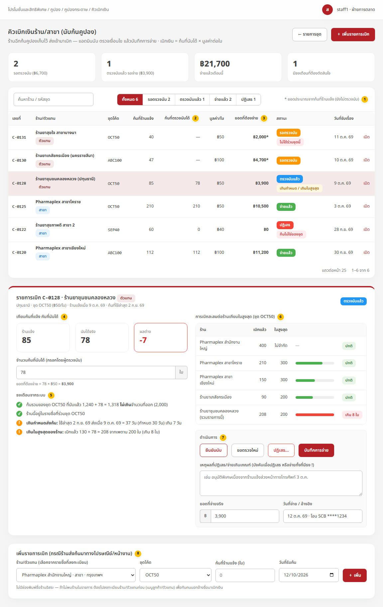

**คำอธิบายแต่ละส่วนในหน้าจอ**

1. ยอดที่มี * คือประมาณการจากก้นที่ร้านแจ้ง ยังไม่ตรวจนับ — ยอดจริงใช้ตัวเลขที่ตรวจนับได้เท่านั้น
2. ช่อง "ก้นที่ตรวจนับได้" ว่างจนกว่าจะนับ — ผู้ตรวจกรอกจากก้นที่ได้รับจริง ผลต่างกับที่ร้านแจ้งแสดงเป็นสีแดง
3. ยอดที่ต้องจ่าย = ก้นที่ตรวจนับได้ × มูลค่า/ใบของชุด (ฟิลด์คำนวณ แก้ตรง ๆ ไม่ได้ ยกเว้นกรอกยอดจ่ายจริงพร้อมเหตุผล)
4. ส่วนเปรียบเทียบ: ร้านแจ้ง vs นับได้ vs ผลต่าง พร้อมช่องกรอกจำนวนที่นับได้ที่คำนวณยอดจ่ายสด
5. ธงเตือนอัตโนมัติ 4 ข้อ: ก้นรวมเกินจำนวนที่ออก / ร้านไม่ได้ร่วมชุด / เกินกำหนดส่งก้น / เกินใบสูงสุดของร้าน — ✓ ผ่าน ! ต้องตัดสินใจ
6. ตารางเปรียบเทียบการเบิกสะสมของแต่ละร้านกับใบสูงสุดที่ตั้งไว้ในชุด (แถบแดงเมื่อเกิน)
7. การดำเนินการ: ยืนยันนับ → บันทึกการจ่าย · ขอตรวจใหม่ (ส่งกลับคิวรอตรวจนับ) · ปฏิเสธ (ต้องมีเหตุผล) — ทุกการกดถูกบันทึกในประวัติ
8. เพิ่มรายการเบิกต้องเลือกร้านจากรายชื่อที่ลงทะเบียนเท่านั้น (select + ค้นหา) ไม่มีช่องพิมพ์อิสระ

**กติกา / ข้อยกเว้น / สถานะ**

- สถานะ: รอตรวจนับ → ตรวจนับแล้ว → จ่ายแล้ว (หรือ ปฏิเสธ) · จ่ายแล้วแก้ตัวเลขไม่ได้ ต้องบันทึกรายการปรับยอดใหม่
- ร้านที่ไม่ได้อยู่ในรายชื่อของชุด (เช่น C-0131) ระบบติดธงแดงและปุ่ม "ยืนยันนับ" ถูกล็อกจนกว่าจะเพิ่มร้านเข้าชุด หรือปฏิเสธ
- ก้นรวมที่นับแล้วของชุดห้ามเกินจำนวนที่ออก — ถ้าเกินระบบบล็อกการยืนยันและแจ้งให้ตรวจก้นปลอม/ซ้ำ
- ก้นเกินกำหนดส่งหรือเกินใบสูงสุด: จ่ายได้เฉพาะเมื่อกรอกเหตุผลอนุมัติพิเศษ (บันทึกชื่อผู้อนุมัติ)

**ข้อที่ต้องตัดสินใจกับลูกค้า**

- ก้นที่ส่งเกินกำหนด 30 วัน และเกินใบสูงสุดต่อร้าน: ให้ปฏิเสธอัตโนมัติ / จ่ายเฉพาะส่วนที่ไม่เกิน / ให้แอดมินอนุมัติพิเศษ (ข้อเสนอ: ธงเตือน + แอดมินอนุมัติพิเศษพร้อมเหตุผล)
- ใครมีสิทธิ์ "บันทึกการจ่าย" — เฉพาะฝ่ายบัญชี หรือแอดมินการตลาดด้วย (ข้อเสนอ: ตรวจนับ = การตลาด, บันทึกจ่าย = บัญชี)

#### แอดมิน · คูปองออนไลน์ + ประวัติการใช้

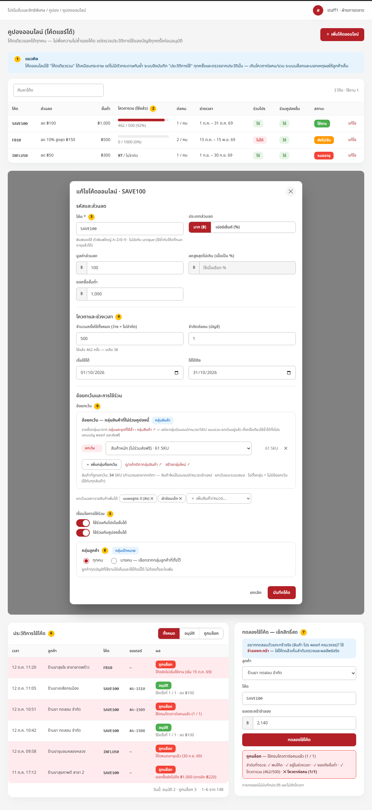

**คำอธิบายแต่ละส่วนในหน้าจอ**

1. ย้ำแนวคิด: โค้ดไม่ต้อง unique — ความถูกต้องมาจากการตรวจประวัติการใช้ของบัญชีทุกครั้ง ไม่ใช่จากตัวโค้ด
2. โควตารวมแสดงเป็นแถบ (แดงเมื่อใช้เกิน 90%) พร้อมตัวเลขใช้แล้ว/ทั้งหมด — "ไม่จำกัด" แสดงเฉพาะจำนวนที่ใช้
3. โค้ดพิมพ์เองได้ ระบบแปลงเป็นตัวพิมพ์ใหญ่และตัดช่องว่าง — ชนกับโค้ดที่ยังใช้งาน/ยังไม่เริ่มอยู่เตือน แต่ไม่บังคับ unique กับโค้ดที่หมดอายุ
4. ต่อคน = ต่อบัญชีลูกค้า (นับจากประวัติ "อนุมัติ" เท่านั้น — ครั้งที่ถูกบล็อกหรือยกเลิกออเดอร์ก่อนชำระไม่นับ)
5. เงื่อนไขการใช้ร่วม: ร่วมโปรโมชั่นไม่ได้ = ไม่คิดคูปองกับรายการที่จับคู่โปรแล้ว · ร่วมคูปองอื่นไม่ได้ = ต้องเป็นใบเดียวในบิล
6. ประวัติการใช้: อนุมัติ = เขียว / ถูกบล็อก = แดงพร้อมเหตุผลที่ตรงกับข้อความที่ลูกค้าเห็นตอนเช็คเอาต์
7. ทดลองใช้โค้ด จำลองลูกค้า+ยอดตะกร้า แล้วแสดงลำดับการตรวจพร้อมจุดที่ติด — ไม่บันทึกประวัติจริง

**กติกา / ข้อยกเว้น / สถานะ**

- ลำดับตรวจเมื่อลูกค้ากรอกโค้ด: พบโค้ด → อยู่ในช่วงเวลา → กลุ่มลูกค้าตรง → ยอดถึงขั้นต่ำ (นับเฉพาะสินค้าที่ไม่ถูกยกเว้น) → โควตารวม → โควตาต่อคน → เงื่อนไขใช้ร่วม
- โควตารวมตัดเมื่อ "ชำระสำเร็จ" ไม่ใช่ตอนใส่โค้ด · ถ้ายกเลิกก่อนชำระ โควตาไม่ถูกตัด
- หมดอายุ/ยังไม่เริ่ม: โค้ดยังเห็นในรายการ แต่ลูกค้ากรอกแล้วขึ้นข้อความเหตุผลตรง ๆ
- แก้ไขโค้ดที่มีประวัติแล้ว: แก้โควตา/วันที่/ขั้นต่ำได้ มีผลกับการใช้ครั้งต่อไปเท่านั้น (ไม่ย้อนหลัง)
- ยกเลิก/คืนสินค้าหลังใช้โค้ดแล้ว ไม่คืนสิทธิ์ ถือว่าใช้แล้ว

**ข้อที่ต้องตัดสินใจกับลูกค้า**

- ถ้าลูกค้า "ยังไม่ได้ล็อกอิน" แล้วกรอกโค้ด จะให้ตรวจสิทธิ์ได้หรือไม่ (ข้อเสนอ: ต้องล็อกอินก่อนจึงตรวจสิทธิ์ เพื่อนับต่อบัญชีได้)
- มีโค้ดที่ผูกกับกลุ่มลูกค้าเฉพาะราย (audience) ต้องใช้จริงหรือไม่ — ถ้าไม่ใช้ ตัดช่องนี้ออกเพื่อลดความซับซ้อน

#### แอดมิน · คูปองเก็บเอง / แจกรายเดือน / ลูกค้าใหม่

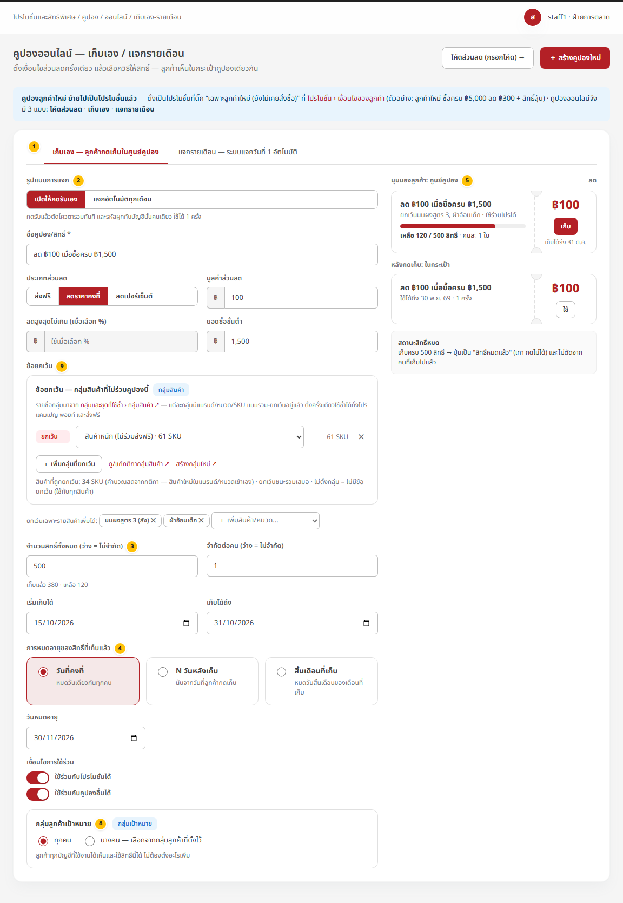

**คำอธิบายแต่ละส่วนในหน้าจอ**

1. สามแท็บ = สามวิธีให้สิทธิ์ ใช้ชุดฟิลด์ส่วนลดเดียวกัน ต่างกันที่ "วิธีรับ" · ใบหนึ่งอยู่ได้แท็บเดียว
2. รูปแบบการแจกเลือกต่อใบ (กดรับเอง / แจกอัตโนมัติรายเดือน) — สร้างได้หลายใบพร้อมกัน เช่น ใบเก็บเอง + ใบรายเดือน
3. จำนวนสิทธิ์ทั้งหมด = โควตารวม ตัดทันทีเมื่อลูกค้ากดเก็บ (แสดง "เหลือ n / ทั้งหมด" ให้ลูกค้าเห็น) · ว่าง = ไม่จำกัด
4. การหมดอายุของสิทธิ์ที่เก็บแล้ว: วันที่คงที่ / N วันหลังเก็บ / สิ้นเดือนที่เก็บ — ช่องกรอกเปลี่ยนตามตัวเลือก
5. ตัวอย่างฝั่งลูกค้าอัปเดตสดตามค่าที่ตั้ง ทั้งในศูนย์คูปอง (ก่อนเก็บ) และกระเป๋า (หลังเก็บ)
6. แถบรายเดือน: ใช้แล้ว / พร้อมใช้ / รอวันที่ 1 — หมดอายุล็อกที่สิ้นเดือนเดียวกันเสมอ
7. ลูกค้าใหม่: ออกอัตโนมัติเมื่อสมัคร/ยืนยันบัญชี ตรวจ "ยังไม่เคยสั่งซื้อ" และใช้ได้ครั้งเดียวต่อบัญชี (ล็อก)

**กติกา / ข้อยกเว้น / สถานะ**

- ลูกค้าเก็บซ้ำเกิน "ต่อคน" ไม่ได้ — ปุ่มเปลี่ยนเป็น "เก็บแล้ว"; สิทธิ์ที่เก็บแล้วไม่หายถ้าแอดมินปิดการแจกภายหลัง
- แก้เงื่อนไขส่วนลดของใบที่มีคนเก็บแล้ว: ใบที่เก็บไปแล้วใช้ค่าเดิมตอนเก็บ (snapshot) ยกเว้น "เงื่อนไขใช้ร่วม" ที่อ่านจากต้นทางสด
- แจกรายเดือน: ไม่ทบข้ามเดือน ไม่ใช้ = หมดสิทธิ์ · ออกให้เฉพาะบัญชีที่ใช้งานอยู่
- ลูกค้าใหม่ที่ยังไม่ยืนยันบัญชี จะยังไม่ได้รับคูปองจนกว่ายืนยัน

**ข้อที่ต้องตัดสินใจกับลูกค้า**

- อายุคูปองลูกค้าใหม่ (ข้อเสนอ 30 วันนับจากวันที่ออก) และจะออกเมื่อ "สมัคร" หรือ "ยืนยันบัญชี"
- ลูกค้าที่สมัครกลางเดือนจะได้สิทธิ์รายเดือนของเดือนนั้นทันทีหรือไม่ (ข้อเสนอ: ได้ทันที หมดสิ้นเดือน)
- เพดานจำนวนสิทธิ์/วันที่ของคูปองเก็บเอง "ไม่จำกัด" อนุญาตหรือไม่ — ข้อเสนอให้บังคับกรอกโควตารวมเพื่อกันงบบาน

#### ลูกค้า · ศูนย์คูปอง + กระเป๋าคูปอง

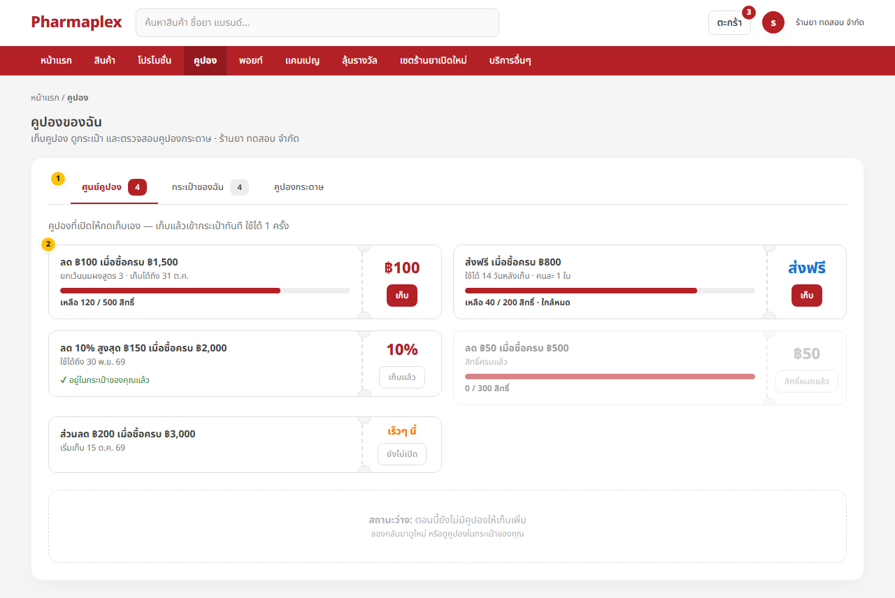

**คำอธิบายแต่ละส่วนในหน้าจอ**

1. สามแท็บ: ศูนย์คูปอง (เก็บเอง) / กระเป๋าของฉัน / คูปองกระดาษ — ตัวเลขข้างชื่อแท็บ = จำนวนที่เก็บได้ / พร้อมใช้
2. การ์ดในศูนย์คูปอง: แถบความคืบหน้า "เหลือ n / ทั้งหมด" · ปุ่มเปลี่ยนตามสถานะ: เก็บ / เก็บแล้ว / สิทธิ์หมดแล้ว / ยังไม่เปิด (ใช้ปุ่มเทาเมื่อกดไม่ได้)
3. กระเป๋าแยกชิปสถานะ พร้อมใช้ / ใช้แล้ว / หมดอายุ พร้อมจำนวน — เรียงใบที่ใกล้หมดอายุก่อน
4. สิทธิ์รายเดือนที่ระบบออกให้: ใบเดือนปัจจุบันกดใช้ได้ ใบเดือนหน้าแสดง "รอวันที่ 1 พ.ย." กดไม่ได้ + แถบรายเดือน ก.ย./ต.ค./พ.ย.
5. คูปองกระดาษไม่อยู่ในกระเป๋า — แท็บนี้อธิบายวิธีใช้ที่ร้านและลิงก์ไปหน้าตรวจสอบรหัส/ร้านที่ใช้ได้

**กติกา / ข้อยกเว้น / สถานะ**

- ปุ่ม "ใช้" พาไปตะกร้า/เช็คเอาต์และเลือกคูปองนั้นไว้ล่วงหน้า — ถ้าตะกร้าว่างจะพาไปเลือกสินค้าก่อน
- ใบที่ใช้แล้ว/หมดอายุ แสดงเป็นสีจาง กดไม่ได้ และแสดงเลขออเดอร์ที่ใช้ (กรณีใช้แล้ว)
- เก็บซ้ำเกิน "ต่อคน" ไม่ได้ — ปุ่มเป็น "เก็บแล้ว"; โควตารวมหมด = "สิทธิ์หมดแล้ว" (ใครเก็บไปก่อนหน้ายังใช้ได้)
- สถานะว่าง: ศูนย์คูปองที่ไม่มีใบให้เก็บ และกระเป๋าที่ว่าง แสดงข้อความนำทางไปอีกแท็บ
- ไม่มีการแจ้งเตือนนอกเว็บ — ลูกค้าต้องเข้ามาดูเองว่าคูปองใกล้หมดอายุ

**ข้อที่ต้องตัดสินใจกับลูกค้า**

- จะแสดงคูปองรายเดือนของเดือนหน้าที่ "ยังไม่ออก" ในกระเป๋าหรือไม่ (ข้อเสนอ: แสดงเพื่อให้ลูกค้ารู้ล่วงหน้า)
- ลูกค้าต้องการให้ผูกคูปองกระดาษเข้าบัญชี (กรอกรหัสเก็บไว้) หรือไม่ — ค่าเริ่มต้นไม่ผูก เพราะรหัสเหมือนกันทั้งชุด

#### ลูกค้า · ใช้คูปองในตะกร้า/เช็คเอาต์

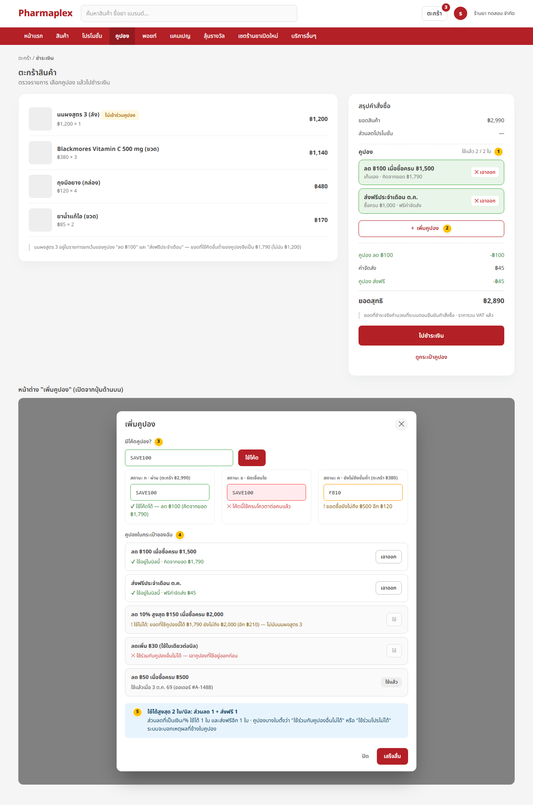

**คำอธิบายแต่ละส่วนในหน้าจอ**

1. สรุปคูปองในตะกร้า: จำนวนที่ใช้/สูงสุดต่อบิล · แต่ละใบแสดงสีเขียวพร้อมปุ่มเอาออก — ยอดสุทธิคำนวณใหม่ทันที
2. ปุ่ม "เพิ่มคูปอง" เปิดหน้าต่างเดียวสำหรับกรอกโค้ดและเลือกจากกระเป๋า (หน้าต่างแสดงเปิดอยู่ด้านล่างเพื่อให้ดูทั้งหมดในภาพเดียว)
3. ช่องกรอกโค้ด 3 สถานะ: ผ่าน (เขียว) / ผิดเงื่อนไข (แดง บอกเหตุผล เช่น ใช้ครบโควตาต่อคน) / ยังไม่เข้าเงื่อนไข (เหลือง บอกว่าขาดอีกเท่าไร)
4. กระเป๋า: ทุกใบมี "เหตุผลที่ใช้ไม่ได้" ใต้ชื่อ (ขั้นต่ำ ยกเว้นสินค้า ใช้ร่วมไม่ได้ ใช้แล้ว) — ปุ่ม "ใช้" ถูกปิดเมื่อใช้ไม่ได้
5. คำอธิบายกติกาซ้อนใบ: ส่วนลด 1 + ส่งฟรี 1 ต่อบิล (ตามค่ากลางในหน้าแอดมิน) แสดงในหน้าต่างเสมอ

**กติกา / ข้อยกเว้น / สถานะ**

- ยอดขั้นต่ำเทียบกับ "ยอดที่คูปองใบนั้นครอบคลุม" หลังหักโปรโมชั่น (ไม่นับสินค้ายกเว้น และไม่นับรายการที่จับคู่โปรถ้าคูปองตั้งใช้ร่วมโปรไม่ได้) — ลำดับการใส่คูปองไม่มีผลกับขั้นต่ำ
- ส่วนลดใบถัดไปคิดจากยอดคงเหลือหลังใบก่อนหน้า ไม่มีทางหักเกินมูลค่ารายการ/ติดลบ
- คูปองส่งฟรีฟรีเฉพาะรายการที่เข้าเงื่อนไข — ถ้ามีรายการที่ยกเว้น ยังคิดค่าส่งส่วนนั้น
- โควตาของโค้ด/คูปองตัดเมื่อชำระสำเร็จ — ถ้ายกเลิกก่อนชำระ สิทธิ์ยังอยู่
- ถ้าตะกร้าเปลี่ยนจนคูปองที่ใช้อยู่ไม่เข้าเงื่อนไข ระบบถอดคูปองให้และแจ้งเหตุผลที่หน้าสรุป

**ข้อที่ต้องตัดสินใจกับลูกค้า**

- จำนวนคูปองสูงสุดต่อบิล (เสนอ 2: ส่วนลด 1 + ส่งฟรี 1) และกรณีมีคูปอง % + คูปองบาท ให้ใช้ได้ทั้งคู่หรือไม่
- ลูกค้ายังไม่ล็อกอินเปิดหน้าต่างนี้ได้หรือไม่ (เสนอ: ต้องล็อกอินก่อนเลือกคูปอง)

#### ลูกค้า · ตรวจสอบคูปองกระดาษ (สาขาที่ใช้ได้)

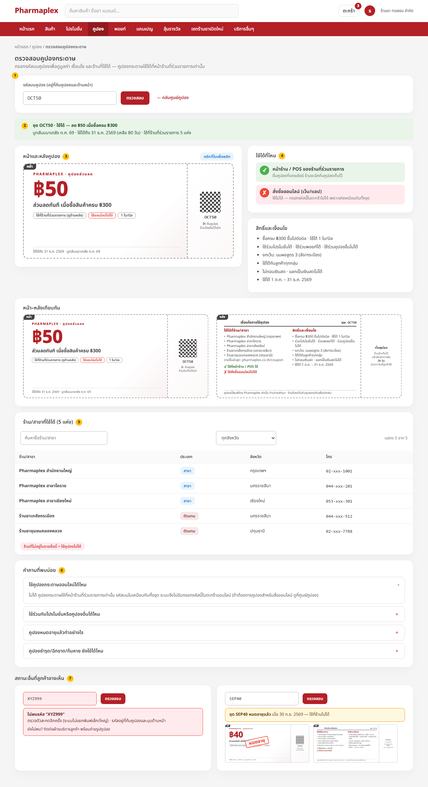

**คำอธิบายแต่ละส่วนในหน้าจอ**

1. ช่องกรอกรหัสชุดบนคูปอง (ไม่ต้องล็อกอิน) — ไม่แยกพิมพ์เล็ก/ใหญ่ ตัดช่องว่าง · หน้านี้ "ตรวจสอบ/ให้ข้อมูล" เท่านั้น ไม่ใช้ส่วนลดให้
2. แบนเนอร์สถานะชุด: ใช้ได้ / หมดอายุ / ไม่พบ พร้อมสรุปมูลค่า ขั้นต่ำ วันที่ และจำนวนร้าน
3. แสดงคูปองทั้งหน้าและหลัง: พลิกดูได้ในใบเดียว และเทียบแบบหน้า–หลังข้างกัน เหมือนที่พิมพ์จริง
4. บรรทัดช่องทาง ✔/✘ ชัดเจน: หน้าร้าน/POS และออนไลน์ พร้อมเหตุผลเมื่อใช้ไม่ได้
5. รายชื่อร้าน/สาขาที่ใช้ได้ ค้นหาและกรองจังหวัดได้ — ร้านที่ไม่อยู่ในรายชื่อ = ใช้ไม่ได้
6. คำถามที่พบบ่อย 4 ข้อ (ออนไลน์ได้ไหม / ใช้ร่วมได้ไหม / หมดอายุ / ใบชำรุด) แบบพับเก็บได้
7. สถานะไม่พบรหัส และหมดอายุ (ตราประทับ "หมดอายุ" บนทั้งสองด้าน)

**กติกา / ข้อยกเว้น / สถานะ**

- ข้อมูลทุกอย่างมาจากชุดที่แอดมินตั้งค่า — ไม่แสดงจำนวนก้น/ยอดเบิก/ข้อมูลภายในของร้านใด ๆ
- ชุดสถานะร่างหรือปิด ตอบเหมือน "ไม่พบรหัส" (ไม่เปิดเผยชุดที่ยังไม่เผยแพร่)
- ถ้าชุดเลือก "ทุกร้านที่ลงทะเบียน" รายชื่อร้านจะแสดงทุกร้านที่ลงทะเบียน ณ วันที่ตรวจ
- จำกัดอัตราการเรียกต่อ IP เพื่อกันการไล่เดารหัส

**ข้อที่ต้องตัดสินใจกับลูกค้า**

- หน้านี้เปิดสาธารณะ (ไม่ต้องล็อกอิน) หรือเฉพาะสมาชิก — เสนอให้เปิดสาธารณะเพื่อให้ผู้ได้รับคูปองหน้างานเช็กได้ทันที
- จะแสดงเบอร์โทรร้านหรือไม่ (ตัวอย่างนี้แสดง) ต้องให้ร้าน/ตัวแทนยินยอม

#### สรุปข้อที่ต้องตัดสินใจกับลูกค้า

- เปิดให้คูปองกระดาษใช้ออนไลน์ได้หรือไม่ (เสนอ: ปิด) ถ้าเปิดต้องนับประวัติต่อบัญชี
- ก้นคูปองที่ส่งเกินกำหนด (เสนอ 30 วัน) หรือเกินใบสูงสุดต่อร้าน: ปฏิเสธ จ่ายเฉพาะส่วนที่ไม่เกิน หรืออนุมัติพิเศษ
- จำนวนร้านสูงสุดที่พิมพ์ชื่อลงด้านหลังใบ (เสนอไม่เกิน 6 ร้าน เกินนั้นให้ดูรายชื่อที่เว็บ) และ URL ที่พิมพ์บนใบ
- จำนวนคูปองสูงสุดต่อบิลออนไลน์ (เสนอ ส่วนลด 1 ใบ + ส่งฟรี 1 ใบ) และเพดานส่วนลดต่อบิล
- อายุคูปองลูกค้าใหม่ (เสนอ 30 วัน) และออกตอนสมัครหรือตอนยืนยันอีเมล
- หน้าตรวจสอบคูปองกระดาษ (10) เปิดสาธารณะโดยไม่ต้องล็อกอินหรือไม่ และแสดงเบอร์โทรร้านหรือไม่

---

## 5. พอยท์และแคมเปญ

### 5.1 พอยท์สะสมอัตโนมัติเมื่อซื้อสินค้า

ลูกค้าได้พอยท์ทันทีเมื่อการชำระเงินของออเดอร์สำเร็จ ไม่ต้องกดแปลงหรือรอคิวใด ๆ พอยท์เข้าบัญชีพร้อมกับยอดสั่งซื้อ และนำไปใช้ได้ทันที

อัตราพอยท์กำหนดที่ระดับสินค้าแต่ละรายการ ไม่ได้คิดจากยอดรวมใบเสร็จ เช่น สินค้าบางรายการได้ 10 พอยท์ต่อหน่วย ส่วนสินค้าควบคุมราคา ยาน้ำ นมผง หรือสินค้าราคาพิเศษ ตั้งค่าเป็น 0 พอยท์ได้

```
พอยท์ที่ได้จากออเดอร์ = ผลรวมของ (จำนวนที่ซื้อ × พอยท์ต่อหน่วยของสินค้านั้น × ตัวคูณของแคมเปญ)
```

ตัวอย่าง: ซื้อสินค้าที่ได้ 10 พอยท์ต่อชิ้น จำนวน 2 ชิ้น และสินค้าอีกรายการที่ได้ 0 พอยท์ รวมได้ 20 พอยท์ทันทีที่ชำระเงินสำเร็จ

ถ้ามีหลายแคมเปญที่มีตัวคูณพอยท์ active พร้อมกัน ตัวคูณจะบวกกัน เช่น แคมเปญหนึ่งตัวคูณ ×1.5 และอีกแคมเปญ ×2 ลูกค้าจะได้รับตัวคูณรวม ×3.5

พอยท์ที่ได้มีวันหมดอายุ โดยแอดมินกำหนดวันหมดอายุของพอยท์แต่ละรอบหรือแต่ละแคมเปญที่แจกพอยท์ได้เอง ไม่ได้ fix เป็นนโยบายเดียวทั้งระบบ

### 5.2 พอยท์ในบัญชีและการนำไปใช้

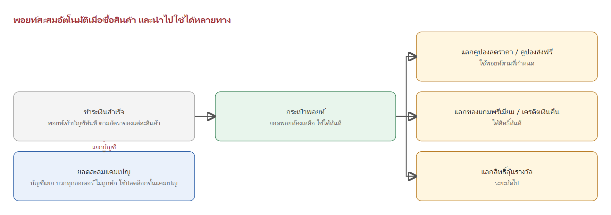

*รูป 5-1 พอยท์เข้าบัญชีทันทีเมื่อซื้อสินค้า ลูกค้านำพอยท์ไปใช้ได้หลายรูปแบบ ส่วนยอดสะสมแคมเปญเป็นอีกบัญชีหนึ่งที่แยกต่างหาก*

ลูกค้านำพอยท์ในบัญชีไปใช้ได้ดังนี้

| การใช้พอยท์ | รายละเอียด |
|---|---|
| แลกคูปองลดราคา | เช่น คูปองลด 50 บาท ใช้ 500 พอยท์ |
| แลกคูปองส่งฟรี | เช่น คูปองส่งฟรี ใช้ 300 พอยท์ |
| แลกของแถมพรีเมียม | เช่น ของแถม ใช้ 1,200 พอยท์ |
| แลกเครดิตเงินคืน | เช่น เครดิตเงินคืน 100 บาท ใช้ 1,000 พอยท์ |
| แลกสิทธิ์ลุ้นรางวัล | ตามที่ระบุในหัวข้อการสุ่มรางวัล (ระยะถัดไป) |

ยอดพอยท์คงเหลือ พอยท์ที่แลกแล้วจะถูกหักทันทีและได้สิทธิ์ใช้ทันที รายการที่แลกได้และจำนวนพอยท์กำหนดจากหน้าแอดมิน

**ยอดสะสมแคมเปญ** เป็นยอดซื้อสินค้าที่เข้าร่วมแคมเปญ ใช้ปลดล็อกรางวัลขั้นบันไดของแคมเปญสะสมยอดรายปี (หัวข้อ 5.4) ยอดนี้บวกทุกออเดอร์อัตโนมัติ ไม่ถูกหักเมื่อแลกพอยท์ และไม่สามารถนำไปแลกเป็นพอยท์หรือส่วนลดได้

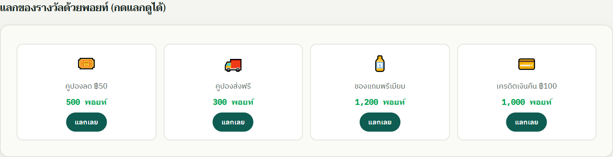

*รูป 5-2 ตัวอย่างหน้าแลกของรางวัลด้วยพอยท์ ลูกค้าเลือกแลกได้ทันทีตามจำนวนพอยท์ที่มี*

### 5.3 แคมเปญตามช่วงเวลาและโควตา

| หัวข้อ | รายละเอียด |
|---|---|
| ช่วงเวลา | กำหนดวันและเวลาเริ่มต้น–สิ้นสุดชัดเจน |
| สินค้าที่เข้าร่วม | ใช้ได้เฉพาะ SKU ที่ผูกไว้กับแคมเปญ สินค้าอื่นไม่ได้สิทธิ์ |
| โควตารวมทั้งระบบ | จำนวนสินค้าแคมเปญที่ขายได้ทั้งหมด |
| โควตาต่อร้านค้า | จำนวนสินค้าแคมเปญสูงสุดที่ร้านแต่ละร้านซื้อได้ |
| การพักโควตา | ระหว่างขั้นตอนชำระเงินระบบพักโควตาไว้ 15 นาที ถ้าชำระไม่สำเร็จโควตาคืนกลับเข้าระบบ |

### 5.4 แคมเปญสะสมยอดรายปี

สำหรับร้านขายส่งที่ทำสัญญาสะสมยอดซื้อรายปี แคมเปญจะปลดล็อกรางวัลตามขั้นบันไดของยอดสะสม รางวัลบางรายการไม่ได้อยู่ในคลังสินค้า POS เช่น ตั๋วเดินทาง หรือเครื่องใช้ไฟฟ้า ยอดสะสมจะรีเซ็ตเป็นศูนย์ทุกครั้งที่ขึ้นสัญญาปีใหม่ ไม่สะสมข้ามปี

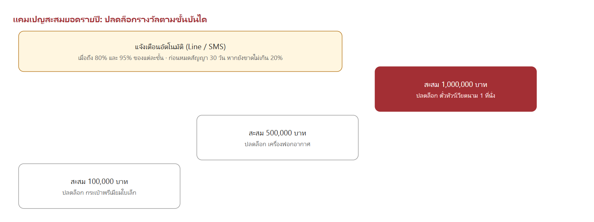

*รูป 5-3 ตัวอย่างขั้นบันไดของแคมเปญสะสมยอดรายปี*

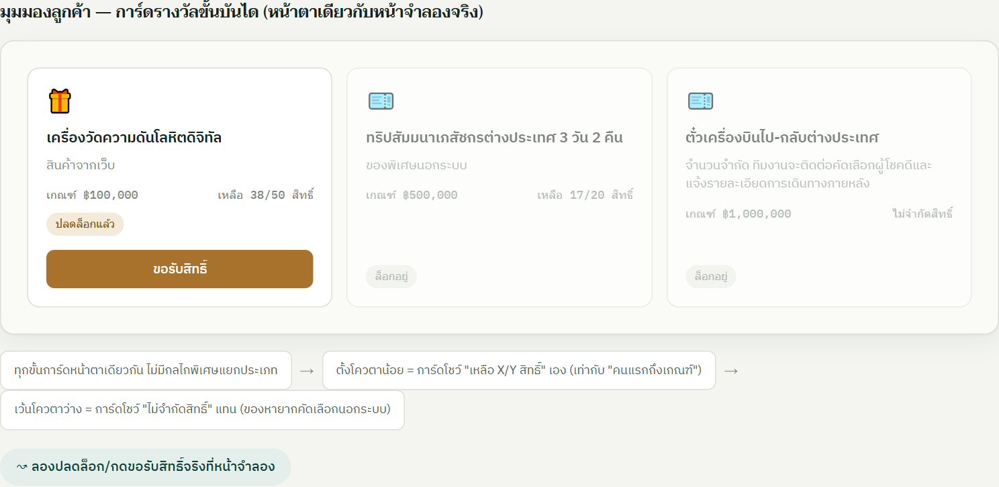

*รูป 5-4 ตัวอย่างหน้าจอ: การ์ดแต่ละขั้นแสดงเกณฑ์ สิทธิ์คงเหลือ และสถานะปลดล็อก ทุกขั้นใช้สิทธิ์ได้จนกว่าแคมเปญจะสิ้นสุด*

- รางวัลแต่ละขั้นแสดงจำนวนสิทธิ์คงเหลือ หรือแสดงว่าไม่จำกัดสิทธิ์สำหรับรางวัลที่คัดเลือกนอกระบบ
- เมื่อถึงยอดของขั้นนั้น ลูกค้ากดขอรับสิทธิ์ได้ทันที
- ไม่มีกำหนดวันหมดสิทธิ์การรับรางวัล ใช้สิทธิ์ได้จนกว่าแคมเปญจะสิ้นสุด

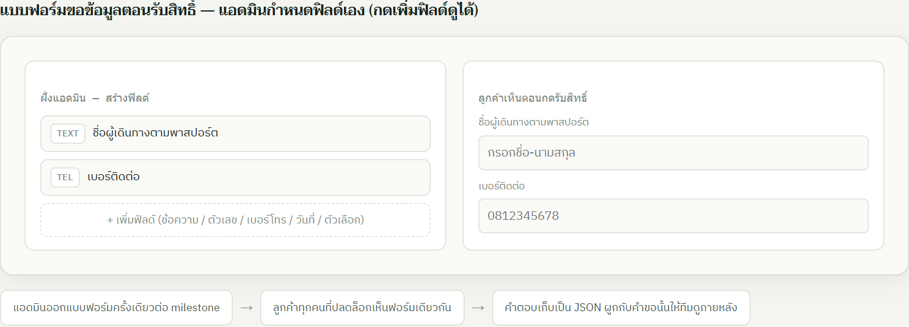

*รูป 5-5 แอดมินออกแบบฟอร์มขอข้อมูลตอนรับสิทธิ์ได้เอง เช่น ชื่อผู้เดินทางตามพาสปอร์ตและเบอร์ติดต่อ ลูกค้าทุกคนที่ปลดล็อกเห็นฟอร์มเดียวกัน*

### 5.5 การตั้งค่าของแอดมิน

| หัวข้อ | รายละเอียด |
|---|---|
| พอยท์ราย SKU | ตั้งพอยท์ต่อหน่วยของสินค้าแต่ละรายการเอง ปิดเป็น 0 พอยท์ได้ |
| ตัวคูณแคมเปญ | ตั้งตัวคูณพอยท์พิเศษสำหรับช่วงแคมเปญ |
| รายการแลกของรางวัล | เพิ่ม ลบ หรือแก้ไขของรางวัล และกำหนดจำนวนพอยท์ที่ใช้แลกแต่ละรายการ |
| แคมเปญตามช่วงเวลา | ผูก SKU ที่เข้าร่วม ตั้งช่วงเวลา และโควตารวม / โควตาต่อร้านค้า (รายละเอียดหัวข้อ 5.3) |
| แคมเปญสะสมยอดรายปี | ตั้งเกณฑ์ยอดสะสมแต่ละขั้น ของรางวัล (รวมของที่ไม่อยู่ใน POS) และออกแบบฟอร์มขอข้อมูลตอนรับสิทธิ์เอง ยอดสะสมรีเซ็ตเองทุกปีสัญญาใหม่ |
| วันหมดอายุพอยท์ | กำหนดวันหมดอายุของพอยท์แต่ละรอบหรือแคมเปญที่แจกได้เอง |

### 5.6 หน้าจอและ flow การใช้งาน

หน้าจอทั้งหมดของโมดูลนี้เรียงตามลำดับ flow การใช้งาน แต่ละภาพมีเลขกำกับบนจอ และคำอธิบายของแต่ละเลขอยู่ใต้ภาพ ตามด้วยกติกา ข้อยกเว้น และสถานะที่ต้องรองรับ พอยท์ที่แลกได้และยอดสะสมแคมเปญเป็นคนละบัญชี ทุกหน้าฝั่งลูกค้าแยกสองส่วนนี้ด้วยการ์ดคนละแบบ

#### โมดูลพอยท์

#### ภาพรวม · ภาพรวม Flow พอยท์

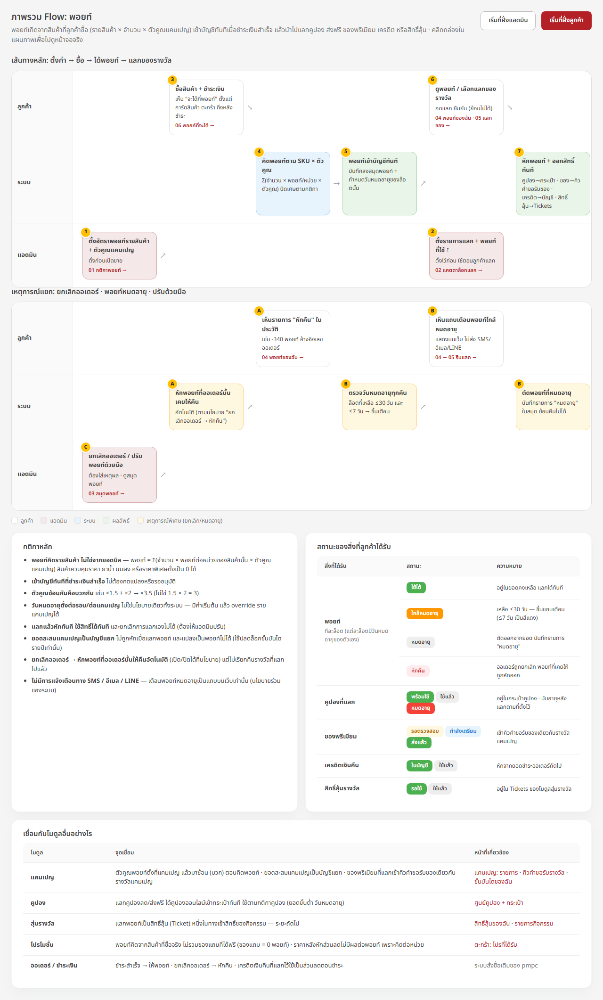

**คำอธิบายแต่ละส่วนในหน้าจอ**

1. ตั้งก่อนขาย: อัตราพอยท์รายสินค้า (รวมตั้งตามแบรนด์/หมวด) + ตัวคูณแคมเปญ + นโยบายหมดอายุ — สินค้าที่ยังไม่ตั้งใช้ "ค่าเริ่มต้นเมื่อสินค้าไม่ได้ตั้งไว้"
2. ตั้งรายการแลก: ประเภท พอยท์ที่ใช้ โควตารวม/ต่อคน สถานะ — ปิดชั่วคราวได้โดยไม่กระทบสิทธิ์ที่ลูกค้าแลกไปแล้ว
3. ลูกค้าเห็นพอยท์ก่อนจ่าย: การ์ดสินค้า → ตะกร้า (รายการละเอียด) → หน้าผลลัพธ์หลังชำระ เพื่อให้เห็นว่าซื้ออะไรได้พอยท์เท่าไร
4. คิดที่เซิร์ฟเวอร์: ตัวเลขบนหน้าจอเป็นประมาณการ ยอดจริงคำนวณที่ระบบตอนชำระสำเร็จ (ใช้อัตราและตัวคูณ ณ เวลาที่ชำระ)
5. เข้าทันที: ไม่มีขั้นตอนกดรับ/แปลง — แต่ละออเดอร์สร้างล็อตใหม่ 1 ล็อต (ฐาน + ส่วนเพิ่มจากตัวคูณ) พร้อมวันหมดอายุ
6. แลกแล้วย้อนไม่ได้เอง: ต้องผ่านหน้าต่างยืนยันที่แสดงยอดคงเหลือหลังแลก — ถ้าแลกผิด ต้องติดต่อแอดมินเพื่อปรับพอยท์
7. ออกสิทธิ์ทันที: คูปอง→กระเป๋าคูปอง · ของพรีเมียม→คิวคำขอรับของ (ลูกค้ากรอกที่อยู่/ฟอร์ม) · เครดิต→ยอดเครดิตในบัญชี · สิทธิ์ลุ้น→Tickets
A. ยกเลิกออเดอร์: หักคืนเท่ากับที่ออเดอร์นั้นให้ไว้ (ทั้งฐานและส่วนเพิ่ม) ตามนโยบายที่เปิดไว้ ถ้าพอยท์ถูกแลกไปแล้วจะหักได้เท่าที่เหลือในบัญชี (ดูข้อที่ต้องตัดสินใจ)
B. หมดอายุ: ระบบตรวจทุกคืน ขึ้นแถบเตือนที่ 30 และ 7 วันก่อน แล้วตัดล็อตที่หมดอายุ — ไม่มีการส่ง SMS/อีเมล/LINE
C. ปรับด้วยมือ: ทำได้เฉพาะแอดมินที่มีสิทธิ์ ต้องใส่เหตุผล เกินวงเงินต้องให้ผู้จัดการอนุมัติ ทุกรายการมี audit "ใครทำ เมื่อไหร่"

**กติกา / ข้อยกเว้น / สถานะ**

- ลำดับหักตอนแลก: หักล็อตที่ใกล้หมดอายุก่อน (เพื่อไม่ให้ลูกค้าเสียพอยท์โดยไม่จำเป็น)
- ของแถมจากโปรโมชั่นและสินค้าราคา 0 ไม่ให้พอยท์; สินค้า 0 พอยท์ยังนับเข้ายอดสะสมแคมเปญได้ตามกติกาแคมเปญ (แยกบัญชี)
- คืนสินค้า/ยกเลิกหลังจากลูกค้าใช้สิทธิ์ที่แลกไปแล้ว: ไม่เรียกคืนสิทธิ์ที่ใช้แล้ว (นโยบายร่วม §1.6) — หักได้เท่าที่เหลือในบัญชี

**ข้อที่ต้องตัดสินใจกับลูกค้า**

- ถ้าลูกค้าแลกพอยท์ไปหมดแล้วค่อยยกเลิกออเดอร์: ให้ยอดติดลบได้ หรือหักได้แค่เท่าที่มี (ค่าเริ่มต้นในมอคอัพ: หักได้เท่าที่มี ไม่ติดลบ)
- ใช้อัตราตามยอดบิล (ทุก ฿100 ได้ X พอยท์) แทนอัตรารายสินค้าได้ไหม — ต้นแบบสถิตเดิมใช้แบบตามยอดบิล แต่ spec ที่อนุมัติคิดรายสินค้า

#### แอดมิน · กติกาพอยท์ + อัตรารายสินค้า

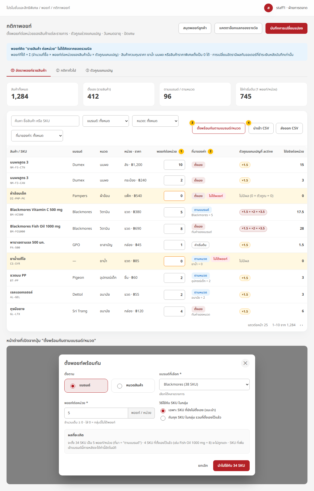

**คำอธิบายแต่ละส่วนในหน้าจอ**

1. พอยท์ต่อหน่วย (แก้ในตารางได้ตรง ๆ): จำนวนเต็ม ≥ 0 · ใส่ 0 = สินค้านี้ไม่ได้พอยท์ (แถวขึ้นสีเหลืองและมีป้าย "ไม่ได้พอยท์") · เปลี่ยนแล้วแถวขึ้นสถานะ "ยังไม่บันทึก" จนกด "บันทึกการเปลี่ยนแปลง"
2. ที่มาของค่า: ตั้งเอง (รายสินค้า) > ตามแบรนด์ > ตามหมวด > ค่าเริ่มต้น — ค่าที่เฉพาะเจาะจงกว่าชนะ · กดชิปเพื่อล้างค่าที่ตั้งเอง ให้กลับไปใช้ค่าของแบรนด์/หมวด/ค่าเริ่มต้น
3. ตั้งพร้อมกันตามแบรนด์/หมวด: เลือกกลุ่ม + ค่า + วิธีใช้ แล้วระบบบอกจำนวน SKU ที่จะถูกเปลี่ยนก่อนกดนำไปใช้ · ค่าเริ่มต้นแนะนำให้ "ไม่ทับที่ตั้งเอง"
4. นำเข้า/ส่งออก CSV: คอลัมน์ sku, points_per_unit · นำเข้าแล้วแสดงสรุป "สำเร็จ X / ข้าม Y (SKU ไม่พบ, ค่าไม่ใช่จำนวนเต็ม)" ก่อนยืนยันจริง
5. ค่าเริ่มต้นเมื่อสินค้าไม่ได้ตั้งไว้: กันสินค้าใหม่ที่ยังไม่มีใครตั้งค่าให้ได้พอยท์ผิดโดยไม่รู้ตัว — มอคอัพตั้ง 1 พอยท์/หน่วย (ดูข้อที่ต้องตัดสินใจ)
6. ปัดเศษ: ตัวคูณ ×1.5 ทำให้เกิดทศนิยมได้ ระบบปัดที่ระดับบรรทัดสินค้า หลังคูณตัวคูณ ผลรวมที่ลูกค้าเห็นจึงเท่ากับยอดที่ได้จริง
7. วันหมดอายุตั้งต่อรอบ/แคมเปญ: มีนโยบายเริ่มต้นไว้ 1 ค่า แต่แต่ละแคมเปญที่แจกพอยท์ override ได้ที่หน้าแคมเปญ — ตารางนี้แสดงผลที่ใช้จริงเพื่อให้ตรวจได้ที่เดียว
8. ยกเลิกออเดอร์ → หักคืน: เปิด/ปิดได้ · การหักคืนบันทึกเป็นรายการ "หักคืน" อ้างเลขออเดอร์ในสมุดพอยท์ (ดูหน้า 03)
9. ตัวคูณแคมเปญ (อ่านอย่างเดียว): ตั้งค่าที่เดียวคือในโมดูลแคมเปญ หน้านี้เป็นมุมมองสรุปว่าตอนนี้ตัวคูณไหน active และซ้อนกันแล้วได้เท่าไร

**กติกา / ข้อยกเว้น / สถานะ**

- อัตรา/ตัวคูณที่เปลี่ยน มีผลกับออเดอร์ที่ ชำระเงินสำเร็จหลังบันทึก เท่านั้น — พอยท์ที่ให้ไปแล้วไม่ถูกคำนวณย้อนหลัง
- ตัวคูณของแคมเปญคิดเฉพาะ SKU ที่แคมเปญนั้นครอบคลุม; ถ้าสินค้าได้ 0 พอยท์ ตัวคูณไม่มีผล (0 × n = 0)
- ของแถมจากโปรโมชั่นไม่ให้พอยท์ (ไม่ได้ซื้อ) · สินค้าที่เกิดจากการแลกพอยท์ก็ไม่ให้พอยท์
- ช่องพอยท์ต่อหน่วยรับเฉพาะจำนวนเต็ม; ถ้าแก้ค่าที่มาจากแบรนด์/หมวดในตาราง ที่มาจะเปลี่ยนเป็น "ตั้งเอง"
- ผู้ที่แก้ได้: ฝ่ายการตลาดที่มีสิทธิ์ "จัดการพอยท์" · ทุกการแก้อัตราบันทึก audit (ค่าเดิม → ค่าใหม่, ใคร, เมื่อไหร่)

**ข้อที่ต้องตัดสินใจกับลูกค้า**

- ใช้อัตราตามยอดบิลแทนได้ไหม (เช่น ทุก ฿100 ได้ 10 พอยท์ แบบต้นแบบสถิต admin.html เดิม) — spec ที่อนุมัติคิดรายสินค้า มอคอัพจึงยึดรายสินค้าเป็นหลัก และมีค่าเริ่มต้นไว้รองรับสินค้าที่ไม่ได้ตั้ง
- ลำดับความสำคัญ แบรนด์ vs หมวด เมื่อขัดกัน (มอคอัพ: แบรนด์ชนะ) และค่าเริ่มต้นสำหรับสินค้าที่ไม่ได้ตั้ง (มอคอัพ: 1 พอยท์/หน่วย หรือจะให้เป็น 0 ก็ได้)
- วันหมดอายุที่ override ต่อแคมเปญ ใช้กับ "เฉพาะพอยท์ส่วนเพิ่มจากตัวคูณ" (มอคอัพ) หรือกับพอยท์ทั้งออเดอร์ในช่วงแคมเปญ
- ปัดเศษทิ้ง/ใกล้เคียง/ขึ้น และปัดรายบรรทัดหรือทั้งออเดอร์ (มอคอัพ: ปัดทิ้ง รายบรรทัด)

#### แอดมิน · แคตตาล็อกแลกของรางวัล

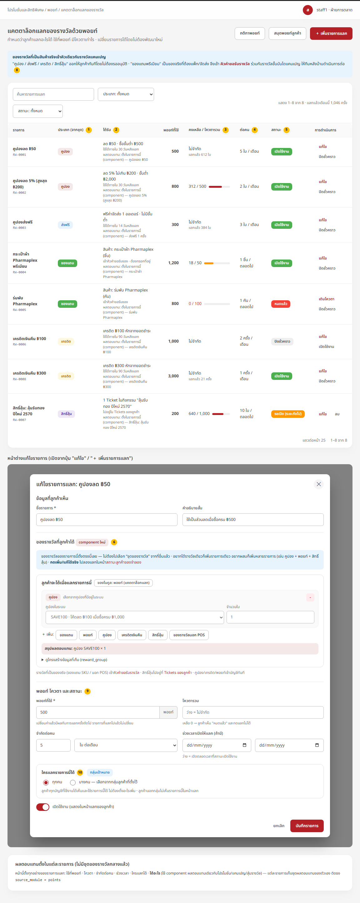

**คำอธิบายแต่ละส่วนในหน้าจอ**

1. ประเภท: คูปอง / ส่งฟรี / ของแถม / เครดิต / สิทธิ์ลุ้น — ประเภทกำหนดว่าออกอะไรให้ลูกค้าและไปอยู่ที่ไหนหลังแลก (ตารางสรุปท้ายหน้า)
2. ได้รับ: สรุปสั้นของสิ่งที่ลูกค้าจะได้ (สร้างอัตโนมัติจากฟิลด์ในรายการ) เพื่อให้แอดมินเห็นผลโดยไม่ต้องเปิดแก้ไข
3. คงเหลือ / โควตารวม: ลดลงทันทีที่มีคนแลก · เหลือ 0 → สถานะอัตโนมัติเป็น "หมดแล้ว" และลูกค้ากดไม่ได้ · เติมโควตาได้ภายหลัง · ของแถมใช้สต็อกที่จัดสรรเป็นโควตา
4. ต่อคน: จำกัดจำนวนครั้งต่อลูกค้า 1 บัญชี รายเดือน/รายปี/ตลอดไป — ว่าง = ไม่จำกัด · ตรวจที่ฝั่งเซิร์ฟเวอร์ตอนกดแลก
5. สถานะ: เปิดใช้งาน / ปิดชั่วคราว (ซ่อนจากลูกค้า) / หมดแล้ว / รอเปิด (ตามช่วงเวลา) · ปิดชั่วคราวไม่กระทบสิทธิ์ที่ลูกค้าแลกไปแล้ว
6. เปลี่ยนประเภทของรายการที่มีคนแลกแล้วไม่ได้: ต้องสร้างรายการใหม่ (กันสิทธิ์เก่าคลาดเคลื่อน) — ช่องประเภทจะเป็นอ่านอย่างเดียว
7. ฟิลด์เปลี่ยนตามประเภท: คูปอง = ชนิด/มูลค่า/ขั้นต่ำ/อายุหลังแลก · ของแถม = สินค้า + สต็อก · เครดิต = บาท · สิทธิ์ลุ้น = กิจกรรม (ลิงก์ไปโมดูลสุ่มรางวัล)
8. ของจริงเข้าคิวเดียวกับแคมเปญ: ลูกค้ากรอกที่อยู่แล้วทีมหลังบ้านจัดการต่อในคิวคำขอรับรางวัล — ไม่ต้องมีคิวแยกสำหรับพอยท์
9. พอยท์ที่ใช้: เป็นจำนวนเต็ม > 0 · แก้ได้ตลอด มีผลกับการแลกครั้งถัดไป · ระบบเตือนถ้าตั้งต่ำกว่ามูลค่าของรางวัลจริงมากผิดปกติ

**กติกา / ข้อยกเว้น / สถานะ**

- ลบรายการที่เคยมีคนแลกแล้วไม่ได้ — ทำได้เพียง "ปิดชั่วคราว" (เก็บประวัติไว้ตรวจย้อนหลัง) ; รายการที่ยังไม่เคยมีคนแลกลบได้
- คูปองที่ได้จากการแลกเป็นคูปองออนไลน์ธรรมดาใบหนึ่ง (ผูกบัญชีลูกค้า ใช้ได้ครั้งเดียว) และใช้ตามกติกาคูปองทุกประการ
- แลกสิทธิ์ลุ้นได้เฉพาะเมื่อกิจกรรมปลายทางเปิดอยู่ — ถ้ากิจกรรมปิด รายการจะแสดง "รอเปิด" และกดไม่ได้
- ลูกค้าที่แลกเกินโควตาพร้อมกันหลายคน: ระบบตัดตามลำดับเวลาที่ชำระ ผู้ที่ช้ากว่าเห็นข้อความ "หมดแล้ว" และพอยท์ไม่ถูกหัก

**ข้อที่ต้องตัดสินใจกับลูกค้า**

- เครดิตเงินคืนใช้ร่วมกับคูปอง/โปรโมชั่นในบิลเดียวกันได้หรือไม่ และมีอายุหรือไม่ (มอคอัพ: 90 วัน)
- สิทธิ์ลุ้นที่แลกด้วยพอยท์นับเข้ากองทุนงบสุ่มรางวัลอย่างไร (กิจกรรมสุ่มรางวัลเป็นระยะถัดไป)
- ของพรีเมียมที่ส่งไม่ได้/สต็อกจริงหมด หลังลูกค้าแลกแล้ว: คืนพอยท์ให้อัตโนมัติ หรือให้แอดมินตัดสินใจรายกรณี

#### แอดมิน · สมุดพอยท์ลูกค้า + ปรับพอยท์

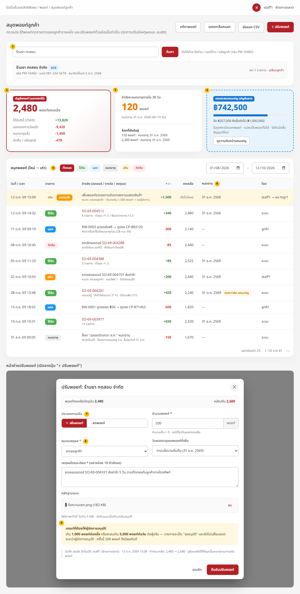

**คำอธิบายแต่ละส่วนในหน้าจอ**

1. ค้นหาลูกค้า: ชื่อร้าน / เบอร์โทร / รหัสลูกค้า (พิมพ์บางส่วนได้) — พบหลายรายให้เลือกจากรายการ; ไม่พบแสดง "ไม่พบลูกค้า ตรวจสอบรหัสอีกครั้ง"
2. พอยท์คงเหลือ: ยอดรวมทุกล็อตที่ยังไม่หมดอายุ — ตัวเลขนี้คือที่ลูกค้าเห็นและแลกได้ · แสดงสรุปได้รับ/แลก/หมดอายุ/หักคืนของปีปฏิทินปัจจุบันเพื่อใช้กระทบยอด
3. กำลังจะหมดอายุ 30 วัน: รวมล็อตที่หมดอายุภายใน 30 วัน พร้อมแจกแจงล็อต — ใช้ตอบลูกค้าที่โทรถามว่า "ทำไมพอยท์หาย"
4. ยอดสะสมแคมเปญ (บัญชีแยก): แสดงให้เห็นแต่ปรับจากหน้านี้ไม่ได้ — ไม่ถูกหักเมื่อแลกพอยท์ และไม่ใช่ส่วนหนึ่งของพอยท์คงเหลือ (สีและกรอบต่างกันตั้งใจ)
5. ประเภทรายการ: ได้รับ / แลก / หมดอายุ / ปรับ / หักคืน — กรองตามประเภทและช่วงวันที่ได้ · รายการอ้างอิงเลขออเดอร์หรือรหัสรางวัลคลิกเข้าดูได้
6. หมดอายุ (ต่อล็อต): แต่ละรายการ "ได้รับ" ผูกวันหมดอายุของตัวเอง (ตามรอบ/แคมเปญ) · รายการ override จากแคมเปญมีป้ายกำกับ
7. ปรับพอยท์ เพิ่ม/ลด: ลดได้ไม่เกินยอดคงเหลือ · แสดง "หลังปรับ" สดขณะกรอก เพื่อกันกรอกผิดจำนวน
8. เหตุผลบังคับ: เลือกหมวด + ใส่รายละเอียดอย่างน้อย 10 ตัวอักษร ปุ่มยืนยันกดไม่ได้จนกว่าจะครบ · หลักฐานแนบเป็นภาพ/PDF
9. อนุมัติและ audit: เกินวงเงินต้องให้ผู้จัดการอนุมัติ (แถวสีเหลืองในสมุด) · ทุกการปรับบันทึกผู้ทำ เวลา ค่าก่อน/หลัง เหตุผล หลักฐาน และแก้ไข/ลบย้อนหลังไม่ได้

**กติกา / ข้อยกเว้น / สถานะ**

- สมุดพอยท์เป็นแบบ append-only — แก้ผิดต้องปรับกลับด้วยรายการใหม่ ไม่แก้/ลบรายการเดิม
- รายการ "หักคืน" จากการยกเลิกออเดอร์ หักได้เท่าที่คงเหลือ ถ้าลูกค้าแลกไปแล้ว ส่วนที่ขาดไม่ตามเรียกคืน (ไม่ทำให้ติดลบ)
- ผู้ปรับกับผู้อนุมัติต้องเป็นคนละคน · ผู้จัดการอนุมัติ/ปฏิเสธพร้อมหมายเหตุ ปฏิเสธแล้วไม่เปลี่ยนยอด
- การแลกที่ลูกค้ากดผิด: แอดมินแก้ได้ด้วยการปรับ "แลกผิดพลาด" (+) และต้องยกเลิกสิทธิ์ที่ออกไปเองด้วย (เช่น คูปองในกระเป๋า)
- สิทธิ์เข้าหน้านี้: ฝ่ายการตลาด (ดู) · ผู้จัดการ (ดู + อนุมัติ) · ผู้ปรับต้องมีสิทธิ์ "ปรับพอยท์"

**ข้อที่ต้องตัดสินใจกับลูกค้า**

- วงเงินที่ต้องอนุมัติ: ต่อครั้ง 1,000 พอยท์ / ต่อวัน 5,000 พอยท์ (ค่าสมมุติ) — หรือกำหนดเป็นมูลค่า ฿ แทน
- แอดมินปรับ "ยอดสะสมแคมเปญ" ได้หรือไม่ (มอคอัพ: ปรับไม่ได้จากหน้านี้ ต้องทำที่ความคืบหน้าแคมเปญ)

#### ลูกค้า · พอยท์ของฉัน + ประวัติ

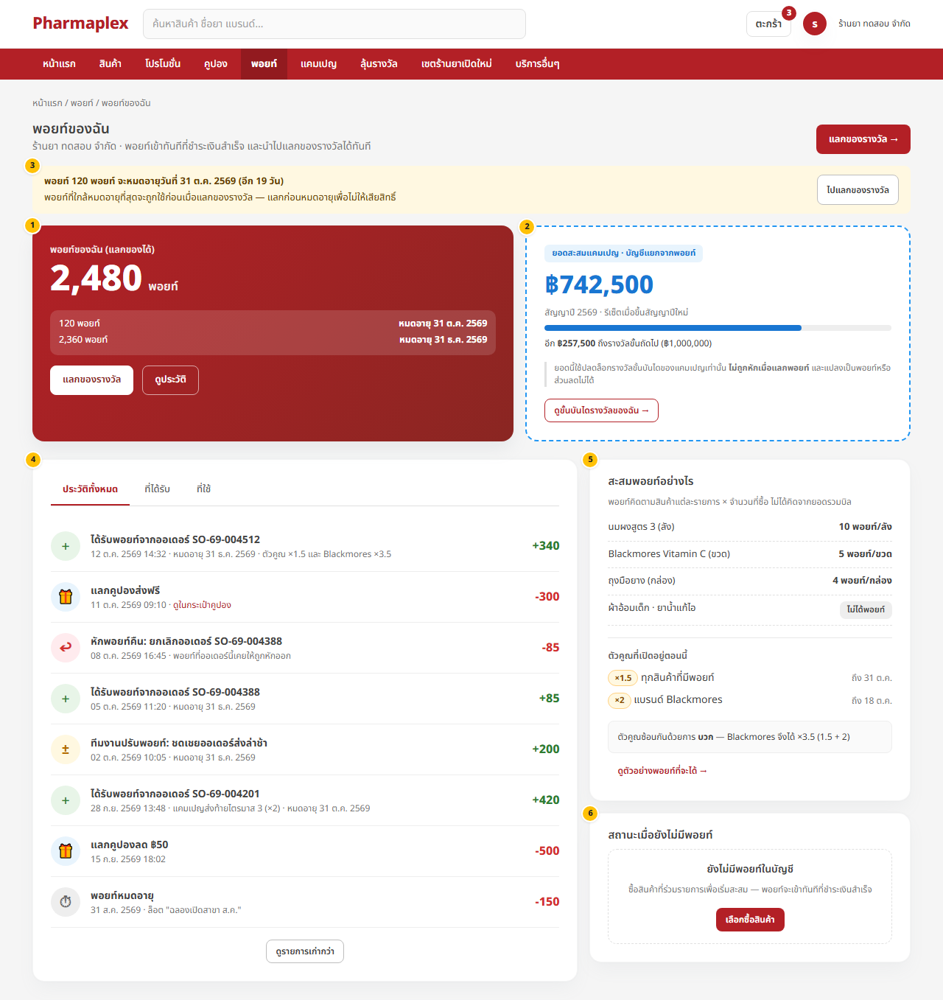

**คำอธิบายแต่ละส่วนในหน้าจอ**

1. การ์ดพอยท์: ตัวเลขใหญ่ = พอยท์ที่แลกได้ตอนนี้ (รวมทุกล็อตที่ยังไม่หมดอายุ) · แจกแจงล็อตตามวันหมดอายุ เรียงใกล้หมดก่อน · ไม่แสดงมูลค่าเป็นบาท
2. ยอดสะสมแคมเปญ (บัญชีแยก): เป็นการ์ดคนละสี กรอบประ มีป้ายกำกับชัดเจน และคำอธิบายว่าไม่ถูกหักเมื่อแลกพอยท์ — ป้องกันลูกค้าสับสนว่าแลกของแล้วยอดแคมเปญจะลด
3. แถบเตือนใกล้หมดอายุ: ขึ้นเมื่อมีล็อตหมดอายุภายใน 30 วัน (≤7 วันเปลี่ยนเป็นสีแดง) · แสดงบนเว็บเท่านั้น ไม่ส่ง SMS/อีเมล/LINE · ปิดแถบไม่ได้จนกว่าจะแลกหรือพอยท์หมด
4. แท็บ ประวัติ / ที่ได้รับ / ที่ใช้: "ประวัติ" รวมทุกอย่างเรียงใหม่ → เก่า · "ที่ได้รับ" เฉพาะรายการ + · "ที่ใช้" เฉพาะการแลก พร้อมลิงก์ไปดูสิทธิ์ที่ได้ (คูปอง/คำขอรับของ)
5. วิธีสะสม: อัตราตัวอย่างดึงจากสินค้าขายดี + ตัวคูณที่ active ตอนนี้พร้อมวันสิ้นสุด และบอกชัดว่าซ้อนกันด้วยการบวก — ลิงก์ไปหน้าตัวอย่างพอยท์ที่จะได้
6. สถานะว่าง: ลูกค้าใหม่หรือพอยท์ 0 เห็นการ์ดนี้แทนรายการ · ปุ่มแลกของรางวัลยังกดเข้าได้แต่ทุกรายการเป็น "พอยท์ไม่พอ"

**กติกา / ข้อยกเว้น / สถานะ**

- รายการ "หักคืน" แสดงเลขออเดอร์ที่ถูกยกเลิก · ถ้ายอดไม่พอหักจะหักเท่าที่มี ไม่ทำให้พอยท์ติดลบ
- รายการ "ทีมงานปรับพอยท์" แสดงเหตุผลสั้น ๆ ให้ลูกค้าเห็น (รายละเอียด/หลักฐานเห็นเฉพาะแอดมิน)
- แลกของ: หักจากล็อตที่ใกล้หมดอายุก่อน · พอยท์ที่หมดอายุแล้วขอคืนไม่ได้
- ลูกค้าหลายผู้ใช้ในร้านเดียวกัน (บัญชีร้าน) ใช้ยอดพอยท์ร่วมกันทั้งร้าน

**ข้อที่ต้องตัดสินใจกับลูกค้า**

- พอยท์เป็นของ "บัญชีร้าน" ทั้งร้านหรือรายผู้ใช้ (มอคอัพ: ทั้งร้าน)
- จะแสดงเตือนหมดอายุที่หน้าอื่น (หน้าแรก/ตะกร้า) ด้วยหรือเฉพาะหน้านี้และหน้าแลกของรางวัล

#### ลูกค้า · แลกของรางวัลด้วยพอยท์

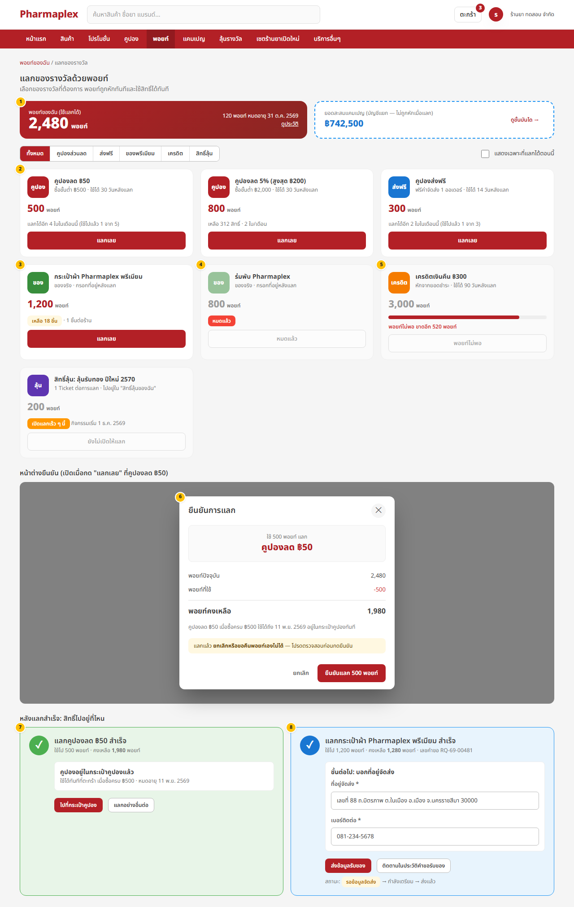

**คำอธิบายแต่ละส่วนในหน้าจอ**

1. แสดงยอดสองบัญชีแยกกัน: พอยท์ (แดง ใช้จ่ายได้) กับยอดสะสมแคมเปญ (กรอบประ น้ำเงิน ไม่ถูกหัก) — เพื่อไม่ให้ลูกค้าคิดว่าแลกของแล้วยอดแคมเปญลด
2. การ์ดที่แลกได้: ชื่อ + รายละเอียดสั้น (ขั้นต่ำ/อายุ) + พอยท์ที่ใช้ + สิทธิ์ที่เหลือของตัวเองในเดือน/ปี (ตามที่ตั้ง "ต่อคน") · ปุ่ม "แลกเลย" เปิดหน้าต่างยืนยัน ไม่แลกทันที
3. ใกล้หมดสต็อก: เหลือน้อยกว่า 20% ของโควตาแสดงป้ายเหลือกี่ชิ้น เพื่อกระตุ้นการตัดสินใจ — ไม่แสดงจำนวนเมื่อไม่จำกัด
4. หมดแล้ว: โควตารวมเป็น 0 — การ์ดจางลง ปุ่มกดไม่ได้ · ไม่ซ่อนเพื่อให้ลูกค้ารู้ว่ารายการนี้มีอยู่ (แอดมินเติมโควตาแล้วกลับมาแลกได้)
5. พอยท์ไม่พอ: บอกส่วนที่ขาด (3,000 − 2,480 = 520) และแถบความคืบหน้า · ปุ่มถูกปิด ไม่ใช่ซ่อน
6. ยืนยันก่อนแลก: แสดงพอยท์ก่อน/หลัง และข้อความเตือนว่ายกเลิกไม่ได้ · ปุ่มยืนยันมีจำนวนพอยท์กำกับ · ถ้าพอยท์เปลี่ยนระหว่างนั้น (เช่น หมดอายุ) ระบบตรวจซ้ำที่เซิร์ฟเวอร์
7. คูปอง/ส่งฟรี/เครดิต/สิทธิ์ลุ้น ได้ทันที: แสดงว่าสิทธิ์ไปอยู่ที่ไหน (กระเป๋าคูปอง / ยอดเครดิต / Tickets) พร้อมปุ่มพาไปใช้
8. ของพรีเมียม: สร้างคำขอเข้าคิวเดียวกับรางวัลแคมเปญ ลูกค้ากรอกที่อยู่/เบอร์ทันทีหรือกลับมากรอกทีหลังได้ — ติดตามสถานะในประวัติคำขอรับของ

**กติกา / ข้อยกเว้น / สถานะ**

- กดแลกซ้ำ/สองแท็บพร้อมกัน: ระบบหักและออกสิทธิ์ครั้งเดียว (idempotent) · แลกไม่สำเร็จ (โควตาหมดพอดี) ไม่หักพอยท์และแจ้ง "รายการนี้หมดแล้ว"
- คูปองลดที่แลกแล้วอายุนับจากวันที่แลก · เครดิตหักจากยอดชำระออเดอร์ถัดไปโดยอัตโนมัติ (ผู้ใช้เลือกไม่ใช้ได้)
- ถ้าแอดมินปิดรายการหลังลูกค้าเปิดหน้านี้ไว้ กดแลกแล้วจะแจ้ง "รายการนี้ไม่เปิดให้แลกแล้ว" โดยไม่หักพอยท์
- ของพรีเมียมที่ยังไม่กรอกที่อยู่ภายใน 14 วัน: ระบบเตือนบนเว็บ ไม่ยกเลิกสิทธิ์เอง

**ข้อที่ต้องตัดสินใจกับลูกค้า**

- ให้แลกของพรีเมียมแล้ว "ขอคืนพอยท์" ได้หากยังไม่ได้เริ่มจัดเตรียม หรือไม่ให้คืนเลย (มอคอัพ: ไม่ให้คืนเอง ต้องผ่านแอดมิน)
- ลูกค้าบัญชีร้านที่มีหลายผู้ใช้: ใครแลกได้บ้าง (เจ้าของร้านเท่านั้น หรือทุกผู้ใช้)

#### ลูกค้า · พอยท์ที่จะได้ (สินค้า/ตะกร้า/หลังชำระ)


**คำอธิบายแต่ละส่วนในหน้าจอ**

1. ป้ายพอยท์บนการ์ดสินค้า: "ได้ N พอยท์/หน่วย" ตามหน่วยที่ขาย (ลัง/ขวด) + ป้ายตัวคูณแคมเปญพร้อมวันสิ้นสุด · บรรทัดล่างบอกยอดรวมตัวคูณต่อหน่วย — ตัวเลขที่ลูกค้าตัดสินใจจริง
2. ตัวคูณซ้อนกัน: แสดง "×1.5 + ×2 = ×3.5" ให้เห็นที่มา ไม่ใช่แค่ผลรวม · ป้ายบนรูปแสดงวันสิ้นสุดที่ใกล้ที่สุด (18 ต.ค.)
3. สินค้า 0 พอยท์: ป้ายเทา "ไม่ได้พอยท์" แทนที่จะซ่อน — ลูกค้าจะได้ไม่เข้าใจผิดว่าลืมให้พอยท์ · ไม่แสดงป้ายตัวคูณ
4. กล่องคำนวณหน้ารายละเอียด: เปลี่ยนตามจำนวนสด · แสดงสูตร พอยท์/หน่วย × จำนวน × ตัวคูณ · มีวันหมดอายุของพอยท์และข้อความว่าเป็นประมาณการ
5. สรุปในตะกร้า: ยอด "พอยท์ที่จะได้รับ" รวมอยู่ใกล้ยอดสุทธิ + ลิงก์ "รายการละเอียด ▾" ขยาย/ยุบได้ (ค่าเริ่มต้นยุบบนมือถือ)
6. รายการละเอียดรายบรรทัด: จำนวน × พอยท์/หน่วย × ตัวคูณ = พอยท์ · บรรทัด 0 พอยท์ใช้แถวสีเทา + เหตุผล (ไม่ได้พอยท์ / ของแถม) · ผลรวมต้องเท่ากับตัวเลขหัวตาราง
7. ยอดสะสมแคมเปญแยกชัดเจน: กรอบประสีน้ำเงิน คนละกล่องกับพอยท์ เพื่อไม่ให้ลูกค้ารวมสองบัญชีเป็นยอดเดียว
8. หลังชำระสำเร็จ: แสดง +พอยท์ ยอดก่อน/หลัง และวันหมดอายุ ทันทีในหน้าผลลัพธ์ · ปุ่มไปหน้าพอยท์ของฉัน และแลกของรางวัล
9. ออเดอร์ถูกยกเลิก: แสดง "หักพอยท์คืน −N" สีแดง ในหน้าสถานะออเดอร์และในประวัติพอยท์ · ตามนโยบายยกเลิกออเดอร์ที่แอดมินเปิดไว้

**กติกา / ข้อยกเว้น / สถานะ**

- ตัวเลขก่อนชำระเป็นประมาณการ — ยอดจริงคิดที่เซิร์ฟเวอร์ตอนชำระสำเร็จ โดยใช้อัตราและตัวคูณ ณ เวลานั้น (ถ้าตัวคูณหมดอายุระหว่างตะกร้า ยอดจะลดและแจ้งเตือนที่หน้าชำระเงิน)
- ปัดเศษทุกบรรทัดตามกติกาแอดมิน (ปัดทิ้ง) ก่อนรวม — ทศนิยม เช่น 17.5 พอยท์/ขวด จึงแสดงเป็นจำนวนเต็มเมื่อคูณจำนวนแล้ว
- ของแถม/สินค้าที่ได้จากการแลกพอยท์ไม่ให้พอยท์ · ส่วนลดและคูปองไม่ลดพอยท์ เพราะคิดจากสินค้าต่อหน่วย (ดูข้อที่ต้องตัดสินใจ)
- ลูกค้าเห็นพอยท์ที่จะได้เฉพาะสินค้าที่ตัวเองสั่งได้ · แสดงค่าเดียวกันทั้งการ์ด หน้ารายละเอียด ตะกร้า และหน้าผลลัพธ์

**ข้อที่ต้องตัดสินใจกับลูกค้า**

- พอยท์ต้องลดตามส่วนลด/คูปองที่ใช้ในบิลหรือไม่ (มอคอัพ: ไม่ลด เพราะคิดต่อหน่วยตามสเปก)
- การคืนสินค้าบางรายการ (ไม่ใช่ยกเลิกทั้งออเดอร์): หักพอยท์ตามสัดส่วนสินค้าที่คืนหรือไม่หัก (สเปกกล่าวถึงเฉพาะการยกเลิกออเดอร์)

#### โมดูลแคมเปญ

#### ภาพรวม · ภาพรวม Flow แคมเปญ


**คำอธิบายแต่ละส่วนในหน้าจอ**

1. สร้างแคมเปญ — เมนู "สร้างแคมเปญ" ในรายการเลือกประเภทก่อน (สะสมยอดรายปี / ช่วงเวลา+โควตา) เพราะฟอร์มต่างกันโดยสิ้นเชิง เปลี่ยนประเภทภายหลังไม่ได้
2. กำหนดขั้น + ฟอร์ม — เรียงขั้นตามยอดเกณฑ์อัตโนมัติ · แต่ละขั้นมีฟอร์มขอข้อมูลของตัวเองได้ 1 ฟอร์ม
3. เปิดแคมเปญ — บันทึกเป็น "ร่าง" ได้ ยังไม่แสดงให้ลูกค้า · เปิดแล้วแก้ยอดเกณฑ์ของขั้นที่มีคนถึงแล้วไม่ได้ (ดูกติกา)
4. ลูกค้าซื้อ — ไม่ต้องทำอะไรเพิ่ม ระบบนับให้เองเฉพาะสินค้าในขอบเขตที่แอดมินตั้ง
5. บวกยอดสะสม — บวกเมื่อสถานะการชำระ = สำเร็จ ไม่รวมค่าส่ง · ยกเลิก/คืนสินค้า = หักคืนและบันทึกประวัติ
6. แจ้งเตือน — ถึง 80%, 95% ของขั้นถัดไป และก่อนสัญญาหมด N วัน ผ่าน LINE/อีเมล/ในเว็บ ส่งครั้งเดียวต่อเหตุการณ์ต่อขั้น
7. ถึงเกณฑ์ — การ์ดขั้นเปลี่ยนเป็น "ปลดล็อกแล้ว" ทันทีหลังชำระเงิน (ไม่ต้องรอรอบคำนวณ)
8. ขอรับสิทธิ์ — เปิดฟอร์มของขั้นนั้น ตรวจ required/รูปแบบก่อนส่ง มีคำเตือนส่งแล้วแก้ไม่ได้
9. ตัดสิทธิ์ — ตัดสิทธิ์คงเหลือทันทีที่ส่งสำเร็จ (กันคนแย่งกัน) และจับ snapshot ยอดสะสม ณ เวลานั้นไว้ให้แอดมินตรวจ
10. ตรวจ/อนุมัติ — ปฏิเสธต้องกรอกเหตุผล แล้วสิทธิ์คืนกลับ ลูกค้าส่งใหม่ได้
11. ส่งมอบ — สินค้า POS ลิงก์ไปรายการจัดส่ง · ของนอก POS ใส่เลขอ้างอิง/แนบใบส่งมอบ (เช่น PNR ตั๋ว)
12. ติดตามสถานะ — ทุกการเปลี่ยนสถานะแจ้งลูกค้าในเว็บ/LINE
13. ได้รับรางวัล — ปิดงานแล้วการ์ดขั้นนั้นเป็น "ได้รับแล้ว" และขอซ้ำไม่ได้
A. ตั้งค่าแคมเปญโควตา — ผูก SKU, ราคา/ตัวคูณพอยท์, โควตารวม และโควตาต่อร้าน
B. เปิดเอง — แคมเปญเริ่ม/จบตามวันเวลาที่ตั้ง ไม่ต้องกดเปิดปิดเอง
C. ใส่ตะกร้า — ไม่เกินโควตาคงเหลือรวมและโควตาต่อร้าน ถ้าเกินแจ้งจำนวนที่ซื้อได้
D. พักโควตา — เริ่มเมื่อลูกค้ากด "ไปชำระเงิน"; ลูกค้าอื่นเห็นโควตา "เหลือ" ลดลงทันที
E. ชำระเงิน — แสดงเวลานับถอยหลังเด่นชัดตลอดหน้าเช็คเอาต์
F. สำเร็จ — โควตาที่พักกลายเป็น "ขายแล้ว" ถาวร และพอยท์ถูกคูณตามตัวคูณของ SKU
G. หมดเวลา — โควตาคืนเข้าระบบ ตะกร้ายังอยู่ ราคาคำนวณใหม่ตามโควตาที่เหลือ

**กติกา / ข้อยกเว้น / สถานะ**

- ยกเลิกออเดอร์ที่เคยนับยอดแล้วทำให้ยอดต่ำกว่าเกณฑ์ที่ลูกค้ากดขอรับไปแล้ว → ระบบไม่ถอนสิทธิ์อัตโนมัติ แต่ขึ้นธงในคำขอให้แอดมินตัดสินใจ
- แคมเปญสิ้นสุด: ปุ่มขอรับสิทธิ์ถูกปิดทุกขั้น คำขอที่ค้างอยู่ยังดำเนินการต่อได้จนปิดงาน
- ลูกค้าที่ไม่มีสัญญาสะสมยอดรายปีไม่เห็นหน้าขั้นบันได (เห็นเฉพาะแคมเปญโควตา)

**ข้อที่ต้องตัดสินใจกับลูกค้า**

- ยอดสะสมนับจาก "ยอดสินค้าหลังหักส่วนลดและคูปอง" (ค่าตั้งต้นที่เลือก) หรือก่อนหักส่วนลด?
- ปีสัญญาของแต่ละร้านเริ่ม/จบพร้อมกันทั้งแคมเปญ (ปีปฏิทิน) หรือเริ่มตามวันที่เซ็นสัญญารายร้าน?
- ถ้ายกเลิก/คืนสินค้าหลังขอรับรางวัลไปแล้วจนยอดต่ำกว่าเกณฑ์ ต้องเรียกคืนรางวัลหรือไม่ (ค่าตั้งต้น: ไม่เรียกคืนอัตโนมัติ ให้แอดมินพิจารณา)

#### แอดมิน · รายการแคมเปญ


**คำอธิบายแต่ละส่วนในหน้าจอ**

1. เมนูสร้างแคมเปญ — เลือกประเภทก่อนเสมอ แล้วพาไปฟอร์มของประเภทนั้น (02 / 03) ประเภทผูกกับแคมเปญตลอดอายุ แก้ไขภายหลังไม่ได้ ต้องสร้างใหม่
2. การ์ดสถิติ — "คำขอรอตรวจ" ลิงก์ไปคิวคำขอที่กรองสถานะรอตรวจ · "ใกล้ถึงเกณฑ์" ลิงก์ไปหน้าความคืบหน้าที่กรอง ≥ 80% · ตัวเลขนับรวมทุกแคมเปญที่กำลังดำเนินการ
3. ตัวกรอง — แยกตามประเภทและสถานะ ค่าเริ่มต้นเรียงแคมเปญที่ "กำลังดำเนินการ" ขึ้นก่อน แล้วร่าง แล้วสิ้นสุด
4. คอลัมน์ความคืบหน้า — ต่างกันตามประเภท: แคมเปญโควตาแสดงขายแล้ว/โควตาและจำนวนที่พักอยู่ · แคมเปญสะสมยอดแสดงจำนวนร้านที่ถึงแต่ละขั้น (ขั้นที่มีคำขอรอตรวจเน้นสี)

**กติกา / ข้อยกเว้น / สถานะ**

- สถานะ: ร่าง (ลูกค้าไม่เห็น) → กำลังดำเนินการ (เปลี่ยนเองตามวันที่เริ่ม) → สิ้นสุด (เปลี่ยนเองเมื่อพ้นวันสิ้นสุด หรือกด "ปิดก่อนกำหนด")
- แคมเปญที่ สิ้นสุดแล้ว แก้ไขไม่ได้ เหลือเพียง "ดูผลสรุป" และ "ทำสำเนา" · แคมเปญที่กำลังดำเนินการแก้ได้เฉพาะบางช่อง (ดู 02/03)
- ลบได้เฉพาะ "ร่าง" ที่ยังไม่เคยเปิด · แคมเปญที่เคยมียอด/คำขอห้ามลบ
- แคมเปญร่างที่ไม่ผ่านการตรวจ (เช่น ยังไม่กำหนดกลุ่มลูกค้า) แสดงข้อความสีแดงใต้ความคืบหน้า และกด "เปิดใช้" ไม่ได้
- แคมเปญสะสมยอดรายปีเปิดซ้อนกันได้เฉพาะต่างปีสัญญา — ปีสัญญาเดียวกันสร้างซ้ำไม่ได้

**ข้อที่ต้องตัดสินใจกับลูกค้า**

- แคมเปญช่วงเวลา+โควตาหลายรายการที่ใช้ SKU เดียวกันและช่วงเวลาทับกัน — ให้ระบบห้ามบันทึก (ค่าตั้งต้น) หรืออนุญาตแล้วใช้ลำดับ priority?

#### แอดมิน · แคมเปญช่วงเวลา+โควตา


**คำอธิบายแต่ละส่วนในหน้าจอ**

1. ช่วงเวลา — เลือกวัน+เวลา (ไม่ใช่แค่วัน) เพราะสินค้าโควตามักเปิดตอนเช้า · แคมเปญที่เริ่มแล้วแก้วันเริ่มไม่ได้ · สถานะแสดงผลคำนวณจากเวลา ไม่ต้องกดเปิด/ปิด
2. ราคาแคมเปญ — ต่ำกว่าราคาปกติเสมอ (ถ้าสูงกว่า/เท่ากันขึ้น error ใต้ช่อง) · โชว์ % ส่วนลดคำนวณสดใต้ช่อง
3. ตัวคูณพอยท์ — คูณกับพอยท์ต่อหน่วยของสินค้านั้น เฉพาะการซื้อในแคมเปญนี้ · ถ้ามีหลายแคมเปญเปิดพร้อมกันตัวคูณบวกกัน (×1.5 + ×2 = ×3.5) ตามสเปกพอยท์
4. โควตาต่อ SKU — ไม่บังคับ ถ้ากรอกผลรวมต้องไม่เกินโควตารวม · เว้นว่าง = ใช้ร่วมกันในโควตารวม
5. โควตารวม — ทั้งระบบ นับ "ขายแล้ว + กำลังพัก" · ลดต่ำกว่าที่ใช้ไปแล้วไม่ได้ (error: "ต้องไม่ต่ำกว่า 3,760")
6. โควตาต่อร้านค้า — ต่อบัญชีลูกค้า รวมทุก SKU ในแคมเปญ · ตัวนับเห็นผลทันทีในหน้าสินค้า (ร้านคุณซื้อได้อีก X)
7. พักโควตา — เริ่มจับเวลาตอนลูกค้ากดไปชำระเงิน (ไม่ใช่ตอนใส่ตะกร้า) · แก้นาทีได้ 5–60 และมีผลกับการพักครั้งใหม่เท่านั้น
8. เมื่อโควตาหมด — 2 ทางเลือก (กลับราคาปกติ / ปิดสินค้าแคมเปญ) ค่าตั้งต้น "กลับราคาปกติ" เพื่อไม่เสียยอดขาย
9. มิเตอร์สด — แยก "ขายแล้ว" กับ "พักอยู่" เพื่อให้แอดมินเข้าใจว่าทำไมโควตา "เหลือ" ลดลงทั้งที่ยังไม่มีออเดอร์สำเร็จ
10. 3 จังหวะ — สรุปผลต่อระบบที่เกิดอัตโนมัติ ไม่ต้องมีคนกด

**กติกา / ข้อยกเว้น / สถานะ**

- ลูกค้าอยู่ในช่วงพักโควตา เมื่อชำระสำเร็จภายหลังแอดมินปิดแคมเปญก่อนกำหนด → ยังได้ราคาแคมเปญตามที่พักไว้
- ตะกร้าที่ใส่สินค้าเกินสิทธิ์ร้านหรือเกินโควตาเหลือ: ปุ่มชำระเงินแสดงจำนวนที่ซื้อได้จริงและขอให้ปรับก่อน (ดู 08)
- SKU เดียวกันอยู่ในแคมเปญช่วงเวลาทับกันไม่ได้ — บันทึกไม่ผ่านพร้อมชื่อแคมเปญที่ชน
- ปิดก่อนกำหนด: ต้องยืนยัน 2 ชั้น, ออเดอร์ที่พักอยู่ยังดำเนินต่อได้, บันทึกใน audit log ด้วยชื่อผู้ทำ

**ข้อที่ต้องตัดสินใจกับลูกค้า**

- ราคาแคมเปญซ้อนกับโปรโมชั่น/คูปองได้หรือไม่ (ค่าตั้งต้น: ราคาแคมเปญเป็นราคาฐาน แล้วโปรโมชั่นแบบเงื่อนไขซ้อนได้ แต่ส่วนลด % ของโปรโมชั่นไม่คิดซ้ำบน SKU แคมเปญ)
- ถ้าลูกค้าใส่เกินสิทธิ์ร้าน — บล็อกทั้งรายการ (ค่าตั้งต้น) หรือแยกบรรทัด ส่วนที่ได้สิทธิ์ราคาแคมเปญ + ส่วนเกินราคาปกติ?
- โควตาต่อร้านนับ "ต่อบัญชีลูกค้า" หรือ "ต่อสาขา" สำหรับลูกค้าที่มีหลายสาขา (เช่น ร้านยาสุขใจ ลาดพร้าว/บางนา)

#### แอดมิน · แคมเปญสะสมยอดรายปี (ขั้นบันได)


**คำอธิบายแต่ละส่วนในหน้าจอ**

1. ปีสัญญา + วันเริ่ม/สิ้นสุด — เลือกปี (พ.ศ.) แล้วระบบเติมวันที่ 1 ม.ค. – 31 ธ.ค. ให้ แก้ได้ · ปีสัญญาเดียวกันสร้างแคมเปญซ้ำไม่ได้ · ยอดสะสมของแต่ละปีแยกกัน ไม่ยกข้ามปี
2. ขอบเขตสินค้า — ทุกสินค้า / แบรนด์ / หมวด / รายสินค้า + รายการยกเว้น (เช่น สินค้าควบคุมราคา) · แก้ขอบเขตหลังเปิดมีผลกับออเดอร์ใหม่เท่านั้น ยอดเก่าไม่คำนวณย้อนหลัง
3. กติกาการนับ — "ชำระแล้ว" และ "ไม่รวมค่าส่ง" ล็อกไว้ตามสเปก (แก้ไม่ได้) · ตัวเลือก "หลังหักส่วนลด" และ "หักเมื่อยกเลิก" เปลี่ยนได้ก่อนเปิดแคมเปญเท่านั้น
4. ยอดเกณฑ์สะสม — เป็นยอดรวมสะสมทั้งปี (ไม่ใช่ส่วนต่างจากขั้นก่อน) ต้องไม่ซ้ำกัน · ขั้นที่มีคนถึงแล้วล็อกช่องนี้
5. ประเภทรางวัล — สินค้าในเว็บ (POS, ตัดสต็อก) / ของนอก POS (ตั๋ว เครื่องใช้ไฟฟ้า ใส่รายละเอียดเอง) / คูปอง (ออกเข้ากระเป๋า) / พอยท์ (เติมเข้าบัญชีพอยท์) · เปลี่ยนประเภทแล้วช่องด้านล่างเปลี่ยนตาม
6. จำนวนสิทธิ์ — เว้นว่าง = ไม่จำกัด · ใส่น้อย = "คนแรกที่ถึง" · ใต้ช่องมีข้อความอธิบายผลต่อลูกค้าเปลี่ยนตามค่าที่กรอก · ลดต่ำกว่าที่ถูกกดไปแล้วไม่ได้
7. ตัวสร้างฟอร์ม — เพิ่มช่องได้ 4 ชนิด (ข้อความ / เบอร์โทร / ตัวเลือก / แนบไฟล์) ตั้งจำเป็น/ไม่จำเป็น และลากเรียงลำดับได้ · ฟอร์มเดียวต่อขั้น ใช้กับทุกคนที่ปลดล็อก · สูงสุด 10 ช่อง
8. แก้แคมเปญที่เปิดอยู่ — จำกัดสิทธิ์แก้ไขเพื่อไม่ให้ลูกค้าที่ถึงเกณฑ์ไปแล้วเสียสิทธิ์ (ดูกล่องเตือน)
9. การแจ้งเตือน — 80% / 95% ของยอดเกณฑ์ขั้นถัดไป และ N วันก่อนสัญญาหมด · เลือก LINE / อีเมล / ในเว็บ · ตัวแปรในข้อความใช้ {…} · ลูกค้าที่ปลดล็อกทุกขั้นแล้วไม่ได้รับ 80/95%
10. ตัวอย่างสด — เปลี่ยนค่าทางซ้ายแล้วแผงนี้อัปเดตทันที ใช้ยอดตัวอย่าง ฿642,350 เพื่อให้เห็นทุกสถานะ (ผ่านแล้ว/ขั้นปัจจุบัน/ล็อก)

**กติกา / ข้อยกเว้น / สถานะ**

- ทุกขั้นเป็น "ขั้นบันได" รูปแบบเดียวกัน — ไม่มีโหมดพิเศษ "คนแรกที่ถึง" หรือ "จับรางวัล" แยก เป็นเพียงค่าจำนวนสิทธิ์ที่ตั้ง
- ปีสัญญาใหม่: ยอดสะสมของปีก่อนถูกเก็บเป็นประวัติ ไม่รวมในปีใหม่ · คำขอที่ค้างจากปีก่อนยังดำเนินการต่อได้
- ไม่มีวันหมดอายุรายรางวัล — ใช้สิทธิ์ได้จนถึงวันสิ้นสุดแคมเปญ
- ลบขั้นที่ไม่มีใครถึงได้ (ยืนยันก่อนลบ) · ถ้าทุกขั้นถูกลบ ไม่สามารถเปิดแคมเปญได้
- ลูกค้าต้องมีรายชื่อในแคมเปญ (มีสัญญา) จึงเห็นขั้นบันไดและยอดสะสม — จัดการรายชื่อที่หน้าความคืบหน้า

**ข้อที่ต้องตัดสินใจกับลูกค้า**

- ลูกค้าที่ปลดล็อกแล้วแต่ยังไม่กดขอ — ต้องการให้แจ้งเตือนซ้ำก่อนแคมเปญสิ้นสุดหรือไม่ (ค่าตั้งต้น: แจ้งอัตโนมัติ 30 วันและ 7 วันก่อนสิ้นสุด)
- รางวัลประเภทคูปอง/พอยท์ในขั้นบันได — ออกให้ทันทีเมื่อกดขอ (ไม่ผ่านการตรวจ) หรือเข้าคิวให้แอดมินอนุมัติเหมือนรางวัลอื่น (ค่าตั้งต้น: ออกทันที)
- กรณีคืนสินค้าทำให้ยอดต่ำกว่าเกณฑ์หลังขอรับสิทธิ์แล้ว — เรียกคืนรางวัลหรือไม่

#### แอดมิน · คิวคำขอรับรางวัล


**คำอธิบายแต่ละส่วนในหน้าจอ**

1. ตัวกรอง — ชิปสถานะ (พร้อมจำนวน) + ที่มา (แคมเปญสะสมยอด / แลกพอยท์) + ผู้ดูแล · ค่าเริ่มต้นเปิด "รอตรวจ" เรียงเก่าสุดขึ้นก่อน เพื่อให้คำขอเก่าไม่ตกหล่น
2. Drawer รายละเอียด — กดแถวเปิดทางขวาโดยไม่เปลี่ยนหน้า ตารางซ้ายยังเลื่อน/กรองได้ · แถวที่เปิดอยู่ไฮไลต์ · แท็กที่มาแยกสี "แลกพอยท์" (ไม่มียอดสะสม/ฟอร์มแคมเปญ มีที่อยู่จัดส่งแทน)
3. คำตอบในฟอร์ม — แสดงตามฟอร์มที่ใช้ตอนลูกค้าส่ง (เก็บเป็น snapshot) แม้แอดมินแก้ฟอร์มภายหลังก็ไม่เปลี่ยน · ไฟล์แนบเปิดดูได้ในแท็บใหม่
4. ยอดสะสม ณ วันที่ขอ — บันทึกค่า ณ ตอนกดส่ง เพื่อตรวจว่าถึงเกณฑ์จริง · แสดงยอดปัจจุบันควบคู่ · ถ้ายอดปัจจุบันต่ำกว่าเกณฑ์ (มีคืนสินค้า) ขึ้นแถบเตือนสีส้ม
5. ไทม์ไลน์ — ทุกการเปลี่ยนสถานะบันทึกผู้ทำ+เวลา · ลูกค้าเห็นสถานะเดียวกันในหน้า "คำขอของฉัน"
6. โน้ตภายใน — เฉพาะทีมงาน ไม่แสดงลูกค้า ไม่แก้/ลบของคนอื่นได้
7. ส่งมอบ — ของนอก POS: ใส่เลขอ้างอิง/ใบส่งมอบ แล้วเปลี่ยนสถานะเป็นกำลังจัดส่ง → เสร็จสิ้น · สินค้า POS: ลิงก์ออกไปรายการจัดส่งเดิม
8. อนุมัติ / ปฏิเสธ — ปฏิเสธต้องกรอกเหตุผล (ปุ่มกดไม่ได้จนกว่าจะกรอก) · เหตุผลแสดงให้ลูกค้า และคืนสิทธิ์ 1 ที่ให้ขั้นนั้นอัตโนมัติ ลูกค้าส่งคำขอใหม่ได้

**กติกา / ข้อยกเว้น / สถานะ**

- สถานะ: รอตรวจ → อนุมัติ → กำลังจัดส่ง → เสร็จสิ้น · แยกสาย: ปฏิเสธ (จบ) · ย้อนสถานะได้เฉพาะ "อนุมัติ → รอตรวจ" ก่อนเริ่มจัดส่ง
- คำขอจาก "แลกพอยท์" ข้ามขั้นตอนตรวจยอดสะสม — ตรวจเฉพาะที่อยู่/สต็อก · ปฏิเสธแล้วคืนพอยท์เข้าบัญชีลูกค้าทั้งหมด
- คนที่เป็นผู้ดูแลแล้วเท่านั้นกดอนุมัติ/ปฏิเสธได้ (กัน 2 คนกดชนกัน) · "มอบหมายให้ฉัน" ทำได้ทุกคนที่มีสิทธิ์โมดูลนี้
- คำขอที่เสร็จสิ้นแล้วเป็นอ่านอย่างเดียว แก้ไขได้เฉพาะโน้ตภายใน
- การส่งออก CSV ไม่รวมไฟล์แนบ (สำเนาพาสปอร์ต) เพื่อคุ้มครองข้อมูลส่วนบุคคล

**ข้อที่ต้องตัดสินใจกับลูกค้า**

- เมื่อปฏิเสธคำขอ ให้คืนสิทธิ์และเปิดให้ส่งใหม่ทุกครั้ง (ค่าตั้งต้น) หรือให้แอดมินเลือกว่า "ปฏิเสธถาวร" ได้?
- ต้องมี SLA ตรวจคำขอ (เช่น 2 วันทำการ) และแจ้งเตือนอัตโนมัติเมื่อเกินกำหนดหรือไม่
- รางวัลนอก POS ที่ต้องทำสัญญา/เอกสารกับบริษัททัวร์ — ใช้ช่องแนบเอกสารนี้พอ หรือต้องการสถานะเพิ่ม (เช่น "รอเอกสารจากลูกค้า")

#### แอดมิน · ความคืบหน้าลูกค้า + แจ้งเตือน


**คำอธิบายแต่ละส่วนในหน้าจอ**

1. การ์ดสรุป — ตัวเลข "ถึง 80%" คลิกกรองตารางเป็นร้านที่ ≥ 80% ได้ · นับเฉพาะร้านที่ยังมีขั้นถัดไปให้ไล่ตาม (ร้านที่ปลดล็อกครบทุกขั้นไม่นับ)
2. ความคืบหน้า — คิด% = ยอดสะสม ÷ ยอดเกณฑ์ของขั้นถัดไป (ไม่ใช่ส่วนต่างระหว่างขั้น) · แถวพื้นส้มอ่อน ≥ 95% / เหลืองอ่อน ≥ 80% · เรียงเริ่มต้นจาก % มากไปน้อย
3. สัญญาสิ้นสุด — แสดงวันที่และจำนวนวันที่เหลือ · ตัวหนาแดงเมื่อเหลือน้อยกว่าที่ตั้งไว้เตือน (30 วัน) หรือสิ้นสุดก่อนสิ้นปีสัญญาของแคมเปญ (ร้านที่เซ็นกลางปี)
4. สัญญาใกล้หมด — กรองร้านที่สัญญาสิ้นสุดใน 90 วัน เพื่อให้เซลล์เข้าไปเจรจาต่อสัญญาปีถัดไป
5. ประวัติแจ้งเตือน — ทุกการส่ง (อัตโนมัติ/ส่งเอง) แยกตามช่องทาง · ส่งไม่สำเร็จเก็บเหตุผล (เช่น ยังไม่เชื่อม LINE) และไม่ retry เกิน 3 ครั้ง
6. ส่งเตือนเอง — แก้ข้อความได้ ส่งซ้ำร้านเดิมได้ไม่เกิน 1 ครั้ง/วัน กันรบกวนลูกค้า · บันทึกชื่อผู้ส่ง
7. ส่งออก CSV — ร้านค้า ยอดสะสม ขั้น % วันสั่งล่าสุด วันสิ้นสุดสัญญา ตามตัวกรองที่เลือก · เฉพาะผู้มีสิทธิ์ดูข้อมูลลูกค้า

**กติกา / ข้อยกเว้น / สถานะ**

- แจ้งเตือนอัตโนมัติส่งครั้งเดียวต่อเหตุการณ์ต่อขั้น — ยอดถูกหักคืนแล้วกลับขึ้นไปอีกครั้งไม่ส่งซ้ำ
- ยอดข้าม 80% และ 95% ในออเดอร์เดียว (กระโดด) → ส่งเฉพาะข้อความ 95% ข้อความเดียว
- ยอดข้ามไปปลดล็อกขั้นถัดไปทันที → ไม่ส่ง 80/95% ของขั้นที่ผ่านไปแล้ว ส่งข้อความ "ปลดล็อกแล้ว" แทน (ระบบ)
- แจ้งเตือนก่อนสัญญาหมดส่งทุกร้านที่ยังไม่ปลดล็อกทุกขั้น ตามจำนวนวันที่ตั้งไว้ใน 03
- ร้านที่ปิดการรับแจ้งเตือนช่องทางใด ระบบข้ามช่องทางนั้นและบันทึกเป็น "ข้าม"

**ข้อที่ต้องตัดสินใจกับลูกค้า**

- ผู้ใช้ฝ่ายขาย (เซลล์) ต้องเห็นเฉพาะร้านที่ตัวเองดูแลหรือเห็นทั้งหมด?
- ควรแจ้งเตือนเมื่อร้านไม่มีออเดอร์เกิน 45 วันหรือไม่ (ตอนนี้เป็นเพียงการเน้นสีในตาราง)

#### ลูกค้า · ขั้นบันไดรางวัลของฉัน


**คำอธิบายแต่ละส่วนในหน้าจอ**

1. การ์ดสรุป — ยอดสะสมของปีสัญญานี้ · จำนวนขั้นที่ปลดล็อก · อีกเท่าไรถึงขั้นถัดไป · วันสิ้นสุดสัญญา (ชิปส้มเมื่อเหลือน้อยกว่าจำนวนวันที่ตั้งเตือน) · ตัวเลขอัปเดตทันทีหลังชำระเงิน
2. ข้อความย้ำ — ต้องเห็นตลอดว่ายอดสะสมไม่ใช่พอยท์ และรีเซ็ตทุกปี เพื่อกันลูกค้าเข้าใจผิดว่าแลกพอยท์แล้วยอดลด
3. เส้นทาง — สเกลตามยอดจริง (ไม่ใช่เว้นระยะเท่ากัน) ป้าย "คุณอยู่ที่นี่" บอกตำแหน่ง · ขั้นที่ผ่านแล้วเป็นเขียว ขั้นที่ปลดล็อกแต่ยังไม่ขอเป็นแดงเน้น
4. การ์ด "ได้รับแล้ว" — ปิดงานแล้ว ปุ่มขอซ้ำหายไป เหลือลิงก์ดูสถานะ · ขอแล้วแต่ยังไม่ปิดงานแสดงสถานะล่าสุดจากคิวคำขอ (รอตรวจ/อนุมัติ/กำลังจัดส่ง)
5. ปลดล็อกกดขอรับได้ — ปุ่มหลักสีแดง · แสดง "เหลือ X/Y สิทธิ์" และแถบเหลือ · สีเหลืองเมื่อสิทธิ์เหลือไม่เกิน 20% · กดแล้วไปฟอร์มของขั้นนี้ (07)
6. ล็อก + ไม่จำกัดสิทธิ์ — ขั้นที่เว้นจำนวนสิทธิ์ว่างแสดง "ไม่จำกัดสิทธิ์ — ทีมงานคัดเลือก" พร้อมรายละเอียดที่แอดมินเขียน · ปุ่มปิดและบอกยอดที่ขาด
7. สิทธิ์เต็ม — ปุ่มกดไม่ได้ แต่ไม่ซ่อนการ์ด เพื่อให้ลูกค้าเข้าใจว่าถึงเกณฑ์แล้วแต่สิทธิ์หมดก่อน (ไม่ใช่ระบบผิดพลาด)

**กติกา / ข้อยกเว้น / สถานะ**

- สถานะการ์ด: ล็อก → ปลดล็อก (กดขอรับได้) → ขอแล้ว (รอตรวจ/อนุมัติ/กำลังจัดส่ง) → ได้รับแล้ว · แยก: สิทธิ์เต็ม, ปฏิเสธ (กลับเป็นปลดล็อกพร้อมเหตุผล)
- ลูกค้าได้ 1 สิทธิ์ต่อ 1 ขั้นต่อปีสัญญา — ขอแล้วขอซ้ำขั้นเดิมไม่ได้ (ถ้าถูกปฏิเสธจึงขอใหม่ได้)
- ถ้ายอดสะสมลดต่ำกว่าเกณฑ์เพราะยกเลิก/คืนสินค้า การ์ดที่ยังไม่ได้ขอกลับเป็น "ล็อก" ทันที
- แคมเปญสิ้นสุด: การ์ดที่ปลดล็อกแล้วแต่ไม่ได้ขอ แสดง "หมดเวลาขอรับสิทธิ์" · ประวัติยังดูได้
- ผู้ใช้ที่ไม่ใช่เจ้าของบัญชี (พนักงานร้าน) ดูได้แต่กดขอรับสิทธิ์ไม่ได้ — ต้องเป็นผู้มีสิทธิ์สั่งซื้อหลัก (ตามสิทธิ์บัญชี B2B เดิม)

**ข้อที่ต้องตัดสินใจกับลูกค้า**

- ต้องการให้ลูกค้าเห็นจำนวนสิทธิ์คงเหลือแบบตัวเลขจริง ("เหลือ 17/20") หรือซ่อนเป็นระดับ (เช่น "ใกล้หมด") เพื่อไม่เปิดเผยจำนวนรางวัล?
- ร้านที่มีหลายสาขา (บัญชีย่อย) ยอดสะสมรวมที่บัญชีหลัก หรือแยกต่อสาขา?

#### ลูกค้า · ฟอร์มรับสิทธิ์ + ประวัติ


**คำอธิบายแต่ละส่วนในหน้าจอ**

1. สรุปบนหัวฟอร์ม — ยืนยันว่าถึงเกณฑ์จริงและบอกสิทธิ์คงเหลือก่อนกรอก · ถ้าสิทธิ์เหลือน้อยเน้นสีส้ม
2. ช่องกรอก = ฟอร์มที่แอดมินออกแบบ (03) เรียงตามที่ตั้ง ใช้ฟอร์มเดียวกันกับทุกร้านที่ปลดล็อกขั้นนี้ · ช่องจำเป็นมีดอกจันสีแดง · ท้ายฟอร์มระบบเพิ่มช่องติ๊กยืนยันให้เสมอ
3. Validation — ตรวจเมื่อออกจากช่องและตอนกดส่ง ข้อความบอกวิธีแก้พร้อมตัวอย่าง · มีสรุปบนสุด · ไม่ล้างค่าที่กรอก
4. แนบไฟล์ — JPG/PNG/PDF ≤ 5 MB แสดงชื่อไฟล์/ขนาด ขึ้น error ใต้ช่องถ้าชนิดหรือขนาดไม่ผ่าน
5. คำเตือนก่อนส่ง — "ส่งแล้วแก้ไขไม่ได้ ติดต่อทีมงานเท่านั้น" เห็นตลอดเหนือปุ่มส่ง และบอกว่าสิทธิ์จะถูกตัดทันที
6. ปุ่มส่ง — ปิดอยู่จนกว่าจะติ๊กยืนยันและกรอกช่องจำเป็นครบ · กดแล้วปุ่มเป็น loading กันกดซ้ำ
7. ผลหลังกดส่ง — สำเร็จ: แสดงเลขคำขอ + ขั้นตอนต่อไป · สิทธิ์เต็มระหว่างกรอก: ไม่บันทึกอะไรและไม่ตัดสิทธิ์ อธิบายตรงๆ
8. คำขอของฉัน — รวมทุกแหล่ง (แคมเปญ + แลกพอยท์) เรียงใหม่สุดก่อน แต่ละคำขอมี stepper 5 ขั้น
9. "ต้องทำอะไรต่อ" — ข้อความสั้นตามสถานะ: รอตรวจ (ไม่ต้องทำอะไร), กำลังจัดส่ง (เตรียมรับ + เลขพัสดุ), ปฏิเสธ (เหตุผล + ปุ่มขอใหม่), เสร็จสิ้น (ไม่มี)

**กติกา / ข้อยกเว้น / สถานะ**

- ลูกค้าส่งคำขอได้ 1 ครั้งต่อขั้นต่อปีสัญญา ยกเว้นคำขอที่ถูกปฏิเสธ
- ตัดสิทธิ์ตอน "ส่งสำเร็จ" ไม่ใช่ตอนเปิดฟอร์ม — จึงมีกรณีสิทธิ์เต็มระหว่างกรอก (ใช้การตรวจ+ตัดแบบ atomic ฝั่งระบบ)
- ข้อมูลที่กรอกแล้วแก้เองไม่ได้ — ต้องติดต่อทีมงาน ซึ่งแก้ในหน้าคิวคำขอ (04) พร้อมบันทึกประวัติ
- แคมเปญสิ้นสุดระหว่างกรอกฟอร์ม: ส่งไม่สำเร็จ ข้อความ "แคมเปญนี้สิ้นสุดแล้ว"
- รางวัลประเภทคูปอง/พอยท์ ไม่มีฟอร์มและไม่มีสถานะรอตรวจ — ออกเข้ากระเป๋าทันทีและขึ้น "ได้รับแล้ว"

**ข้อที่ต้องตัดสินใจกับลูกค้า**

- ลูกค้าแก้ข้อมูลหลังส่ง (เช่น พิมพ์ชื่อพาสปอร์ตผิด) ต้องผ่านทีมงานเท่านั้นตามสเปก — ต้องการช่องทางขอแก้ไขในหน้านี้ (ส่งข้อความหาทีมงาน) หรือไม่
- ระยะเวลาที่ให้ลูกค้าเห็นว่า "ตรวจภายใน 2 วันทำการ" เป็นคำสัญญาที่ธุรกิจรับได้จริงหรือไม่

#### ลูกค้า · สินค้าแคมเปญ: โควตา + พักโควตา


**คำอธิบายแต่ละส่วนในหน้าจอ**

1. ราคาและป้าย — ราคาแคมเปญใหญ่ + ราคาปกติขีดฆ่า + % ลด · ป้ายแคมเปญและตัวคูณพอยท์บนรูป · แสดงเวลาสิ้นสุดแคมเปญ · ลูกค้านอกกลุ่มที่ร่วมแคมเปญเห็นราคาปกติ ไม่เห็นป้าย
2. มิเตอร์โควตารวม — แสดง "เหลือ X / Y ชิ้น" และจำนวนที่กำลังถูกพัก (กระตุ้นให้รีบ แต่ไม่ถูกนับเป็นขายแล้ว) · เหลือ ≤ 20% ชิปเตือน "เหลือน้อย"
3. โควตาต่อร้าน — "ร้านคุณซื้อได้อีก N" คำนวณจากสิทธิ์ − (ชำระแล้ว + กำลังพัก) ของบัญชีลูกค้า · เป็นตัวเลขที่ทับซ้อนกับโควตารวม ใช้ค่าที่น้อยกว่าเป็นเพดาน
4. ตัวเลือกจำนวน — ขึ้น error ทันทีที่เกินเพดาน (min ของสิทธิ์ร้านและโควตารวมคงเหลือ) พร้อมปุ่ม "ปรับเป็น N" · ปุ่มใส่ตะกร้าปิดจนกว่าจะแก้
5. แถบพักโควตา — เริ่มเมื่อเข้าหน้าเช็คเอาต์ แสดงเวลานับถอยหลังและแถบเวลาเหลือ · เวลาอ้างอิงจากเซิร์ฟเวอร์ (ไม่ใช่นาฬิกาเครื่องลูกค้า) · ล็อกการแก้จำนวนสินค้าระหว่างพัก
6. เปลี่ยนสีตามเวลา — ฟ้า (ปกติ) → ส้มเมื่อเหลือ ≤ 3 นาที → แดงเมื่อ ≤ 1 นาที · ข้อความบอกสิ่งที่จะเกิดขึ้นถ้าหมดเวลา
7. หมดเวลา — กลับตะกร้า (ไม่ทิ้งรายการ) ข้อความอธิบายว่าโควตาถูกคืนแล้วและราคาจะคำนวณใหม่ · ปุ่มเดียว "ไปชำระเงินอีกครั้ง" เริ่มพักใหม่ถ้าโควตายังพอ
8. โควตาหมด — ตามที่แอดมินตั้ง: "กลับราคาปกติ" (ซื้อได้ ราคา ฿380 ไม่ได้พอยท์ ×2) หรือ "ปิดสินค้าแคมเปญ" (ปุ่มกดไม่ได้) · ร้านที่ใช้สิทธิ์ครบแต่โควตารวมยังเหลือ ซื้อได้ในราคาปกติ

**กติกา / ข้อยกเว้น / สถานะ**

- สถานะโควตาในหนึ่งออเดอร์: ว่าง → พักอยู่ (15 นาที) → ขายแล้ว (ชำระสำเร็จ) หรือ คืน (หมดเวลา/ยกเลิก)
- ถ้าตอนกด "ชำระเงิน" โควตารวมเหลือน้อยกว่าที่ต้องการ: ระบบไม่พักบางส่วน แต่แจ้ง "เหลือ N ชิ้น ปรับจำนวนก่อน" และกลับตะกร้า
- ลูกค้าเปิดเช็คเอาต์หลายแท็บ — นับเป็นการพักครั้งเดียวต่อบัญชี (พักใหม่แทนที่ของเดิม ไม่พักซ้อน)
- ชำระด้วยโอน/QR ที่ยืนยันช้า: ระหว่างรอผลการชำระ ระบบขยายเวลาพักอัตโนมัติสูงสุด 5 นาที (ตามผลของเกตเวย์)
- ลูกค้าชำระสำเร็จหลังหมดเวลา (เงินเข้าแต่โควตาถูกคืนไปแล้ว): ถ้ายังมีโควตา ออเดอร์ได้ราคาแคมเปญ · ถ้าหมดแล้ว ฝ่ายขายติดต่อลูกค้าเพื่อปรับราคาหรือคืนเงิน (ต้องตัดสินใจ)

**ข้อที่ต้องตัดสินใจกับลูกค้า**

- แสดงจำนวน "กำลังชำระเงินอยู่ 38 ชิ้น" ให้ลูกค้าเห็นหรือไม่ (เพิ่มความเร่งด่วน แต่เปิดเผยพฤติกรรมของร้านอื่น)
- ระยะพักนับจากตอน "เข้าหน้าเช็คเอาต์" (ค่าตั้งต้น) หรือตอน "กดยืนยันชำระ"
- กรณีชำระสำเร็จหลังหมดเวลาแล้วโควตาหมด — ให้ยอมขายตามราคาแคมเปญ (กำไรลด) หรือคืนเงิน?

#### สรุปข้อที่ต้องตัดสินใจกับลูกค้า

- คิดพอยท์ตามอัตรารายสินค้า (ตามสเปก) หรือตามอัตราต่อยอดบิล และสินค้าที่ไม่ได้ตั้งอัตราจะได้พอยท์เท่าไร
- แบรนด์กับหมวดตั้งอัตราขัดกัน ให้อันไหนชนะ (ต้นแบบ: แบรนด์ชนะ)
- ยกเลิกออเดอร์หลังแลกพอยท์ไปใช้แล้ว: หักไม่เกินยอดคงเหลือ หรือยอมให้ติดลบ
- เกณฑ์ที่ต้องให้ผู้จัดการอนุมัติเมื่อแอดมินปรับพอยท์ (ต้นแบบ 1,000 ต่อครั้ง และ 5,000 ต่อวัน)
- ยอดสะสมแคมเปญนับหลังหักส่วนลด/คูปองหรือก่อน และปีสัญญาตามปีปฏิทินหรือวันเซ็นของแต่ละร้าน
- คืนสินค้าจนยอดต่ำกว่าเกณฑ์หลังรับรางวัลไปแล้ว: ไม่ดึงรางวัลคืนอัตโนมัติ ให้แอดมินตัดสินใจ
- การพักโควตา 15 นาทีเริ่มตอนเข้าหน้าเช็คเอาต์หรือตอนกดยืนยันชำระ และกรณีชำระสำเร็จหลังหมดเวลาพัก
- ราคาแคมเปญซ้อนกับโปรโมชั่นหรือคูปองได้หรือไม่ และโควตาต่อร้านนับต่อบัญชีหรือต่อสาขา

---

## 6. การสุ่มรางวัล

### 6.1 คืออะไร

การสุ่มรางวัลคือกิจกรรมที่ลูกค้าได้รับ "สิทธิ์ลุ้น" จากการกระทำต่าง ๆ ในระบบ แล้วนำสิทธิ์ไปลุ้นรางวัล ทุกทางที่ได้สิทธิ์รวมลงเป็นหน่วยกลางหน่วยเดียว ทำให้เปิดกิจกรรมใหม่ในอนาคตได้โดยไม่ต้องสร้างระบบใหม่ เพียงกำหนดว่ารอบนั้นรับสิทธิ์จากทางใดและแจกอะไร

### 6.2 สิทธิ์ลุ้นและทางเข้า


*รูป 6-1 สิทธิ์ลุ้นได้จากหลายทาง ทุกทางรวมเป็นสิทธิ์ชนิดเดียว แล้วเข้าสู่โหมดการจับรางวัลที่เหมาะกับของรางวัลนั้น*

| ทางเข้า | ตัวอย่าง |
|---|---|
| แลกด้วยพอยท์ | 300 พอยท์ได้ 1 สิทธิ์ ต่อยอดจากรายการแลกของที่มีอยู่แล้ว |
| ยอดซื้อ | ทุกยอดซื้อ 2,000 บาทในบิลได้ 1 สิทธิ์ อัตโนมัติ |
| สินค้าร่วมรายการ | แทนส่วนลดของสินค้าบางรายการ |
| ขั้นแคมเปญ | ถึงยอดสะสมขั้นนั้นได้สิทธิ์ลุ้นรางวัลใหญ่ |
| โค้ดในกล่องสินค้า | กรอกโค้ดที่พิมพ์แจกเพื่อรับสิทธิ์ |

สิทธิ์ลุ้นมีอายุ นับแยกต่อคน และตรวจย้อนหลังได้ทุกใบ สิทธิ์ที่ได้มาแล้วแลกกลับเป็นพอยท์หรือเงินไม่ได้

### 6.3 สองโหมดการจับรางวัล

| หัวข้อ | โหมด A: ลุ้นทันที | โหมด B: จับตามรอบ |
|---|---|---|
| วิธีการ | กดใช้สิทธิ์แล้วรู้ผลทันที | เก็บสิทธิ์รวมกันไว้ ถึงกำหนดจึงจับพร้อมกัน |
| เหมาะกับ | ของเล็ก เช่น คูปอง ส่งฟรี พอยท์ ของแถม | ของใหญ่ เช่น ทริป ทอง ตั๋วเครื่องบิน |
| งบประมาณ | เป็นค่าคาดหวัง คุมด้วยจำนวนต่อรางวัลและเพดานงบต่อวัน | แน่นอน แจกตามจำนวนที่ประกาศ |
| ประสบการณ์ | ลูกค้าเห็นผลทันที กลับมาเล่นบ่อย | สร้างจุดสนใจเป็นอีเวนต์ประกาศผลรายเดือนหรือไตรมาส |

ของรางวัลใหญ่ควรใช้โหมด B เพราะโหมด A ผลลัพธ์จริงอาจเกิดได้สองทาง คือไม่มีใครถูกเลย หรือถูกพร้อมกันหลายคนในวันเดียว โหมด B ทำให้แจกของใหญ่แน่นอนตามจำนวนที่ประกาศไว้ตั้งแต่ก่อนเปิดกิจกรรม

### 6.4 การตั้งค่าน้ำหนักและงบประมาณ


*รูป 6-2 ตัวอย่างหน้าแอดมิน: แอดมินกรอกน้ำหนักของแต่ละรางวัล ระบบคำนวณโอกาสและค่าใช้จ่ายเฉลี่ยต่อการหมุนให้ทันที*

- แอดมินกรอก **น้ำหนัก** ไม่ต้องกรอกเปอร์เซ็นต์ ระบบคำนวณโอกาสให้เอง ทำให้รวมไม่ครบ 100% ไม่ได้
- ตัวเลขที่ต้องเห็นก่อนเปิดกิจกรรมคือ ต้นทุนเฉลี่ยต่อการหมุน และงบรวมเมื่อคูณจำนวนสิทธิ์ทั้งรอบ
- เมื่อรางวัลใดหมดจำนวน ระบบตัดออกจากการจับและเกลี่ยสัดส่วนที่เหลือให้อัตโนมัติ
- ตัวคุมงบที่สำคัญคือ จำนวนจำกัดต่อรางวัล เพดานงบต่อรอบหรือต่อวัน เพดานการถูกรางวัลต่อคนต่อรอบ และการันตีของปลอบใจเมื่อลูกค้าพลาดติดกันหลายครั้ง
- จำกัดจำนวนสิทธิ์ลุ้นที่ลูกค้าคนเดียวซื้อสะสมได้ต่อรอบหรือต่อวัน (กันลูกค้ารายเดียวกว้านสิทธิ์ทั้งหมด) แอดมินตั้งค่าเพดานนี้ได้

### 6.5 ได้รางวัลแล้วไปไหน


*รูป 6-3 รางวัลไม่ได้ต้องใช้ระบบใหม่ ทุกรางวัลไหลเข้าช่องทางที่มีอยู่แล้ว*

| ผลรางวัล | ไปที่ไหน |
|---|---|
| คูปอง / ส่งฟรี | เข้ากระเป๋าคูปอง ใช้กับบิลถัดไปได้ทันที |
| พอยท์ | บวกเข้ายอดพอยท์ |
| สินค้า / ของใหญ่ | เข้าคิวคำขอรับของ พร้อมฟอร์มข้อมูลจัดส่งเหมือนรางวัลแคมเปญ |
| ไม่ถูกรางวัล | บันทึกไว้ทุกใบ ลูกค้าดูประวัติการลุ้นของตัวเองได้ |

### 6.6 ความโปร่งใสและการตรวจสอบ

1. **ผลถูกตัดสินที่เซิร์ฟเวอร์ก่อนแสดงผล** วงล้อ บัตรขูด หรือกล่องของขวัญเป็นเพียงภาพเคลื่อนไหวเพื่อเปิดเผยผล จะไม่มีการสุ่มที่เครื่องลูกค้า
2. **บันทึกทุกใบที่ถูกใช้** ระบุว่าใครใช้ เมื่อไหร่ มาจากทางใด ได้อะไร และน้ำหนักหรือของคงเหลือตอนนั้นเป็นเท่าไร
3. **โหมดจับตามรอบมีการประกาศก่อนจับ** ประกาศจำนวนสิทธิ์ทั้งกองพร้อมรหัสยืนยัน เมื่อจับเสร็จเปิดเผยรหัสจริงพร้อมรายชื่อ ผู้เข้าร่วมตรวจสอบได้ว่าผลไม่ได้เลือกทีหลัง
4. **แก้ผลย้อนหลังไม่ได้** แอดมินทำได้เพียงเพิ่มรางวัลชดเชย ซึ่งบันทึกเป็นรายการแยกและเห็นชัดว่าใครอนุมัติ

### 6.7 ข้อควรตรวจสอบก่อนเปิดใช้งานจริง

การจัดชิงโชคหรือจับรางวัลมีข้อกำหนดทางกฎหมายและภาษีที่ต้องตรวจกับฝ่ายกฎหมายและฝ่ายบัญชี ทั้งเรื่องการขออนุญาตจัดกิจกรรมที่มีการเสี่ยงโชค และภาระภาษีของมูลค่ารางวัล เอกสารนี้ไม่ได้ให้คำตอบด้านกฎหมาย

ข้อสังเกตเชิงออกแบบ รูปแบบที่ลูกค้าได้สิทธิ์จากการซื้อสินค้าหรือแลกพอยท์ โดยทั่วไปตรงไปตรงมากว่ารูปแบบที่ลูกค้าจ่ายเงินเพื่อซื้อสิทธิ์ลุ้นโดยตรง

### 6.8 ลำดับการพัฒนา

| ระยะ | ขอบเขต |
|---|---|
| ระยะที่ 1 | โหมดลุ้นทันที แลกพอยท์เป็นสิทธิ์ และหน้าตั้งค่าน้ำหนักที่เห็นงบประมาณแบบสด |
| ระยะที่ 2 | เปิดทางรับสิทธิ์จากยอดซื้อและสินค้าร่วมรายการ ประวัติการลุ้น และรายงานงบที่จ่ายจริง |
| ระยะที่ 3 | โหมดจับตามรอบสำหรับของใหญ่ พร้อมประกาศกองสิทธิ์และรหัสยืนยัน |

### 6.9 การตั้งค่าของแอดมิน

| หัวข้อ | รายละเอียด |
|---|---|
| ทางเข้าของสิทธิ์ลุ้น | เปิดหรือปิดได้ทีละทาง (แลกพอยท์ ยอดซื้อ สินค้าร่วมรายการ ขั้นแคมเปญ โค้ดในกล่อง) และตั้งอัตราแลกของแต่ละทาง เช่น กี่พอยท์ หรือกี่บาท ต่อ 1 สิทธิ์ |
| รางวัลและน้ำหนัก | เพิ่มรายการรางวัล กรอกน้ำหนัก จำนวนจำกัด และมูลค่าต่อรางวัล (รายละเอียดหัวข้อ 6.4) |
| ตัวคุมงบ | เพดานงบต่อรอบหรือต่อวัน เพดานการถูกรางวัลต่อคนต่อรอบ และของปลอบใจการันตี |
| โหมดการจับ | เลือกต่อรางวัลว่าใช้โหมดลุ้นทันทีหรือจับตามรอบ |
| เพดานสิทธิ์ต่อคน | จำกัดจำนวนสิทธิ์ลุ้นสะสมที่ลูกค้าคนเดียวซื้อได้ต่อรอบหรือต่อวัน |

### 6.10 หน้าจอและ flow การใช้งาน

หน้าจอทั้งหมดของโมดูลนี้เรียงตามลำดับ flow การใช้งาน แต่ละภาพมีเลขกำกับบนจอ และคำอธิบายของแต่ละเลขอยู่ใต้ภาพ ตามด้วยกติกา ข้อยกเว้น และสถานะที่ต้องรองรับ แต่ละหน้ามีป้ายระยะพัฒนา (ระยะที่ 1/2/3 ตามหัวข้อ 6.8) และเช็กลิสต์ด้านกฎหมาย/ภาษีก่อนเปิดกิจกรรม

#### ภาพรวม · ภาพรวม Flow สุ่มรางวัล


**คำอธิบายแต่ละส่วนในหน้าจอ**

1. เลนแอดมิน: ขั้น A3 ถูกบล็อกจนกว่าเช็คลิสต์ก่อนเปิดจะครบ 4 ข้อ (งบ กฎหมาย/ภาษี รางวัลพอ ข้อความเงื่อนไข) — ไม่มีทางข้ามจากหน้าเดียวกัน; A4–A6 มีเฉพาะกิจกรรมที่มีรางวัลโหมด B
2. เลนลูกค้า: สองแถวคือ "โหมด A" (กดแล้วรู้ผล) กับ "โหมด B" (ลงกองรอประกาศ) — กิจกรรมเดียวผสมได้ ตัวอย่างคือ EV-0013 ที่ของเล็กเป็น A ทริป/ตั๋วเป็น B
3. เลนระบบ: S3 ต้องเสร็จก่อนภาพเคลื่อนไหวเริ่ม (ผลมาจากเซิร์ฟเวอร์) และ S5/S8 ใช้ช่องทางเดิมทั้งหมด — ไม่มีท่อจ่ายรางวัลใหม่ให้พัฒนา
4. กติกาหลักสรุปจากสเปกหัวข้อ 6.2–6.6 เป็นกติกาเดียวกับที่ทุกหน้าถัดไปอ้างถึง
5. ตัวเลือกสถานะนี้คือชุดเดียวกับที่ใช้ในหน้า "รางวัลของฉัน" และคิวคำขอรับของฝั่งแอดมิน — ไม่คิดชื่อสถานะใหม่ต่างจากแคมเปญ
6. ลิงก์ในการ์ดนำไปยังหน้าของโมดูลที่เกี่ยวข้องโดยตรง ให้ไล่ดูว่าข้อมูลไหลไปทางไหน
7. แท็ก "ระยะ 1/2/3" ปรากฏบนฟีเจอร์ทุกหน้า เพื่อให้ลูกค้าเห็นว่าอะไรออกก่อน
8. คำเตือนกฎหมายแสดงถาวรบนหน้าแอดมินที่เกี่ยวข้อง ไม่ใช่ pop-up ครั้งเดียว

**กติกา / ข้อยกเว้น / สถานะ**

- สิทธิ์ที่ลงกองโหมด B แล้วถอนคืน/โอนให้คนอื่นไม่ได้ และสิทธิ์ทุกชนิดแลกกลับเป็นพอยท์หรือเงินไม่ได้
- ยกเลิก/คืนสินค้าบิลที่ให้สิทธิ์ → ยกเลิกสิทธิ์ที่ยังไม่ใช้ของบิลนั้น ส่วนสิทธิ์ที่ใช้ไปแล้วไม่ย้อนผล แต่แสดงในรายการผิดปกติให้แอดมินตรวจ
- แอดมินไม่มีปุ่มแก้/ลบผลการลุ้นหรือผลจับ — ทำได้เพียง "เพิ่มรางวัลชดเชย" พร้อมผู้อนุมัติ

**ข้อที่ต้องตัดสินใจกับลูกค้า**

- ทางเข้า "ขั้นแคมเปญ" และ "โค้ดในกล่อง" สเปกไม่ได้ระบุระยะพัฒนา — เสนอให้อยู่ระยะที่ 2 ร่วมกับยอดซื้อ (โค้ดในกล่องใช้โครงคูปองกระดาษเดิม) ขอให้ยืนยัน
- การคุมงบเมื่อชนเพดานงบโหมด A: เสนอให้ระบบเปลี่ยนเป็นออกผล "ไม่ถูก/ของปลอบใจ" ต่อ (ไม่หยุดให้ลูกค้ากดไม่ได้) — ยืนยันกับฝ่ายการตลาด

#### แอดมิน · รายการกิจกรรมสุ่มรางวัล


**คำอธิบายแต่ละส่วนในหน้าจอ**

1. แจ้งเตือนอยู่บนสุดของหน้าเมื่อมีกิจกรรมสถานะ "ร่าง" ที่เช็คลิสต์ไม่ครบ ระบุว่าขาดข้อไหนและลิงก์ไปที่ขั้นตอน 5 ของตัวแก้ไขโดยตรง (หายไปเองเมื่อครบ)
2. สถิติบนสุดนับเฉพาะเดือนปัจจุบัน; "จ่ายจริง" = มูลค่ารางวัลที่ส่งออกไปแล้วตามมูลค่า/ชิ้นที่ตั้งไว้ ไม่รวมงบที่จองสำหรับโหมด B ที่ยังไม่จับ
3. ชิป A/B ต่อกิจกรรมแสดงว่ามีรางวัลโหมดใดบ้าง (กิจกรรมเดียวผสมได้ เพราะโหมดตั้งต่อรางวัล) พร้อมแท็กระยะพัฒนาของแต่ละโหมด
4. แถบงบ: ตัวเลขหนา = จ่ายจริง, จางกว่า = งบที่ตั้ง; แถบเป็นสีเขียวตามปกติ สีส้มเมื่อ ≥ 90% ของงบ และสีแดง + chip "เกินงบ" เมื่อเกิน 100%; โหมด B แสดงยอดที่จองไว้ใต้แถบ
5. ปุ่มหลักต่อแถวเปลี่ยนตามสถานะ: ร่าง = ตรวจเช็คลิสต์, เปิด = แก้ไข/รางวัลงบ, ปิดรับที่มีโหมด B = จับรางวัล, จับแล้ว = ดูผล; ทุกสถานะมีลิงก์ไป "บันทึก" ที่กรองกิจกรรมนั้น
6. สถานะว่างของหน้ารายการ — ยังไม่มีกิจกรรมจึงมีเพียงปุ่มสร้าง ไม่แสดงตารางเปล่า

**กติกา / ข้อยกเว้น / สถานะ**

- สถานะ: ร่าง (แก้ไขได้ทุกอย่าง) → เปิด (แก้ได้เฉพาะข้อความ/วันสิ้นสุด และเพิ่มจำนวนรางวัล) → ปิดรับ (หยุดออกสิทธิ์/ใช้สิทธิ์) → จับแล้ว (เฉพาะกิจกรรมที่มีโหมด B)
- กิจกรรมที่เปิดแล้ว "ลบ" ไม่ได้ ปิดรับได้อย่างเดียว เพื่อคงบันทึกการลุ้นไว้ตรวจสอบ
- ปุ่ม "จับรางวัล" ปรากฏเฉพาะกิจกรรมที่มีรางวัลโหมด B และถึงสถานะ "ปิดรับ" เท่านั้น
- สิทธิ์ "ใช้แล้ว" ของโหมด B หมายถึงสิทธิ์ที่เข้ากองแล้ว (ยังไม่มีผล) จนกว่าจะจับ

**ข้อที่ต้องตัดสินใจกับลูกค้า**

- ใครมีสิทธิ์สร้าง/เปิดกิจกรรม และใครอนุมัติงบ — เสนอ: สร้างได้โดยฝ่ายการตลาด, "เปิด" ต้องมีผู้อนุมัติงบจากฝ่ายบัญชี (ตรงกับข้อ "งบอนุมัติ" ในเช็คลิสต์)

#### แอดมิน · ตั้งค่ากิจกรรม (ทางเข้าสิทธิ์/โหมด)


**คำอธิบายแต่ละส่วนในหน้าจอ**

1. Stepper 5 ขั้น (ขั้น 3–4 ลิงก์ไปหน้ารางวัล/งบ) — ขั้นสุดท้ายมีจุดสีแดงจนกว่าเช็คลิสต์จะครบ ขั้นที่ผ่านแล้วเป็นเขียว; กดข้ามไปมาได้ ไม่ต้องบังคับลำดับ
2. โหมดไม่ได้ตั้งทั้งกิจกรรม แต่ตั้งต่อรางวัลในขั้น 3 — ช่องนี้เป็นเพียงค่าเริ่มต้นเมื่อเพิ่มรางวัลใหม่ และสรุปจำนวนรางวัลต่อโหมด; ของมูลค่า ≥ เกณฑ์ที่ตั้ง ระบบแนะนำโหมด B
3. อายุสิทธิ์: ค่าเริ่มต้น "ถึงสิ้นกิจกรรมหรือ 60 วันหลังได้รับ แล้วแต่ถึงก่อน" — สิทธิ์ที่ใกล้หมด (≤ 14 วัน) ขึ้นเตือนในหน้าสิทธิ์ของลูกค้า; หมดอายุแล้วคืน/ต่อไม่ได้
4. เพดานสิทธิ์สะสมต่อคน (ต่อรอบ + ต่อวัน) นับรวมทุกทางเข้า — ถึงเพดานแล้วหน้าลูกค้าขึ้นสถานะ "ครบเพดาน" และปุ่มแลกพอยท์/กรอกโค้ดปิด; ค่า 0 = ไม่จำกัด (ต้องมีคำเตือนยืนยัน)
5. ตารางทางเข้า: สวิตช์ปิด = ช่องอัตราจาง/แก้ไม่ได้ และทางนั้นไม่ออกสิทธิ์ใหม่ (สิทธิ์ที่ออกไปแล้วยังใช้ได้); อัตราต้องเป็นจำนวนเต็ม > 0; ปรับอัตราระหว่างเปิดกิจกรรมมีผลกับบิล/การแลกครั้งถัดไปเท่านั้น
6. ตัวอย่างรวมหลายทางช่วยแอดมินตรวจว่าลูกค้า 1 ราย ได้สิทธิ์มากสุดเท่าไรต่อวัน ก่อนตั้งเพดาน — คำนวณสดจากอัตราที่กรอก
7. เช็คลิสต์ 4 ข้อ: งบอนุมัติ (ดึงจากผู้อนุมัติงบ), กฎหมาย/ภาษี (บันทึกผู้ยืนยัน + เลขที่อ้างอิง — ระบบไม่ตัดสินให้), รางวัลพอ (ตรวจอัตโนมัติ), ข้อความเงื่อนไข (ต้องไม่ว่าง)
8. ปุ่ม "เปิดกิจกรรม" ปิดใช้งานจนครบ 4/4 และแสดงข้อที่ขาดข้างปุ่ม; เมื่อครบ ระบบเปิดตามเวลาเริ่มอัตโนมัติ หรือกดเปิดก่อนกำหนดได้ (มีกล่องยืนยัน)

**กติกา / ข้อยกเว้น / สถานะ**

- กิจกรรมที่เปิดแล้ว ห้ามเปลี่ยนโหมดของรางวัลที่มีคนใช้สิทธิ์แล้ว และห้ามลดจำนวนรางวัลต่ำกว่ายอดที่แจกไปแล้ว
- ปิดทางเข้า "ยอดซื้อ" ระหว่างเปิด: บิลที่ชำระก่อนเวลาปิดยังได้สิทธิ์ครบ
- ถ้าบิลที่ให้สิทธิ์ถูกยกเลิก/คืนสินค้า → ยกเลิกสิทธิ์ที่ยังไม่ใช้; ถ้าใช้ไปแล้ว บันทึกเป็นรายการผิดปกติให้แอดมินตรวจ ไม่ย้อนผลลุ้น
- แสดงปีเป็น พ.ศ. ในข้อความ; ช่องวันที่ใช้ค.ศ.ตามตัวเลือกวันที่ของเบราว์เซอร์ พร้อมข้อความช่วยด้านล่าง

**ข้อที่ต้องตัดสินใจกับลูกค้า**

- อัตราและเพดานเริ่มต้น (300 พอยท์/สิทธิ์, ฿2,000/สิทธิ์, 20 สิทธิ์/คน/รอบ, 10/วัน, แลกพอยท์ 5/วัน, อายุ 60 วัน) — เป็นค่าตัวอย่างจากสเปก/ค่าเสนอ ขอให้ฝ่ายการตลาดยืนยัน
- ใครเป็น "ผู้ยืนยันกฎหมาย/ภาษี" ในระบบ — บทบาทเฉพาะ หรือใช้แอดมินระดับสูงสุด
- "ขั้นแคมเปญ" และ "โค้ดในกล่อง" ให้อยู่ระยะที่ 2 หรือ 3 (สเปก 6.8 ไม่ได้ระบุ)

#### แอดมิน · รางวัล น้ำหนัก งบประมาณ


**คำอธิบายแต่ละส่วนในหน้าจอ**

1. ตัวเลข 4 ใบคำนวณสดทุกครั้งที่แก้น้ำหนัก/จำนวน/มูลค่า: ต้นทุนเฉลี่ย = Σ(น้ำหนัก × มูลค่า) ÷ น้ำหนักรวม; งบรวม = ต้นทุนเฉลี่ย × สิทธิ์ที่คาดไว้ (กรอกเองได้ ค่าเริ่มต้นจากรอบก่อน); ใบสุดท้ายเทียบกับเพดานงบ — แดงเมื่อเกิน เขียวเมื่ออยู่ในงบ
2. เกินงบ = เตือนระดับ error: ปุ่ม "บันทึกรางวัล" ยังกดได้แต่ต้องมีผู้อนุมัติงบยืนยัน (กล่องยืนยันบันทึกชื่อผู้อนุมัติ) — ไม่ปล่อยให้บันทึกเงียบๆ
3. เตือนรางวัลใหญ่ในโหมด A ตามสเปก 6.3 (เกณฑ์ ≥ ฿1,000/ชิ้น ปรับได้) พร้อมปุ่มย้ายไปโหมด B ในคลิกเดียว; ถ้าเลือก "คงไว้" ต้องระบุผู้อนุมัติ
4. กรอก "น้ำหนัก" เป็นจำนวนเต็ม ≥ 0 เท่านั้น ไม่มีช่องเปอร์เซ็นต์ — "โอกาส" เป็นผลลัพธ์อ่านอย่างเดียว คำนวณจากน้ำหนักเฉพาะรางวัลที่ยังมีของ จึงรวมครบ 100% เสมอ
5. รางวัลที่คงเหลือ = 0 ถูกตัดออกจากกองสุ่มทันที (แสดงชิป "หมด") และสัดส่วนที่เหลือเกลี่ยใหม่อัตโนมัติ; ตัวเลขโอกาสที่ลูกค้าเห็นเปลี่ยนตาม; ทุกการเกลี่ยบันทึกใน audit
6. รางวัลโหมด B ไม่ใช้น้ำหนัก — ทุกสิทธิ์ในกองมีโอกาสเท่ากัน กรอก "จำนวนผู้ได้รับ" ซึ่งต้องประกาศก่อนเปิดกิจกรรมและเปลี่ยนลดลงไม่ได้หลังเปิด; งบ B จองทั้งก้อนล่วงหน้า
7. ตัวคุมงบ: เพดานต่อรอบ/ต่อวัน, เพดานการถูกรางวัลต่อคน (แยกของทั่วไปกับรางวัลใหญ่), เพดานสิทธิ์สะสมต่อคน — ค่า "เมื่อชนเพดานงบ" ต้องเลือกให้ชัดเพราะกระทบประสบการณ์ลูกค้า
8. การันตีของปลอบใจ: นับพลาดติดกันต่อคนต่อกิจกรรม ถึง N ครั้งการลุ้นครั้งถัดไปได้ของปลอบใจแน่นอน; ลูกค้าเห็นตัวนับในหน้าลุ้น (หน้า 07)
9. จำลอง 10,000 ครั้งเป็นค่าคาดหวัง (น้ำหนัก × 10,000) ไม่ใช่การสุ่มจริง — ใช้ดูว่ารางวัลไหนจะหมดก่อน และเส้นเพดานงบจะชนที่ครั้งที่เท่าไร; "จำลองซ้ำ" สุ่มด้วยเมล็ดใหม่เพื่อดูความแกว่ง

**กติกา / ข้อยกเว้น / สถานะ**

- แก้น้ำหนัก/จำนวนระหว่างเปิดกิจกรรม: มีผลกับการลุ้นครั้งถัดไปเท่านั้น และทุกการแก้บันทึกเป็นเวอร์ชันพร้อมผู้แก้ (นำไปแสดงใน snapshot ของหน้าบันทึกการลุ้น)
- รางวัลที่มีคนถูกไปแล้วลบไม่ได้ — ตั้งจำนวนคงเหลือเป็น 0 ได้อย่างเดียว
- มูลค่า/ชิ้นของรางวัลพอยท์คิดตามมูลค่าพอยท์ที่ตั้งไว้ (ที่นี่ 10 พอยท์ = ฿1)
- การันตีของปลอบใจเป็นรางวัลมีต้นทุนจึงต้องมีมูลค่า > 0 หรือเลือกชนิดที่ไม่มีต้นทุน เช่น คูปองหมดอายุเร็ว

**ข้อที่ต้องตัดสินใจกับลูกค้า**

- เมื่อชนเพดานงบโหมด A ให้ "ออกผลไม่ถูกต่อ" (เสนอ) หรือ "หยุดรับการลุ้น" — เสนอแบบแรกเพื่อไม่ให้ลูกค้ากดแล้วใช้ไม่ได้ แต่ฝ่ายกฎหมายควรเห็นชอบว่าไม่เข้าข่ายหลอกลวง
- เปิดเผยโอกาส % ให้ลูกค้าเห็นหรือไม่ (เสนอ: เปิด — โปร่งใสตามสเปก 6.6) และแสดงเป็นเปอร์เซ็นต์จริงหรือเป็นช่วง
- เกณฑ์ "รางวัลใหญ่" ที่ระบบเตือน/แนะนำโหมด B (เสนอ ≥ ฿1,000/ชิ้น)
- ต้นทุนของปลอบใจที่การันตีนับรวมในงบรอบหรือแยกงบต่างหาก (เสนอ: นับรวม)

#### แอดมิน · ประกาศกองสิทธิ์ + จับรางวัล (โหมด B)


**คำอธิบายแต่ละส่วนในหน้าจอ**

1. 4 ขั้นต่อเนื่อง: ขั้นที่เสร็จแล้วล็อกและเป็นสีเขียว ย้อนไปแก้ไม่ได้ ขั้นถัดไปกดได้เมื่อขั้นก่อนหน้าเสร็จเท่านั้น; ทุกขั้นบันทึกผู้ทำ + เวลา
2. ขั้น ① (ปิดรับ + ประกาศกอง) ทำก่อนวันจับ: ระบบล็อกกอง คำนวณ commitment hash และเผยแพร่จำนวนสิทธิ์รวม + hash ที่หน้าลูกค้า ผู้ร่วมเห็นก่อนจับ จึงพิสูจน์ได้ว่าผลไม่ได้เลือกทีหลัง (สเปก 6.6 ข้อ 3)
3. ปุ่มจับรางวัลจะกดได้เมื่อเช็คลิสต์ความพร้อมครบ (กองล็อก, งบจอง, พ้นเวลาประกาศขั้นต่ำ, กฎหมาย/ภาษี); เวลาจับอัตโนมัติตามกำหนดก็ได้ แต่ค่าเริ่มต้นให้แอดมินกดเอง
4. กล่องยืนยัน: ต้องติ๊กรับทราบและพิมพ์คำว่า "จับรางวัล" ก่อนปุ่มยืนยันจะใช้งานได้; กดซ้ำไม่ได้ (ปุ่มปิดทันทีระหว่างประมวลผล และฝั่งเซิร์ฟเวอร์ใช้คีย์กันซ้ำ)
5. ขั้น ③ แสดงผลทั้งหมดพร้อมเปิดเผย seed และผลเทียบ hash อัตโนมัติ; ตารางส่งออกเป็น CSV ได้; รายการนี้อ่านอย่างเดียว
6. ขั้น ④ ประกาศแยกจากการจับ เพื่อให้แอดมินตรวจรายชื่อก่อนเผยแพร่ — แต่ "ผลจับ" ไม่สามารถเปลี่ยนได้ในช่วงนี้; ผู้ชนะสินค้า/ของใหญ่เข้าคิวคำขอรับของ + ฟอร์มข้อมูลจัดส่งเดียวกับแคมเปญ
7. รางวัลชดเชยเป็นรายการใหม่ในตารางแยก (ไม่ทับผลเดิม) ต้องมีเหตุผล + ผู้อนุมัติ และปรากฏในหน้าบันทึกการลุ้นด้วยป้าย "ชดเชย"

**กติกา / ข้อยกเว้น / สถานะ**

- ถ้าผู้ชนะไม่กรอกข้อมูลรับของภายในกำหนด สิทธิ์ในรางวัลสิ้นสุด — ไม่มีการจับใหม่โดยอัตโนมัติ แอดมินต้องตัดสินใจเป็นรายกรณีผ่านรางวัลชดเชย/บันทึกการอนุมัติ
- ถ้ากองสิทธิ์เล็กกว่าจำนวนผู้ได้รับที่ประกาศ ระบบแจกเท่าที่มีและแจ้งแอดมินก่อนกดจับ (ไม่ปัดเศษ)
- 1 สิทธิ์ถูกรางวัลได้ 1 ครั้ง; ลูกค้า 1 ราย ถูกรางวัลใหญ่ได้ไม่เกินเพดานต่อรอบ (ถ้าตั้งไว้) — ใบถัดไปในลำดับจะถูกจับแทน
- จับไม่สำเร็จกลางทาง (ข้อผิดพลาดระบบ): ทั้งธุรกรรมย้อนกลับ ไม่มีผลบางส่วนปรากฏ และ hash/seed เดิมยังใช้ได้

**ข้อที่ต้องตัดสินใจกับลูกค้า**

- จับด้วยมือแอดมินเท่านั้น หรือให้เซิร์ฟเวอร์จับอัตโนมัติตามเวลา (เสนอ: แอดมินกดเอง เพื่อให้มีผู้รับผิดชอบ)
- อัลกอริทึมตรวจสอบสาธารณะ (รูปแบบ hash/seed/ตัวตรวจสอบ) ต้องตกลงกับทีมพัฒนาและเผยแพร่เป็นเอกสารสั้นๆ ให้ผู้ร่วมตรวจเองได้
- ระยะเวลาให้ผู้ชนะกรอกข้อมูลรับของ (เสนอ 30 วัน) และกติกาเมื่อไม่ตอบกลับ
- ถ้ามีหน้าที่หัก/ออกเอกสารภาษีของมูลค่ารางวัล ต้องเก็บข้อมูลเพิ่มจากผู้ชนะหรือไม่ — รอผลตรวจจากฝ่ายบัญชี

#### แอดมิน · บันทึกการลุ้น/ตรวจสอบย้อนหลัง


**คำอธิบายแต่ละส่วนในหน้าจอ**

1. ตัวกรอง: กิจกรรม, ช่วงเวลา, ทางที่ได้, โหมด, ผล, ค้นหาชื่อ/รหัสลูกค้า/หมายเลขสิทธิ์ — ส่งออก CSV ตามตัวกรองที่เลือก; ตารางไม่มีปุ่มแก้ไข/ลบใดๆ
2. คอลัมน์ "น้ำหนัก/คงเหลือตอนนั้น" คือ snapshot ที่บันทึกพร้อมผลลุ้น (สเปก 6.6 ข้อ 2) ไม่ใช่ค่าปัจจุบัน; คลิกแถวเพื่อกางรายละเอียด (เวอร์ชันการตั้งค่า, น้ำหนักรวมของกอง, ที่มาของสิทธิ์, ปลายทางรางวัล); แถวสีเหลือง = ติดธงในรายการผิดปกติ
3. รายชื่อลูกค้าที่ชนเพดาน (สิทธิ์สะสม/ถูกรางวัลต่อคน/แลกต่อวัน) พร้อมสิ่งที่ระบบทำ — ใช้ตอบข้อร้องเรียน "ทำไมแลกไม่ได้/ทำไมไม่ถูก"
4. ความผิดปกติตรวจจากกฎ: ถูกรางวัลมูลค่าซ้ำเกินเกณฑ์เทียบโอกาสทางทฤษฎี และใช้สิทธิ์ถี่เกินเกณฑ์ต่อนาที; แอดมินทำได้ 3 อย่าง ดูรายการ / ระงับการลุ้นของลูกค้านั้นชั่วคราว / ปิดเรื่องว่าไม่ผิดปกติ (ต้องใส่หมายเหตุ) — ไม่มีการแก้ผล

**กติกา / ข้อยกเว้น / สถานะ**

- รายการที่ระงับลูกค้าชั่วคราวไม่ยกเลิกผลที่ออกไปแล้ว — เพียงหยุดการลุ้นครั้งต่อไปจนกว่าจะตรวจเสร็จ
- รางวัลชดเชย (จากหน้าจับรางวัล) แสดงเป็นแถวแยกป้าย "ชดเชย" พร้อมผู้อนุมัติ ไม่แทนที่แถวเดิม
- โหมด B แสดงเป็น "เข้ากองรอจับ" จนกว่าจะจับ แล้วจึงมีแถวผลต่อสิทธิ์
- ข้อมูลบันทึกเก็บตลอดอายุกิจกรรมอย่างน้อยตามระยะเวลาที่ฝ่ายบัญชี/กฎหมายกำหนด และสิทธิ์เข้าดูเฉพาะบทบาทที่ได้รับอนุญาต

**ข้อที่ต้องตัดสินใจกับลูกค้า**

- ระยะพัฒนา: การ "บันทึก" ทุกใบควรเริ่มตั้งแต่ระยะ 1 (ไม่เช่นนั้นย้อนหลังไม่ได้) แต่หน้านี้และการส่งออกอยู่ระยะ 2 ตามสเปก 6.8 — ขอให้ยืนยัน
- เกณฑ์ความผิดปกติ (กี่ครั้ง/กี่วินาที/โอกาสต่ำกว่าเท่าไร) และระยะเวลาเก็บบันทึก
- การระงับลูกค้าชั่วคราวโดยแอดมินคนเดียว หรือต้องมีผู้อนุมัติร่วม

#### ลูกค้า · สิทธิ์ลุ้นของฉัน


**คำอธิบายแต่ละส่วนในหน้าจอ**

1. สรุป 3 ตัวเลข: พร้อมใช้ (รวมทุกกิจกรรมที่เปิด), เข้ากองรอจับ (ใช้แล้วแต่ยังไม่ประกาศ), ใกล้หมดอายุ (≤ 14 วัน) — กดตัวเลขเพื่อกรองรายการ
2. การ์ดต่อกิจกรรม: เลขใหญ่ = สิทธิ์พร้อมใช้, ชิป "จากพอยท์ 2 / จากยอดซื้อ 3 / จากโค้ดกล่อง 1" แยกตามทางที่ได้ (นับจากบันทึกจริง), แถบ "สะสมแล้ว x/เพดาน" บอกเพดานต่อรอบ; ปุ่มหลักเปลี่ยนตามโหมด (A = ลุ้นเลย, B = ลงกอง/ดูกอง)
3. สถานะ "ครบเพดาน": การ์ดมีกรอบสีส้ม + ข้อความบอกสาเหตุ; ปุ่มรับสิทธิ์เพิ่ม (แลกพอยท์/กรอกโค้ด) ปิดสำหรับกิจกรรมนี้ แต่ใช้สิทธิ์ที่ถืออยู่ได้ตามปกติ
4. สิทธิ์ที่เข้ากองโหมด B ถอนคืน/โอนไม่ได้ จึงแสดงเป็นสถานะแยกพร้อมลิงก์ไปหน้านับถอยหลังและกองสิทธิ์
5. "รับสิทธิ์เพิ่ม" แสดงครบ 5 ทาง ทางที่กิจกรรมนี้ปิดอยู่จะจางและระบุเหตุผล; ปุ่มแลกพอยท์พาไปหน้าแลกของรางวัลของโมดูลพอยท์ (เลือกรายการ "สิทธิ์ลุ้น") เพื่อไม่ทำหน้าแลกซ้ำ

**กติกา / ข้อยกเว้น / สถานะ**

- สถานะสิทธิ์: พร้อมใช้ · ใกล้หมดอายุ (≤ 14 วัน) · ใช้แล้ว · เข้ากองรอจับ · หมดอายุ — สิทธิ์ที่หมดอายุกู้คืนไม่ได้
- ใช้สิทธิ์ที่ใกล้หมดอายุก่อนเสมอ (FIFO ตามวันหมดอายุ) เมื่อกดลุ้น
- หน้าเปล่า (ยังไม่มีสิทธิ์): แสดงข้อความ "ยังไม่มีสิทธิ์ลุ้น" พร้อมปุ่มรับสิทธิ์ 5 ทางด้านล่างเหมือนเดิม
- ถ้าบิลที่ให้สิทธิ์ถูกยกเลิก สิทธิ์ที่ยังไม่ใช้ถูกยกเลิก และแสดงข้อความในรายการ

**ข้อที่ต้องตัดสินใจกับลูกค้า**

- ลูกค้า B2B หนึ่งบัญชีมีหลายผู้ใช้/สาขา — นับสิทธิ์ต่อบัญชีร้านค้า (เสนอ) หรือต่อผู้ใช้
- ลูกค้าเลือกเองได้หรือไม่ว่าจะใช้สิทธิ์โหมด A หรือลงกอง B (เสนอ: เลือกเอง ใช้ได้เฉพาะสิทธิ์ที่ถือ ไม่ปนกัน)

#### ลูกค้า · ลุ้นทันที (โหมด A)


**คำอธิบายแต่ละส่วนในหน้าจอ**

1. จำนวนสิทธิ์คงเหลือแสดงบนสุดตลอด และอัปเดตทันทีหลังกดลุ้น (หักเมื่อเซิร์ฟเวอร์ตอบ ไม่ใช่เมื่อภาพจบ); สิทธิ์ที่ใกล้หมดอายุถูกใช้ก่อน
2. เวที: วงล้อ/กล่อง/บัตรขูด เลือกสไตล์ภาพได้ (ผลเหมือนกันทุกแบบ) — ภาพนี้เป็นเฟรมนิ่ง; ปุ่มปิดทันทีเมื่อกด กันกดซ้ำ และเซิร์ฟเวอร์ใช้คีย์กันการยิงซ้ำ
3. ข้อความ "ผลถูกตัดสินแล้วที่เซิร์ฟเวอร์" + รหัสอ้างอิงการลุ้น (DR-…) แสดงถาวรใต้ปุ่ม เพื่อสื่อสารว่าภาพเป็นแค่การเปิดเผยผล (สเปก 6.6 ข้อ 1)
4. กล่องผลลัพธ์ถูกรางวัล: ระบุรางวัล + ปลายทางทันที ("คูปองส่งฟรี → อยู่ในกระเป๋าแล้ว") และ CTA ไปกระเป๋าคูปอง/ลุ้นต่อ; พอยท์ = "บวกเข้ายอดแล้ว"; สินค้า = "รอกรอกข้อมูลจัดส่ง" พร้อมปุ่มกรอก
5. ตารางโอกาสแสดงตามที่แอดมินเปิดเผย (สวิตช์ "แสดงโอกาส" ที่หน้า 03) — ตัวเลขเป็นผลจากน้ำหนักปัจจุบัน และเปลี่ยนเมื่อรางวัลหมด; ของที่หมดจะหายจากตาราง
6. สถานะไม่ถูก: บอกตัวนับ "พลาดติดกัน 3/5" และของปลอบใจที่จะได้ ไม่ใช้ข้อความที่ทำให้เข้าใจว่าใกล้ถูกรางวัลใหญ่ (กันการนำเสนอที่ชวนเข้าใจผิด)
7. สถานะไม่มีสิทธิ์: ปุ่มลุ้นเทา พร้อมทางไปรับสิทธิ์เพิ่ม; สถานะถึงเพดาน/ของหมดทั้งกอง แสดงข้อความอธิบายก่อนกดเสมอ

**กติกา / ข้อยกเว้น / สถานะ**

- เครือข่ายขาดหลังกด: สิทธิ์ถูกหักแล้วถ้าเซิร์ฟเวอร์ตอบ — เมื่อกลับมา หน้าแสดงผลล่าสุดจากประวัติ (ไม่หมุนใหม่)
- รางวัลที่คงเหลือหมดระหว่างกำลังลุ้น: ระบบตัดสินผลจากกองปัจจุบัน ณ เวลาเซิร์ฟเวอร์ ไม่ใช่ตามที่เห็นในหน้า
- เพดานงบต่อวันชน → ผลเป็น "ไม่ถูก/ของปลอบใจ" ตามที่ตั้งไว้ (ดูข้อตัดสินใจหน้า 03) และต้องไม่แสดงรางวัลมูลค่าเป็นผลที่ถูก
- ปุ่มลุ้นหลายครั้ง (x5, x10) ยังไม่มีในระยะ 1 — ทีละครั้งเพื่อให้เห็นผลและตัวนับชัดเจน

**ข้อที่ต้องตัดสินใจกับลูกค้า**

- เปิดเผยโอกาส % ตรงๆ ให้ลูกค้าเห็นหรือไม่ (เสนอ: เปิด เพื่อความโปร่งใส ตามสเปก 6.6)
- รูปแบบภาพ (วงล้อ/กล่อง/บัตรขูด) เลือกกี่แบบในระยะ 1 และความยาวภาพเคลื่อนไหว (เสนอ ≤ 3 วินาที มีปุ่มข้าม)
- ปลายทางของรางวัลที่เป็นสินค้า: กรอกข้อมูลจัดส่งทันทีในกล่องผลลัพธ์ หรือไปกรอกทีหลังในหน้ารางวัลของฉัน

#### ลูกค้า · จับตามรอบ + ประกาศผล (โหมด B)


**คำอธิบายแต่ละส่วนในหน้าจอ**

1. ส่วนหัว: ชื่อกิจกรรม + เวลาจับ + นับถอยหลังแบบสด (ใช้เวลาเซิร์ฟเวอร์ ไม่ใช่เครื่องลูกค้า); เมื่อถึงเวลา หน้าเปลี่ยนเป็น "กำลังจับรางวัล" แล้วขึ้นผลเองโดยไม่ต้องรีเฟรช
2. แสดงสิทธิ์ของลูกค้าที่เข้ากองพร้อมหมายเลข (ใช้ตรวจผล) และโอกาสโดยประมาณ — ตัวเลขนี้เป็นค่าประมาณ ระบุไว้ชัดว่าไม่ใช่การรับประกัน
3. กองสิทธิ์ที่ประกาศ: จำนวนสิทธิ์รวม + จำนวนผู้ร่วม + commitment hash ต้องเผยแพร่ก่อนเวลาจับเสมอ; ผู้ร่วมคัดลอกรหัสเก็บไว้เทียบหลังจับได้
4. แกลเลอรีรางวัลระบุ "จำนวนผู้ได้รับ" ที่ล็อกไว้ตั้งแต่เปิดกิจกรรม — จุดต่างหลักจากโหมด A ที่งบเป็นค่าคาดหวัง
5. หลังจับ: รายชื่อผู้ชนะแสดงชื่อปิดบังบางส่วน + หมายเลขสิทธิ์ (ให้ผู้ร่วมตรวจว่าตรงกับกองที่ประกาศ) ไม่แสดงข้อมูลติดต่อ
6. การ์ด "ตรวจสอบผลได้เอง": แสดง seed ที่เปิดเผย, ผลเทียบ hash อัตโนมัติ, ขั้นตอนตรวจ 3 ข้อ และไฟล์รายการสิทธิ์ที่ไม่มีชื่อ
7. สถานะผู้ชนะ (เฉพาะผู้ที่ถูก): แบนเนอร์ + ฟอร์มข้อมูลจัดส่งแบบเดียวกับฟอร์มรับรางวัลแคมเปญ มีกำหนดส่งภายใน 30 วัน; กดส่งแล้วเข้าคิวคำขอรับของ และเห็นสถานะในหน้า "รางวัลของฉัน"

**กติกา / ข้อยกเว้น / สถานะ**

- สถานะหน้า: ก่อนจับ (นับถอยหลัง) → กำลังจับ → ประกาศผลแล้ว (มี/ไม่มีผู้ชนะในบัญชีนี้)
- ไม่ถูกรางวัล: การ์ดสถานะแสดง "รอบนี้ยังไม่ถูกรางวัล" พร้อมลิงก์ไปรอบถัดไป ไม่แสดงฟอร์ม
- ผู้ชนะที่ไม่กรอกข้อมูลภายในกำหนด สิทธิ์ในรางวัลสิ้นสุดตามเงื่อนไขกิจกรรม (ข้อความเงื่อนไขต้องบอกชัดตั้งแต่ก่อนร่วม)
- รางวัลคูปอง/พอยท์ในโหมด B ไม่ต้องกรอกข้อมูล เข้ากระเป๋า/ยอดพอยท์ทันทีที่ประกาศ

**ข้อที่ต้องตัดสินใจกับลูกค้า**

- แสดงชื่อผู้ชนะแบบปิดบังบางส่วนหรือเฉพาะรหัสลูกค้า (ความเป็นส่วนตัว B2B) — เสนอ: ปิดบังบางส่วน + หมายเลขสิทธิ์
- กำหนดเวลาให้ผู้ชนะกรอกข้อมูล (เสนอ 30 วัน) และวิธีส่งทองคำ/ของมูลค่าสูง (ประกันพัสดุ/รับเอง)
- ต้องเก็บเลขผู้เสียภาษีหรือเอกสารเพิ่มจากผู้ชนะหรือไม่ — รอผลตรวจฝ่ายบัญชี

#### ลูกค้า · ประวัติการลุ้น + รางวัลของฉัน


**คำอธิบายแต่ละส่วนในหน้าจอ**

1. สองแท็บ: "ประวัติการลุ้น" (ทุกใบที่ใช้ รวมที่ไม่ถูก) และ "รางวัลของฉัน" (เฉพาะที่ถูก พร้อมสถานะการส่งมอบ) — ตัวเลขบนแท็บ = จำนวนรางวัลทั้งหมดที่ได้รับ (รายการที่ยังต้องดำเนินการเน้นสีในแถว)
2. ทุกแถวย้อนรอยได้: ทางที่ได้สิทธิ์ (แลกพอยท์/บิลไหน/โค้ดอะไร) → หมายเลขสิทธิ์ → รหัสการลุ้น → รางวัล/คูปอง; คลิกชิปเพื่อเปิดรายละเอียดหรือไปหน้าที่เกี่ยวข้อง (บิล คูปอง ยอดพอยท์)
3. สถานะรางวัลตามสเปก 6.5: เข้ากระเป๋าแล้ว (คูปอง/ส่งฟรี) · ได้พอยท์แล้ว · รอจัดส่ง (สินค้า/ของใหญ่) · จัดส่งแล้ว; แต่ละสถานะมีปุ่มปลายทางที่ตรงกัน (กระเป๋าคูปอง, ยอดพอยท์, ติดตามพัสดุ)
4. "รอจัดส่ง" แยกย่อย 2 กรณี: ข้อมูลจัดส่งครบแล้ว (รอแอดมินส่ง) กับ รอลูกค้ากรอกข้อมูล — กรณีหลังขึ้นกำหนดวันและปุ่มกรอกฟอร์มเดียวกับรางวัลแคมเปญ
5. รางวัลโหมด B เข้าหน้านี้เมื่อประกาศผลแล้วเท่านั้น (ก่อนหน้านั้นเห็นเป็น "รอประกาศผล" ในแท็บประวัติ)

**กติกา / ข้อยกเว้น / สถานะ**

- ทุกใบที่ใช้ถูกบันทึก ไม่ถูกก็บันทึก — ลูกค้าดูได้ย้อนหลังตลอดอายุกิจกรรม + ระยะเวลาเก็บบันทึกที่กำหนด
- ผลการลุ้นแก้ไขไม่ได้ ถ้าลูกค้าสงสัยให้ส่งเรื่อง (ปุ่ม "แจ้งปัญหา" ที่ผูกรหัส DR- ไปยังทีมงาน) ไม่ใช่ให้แก้เอง
- รางวัลชดเชยที่แอดมินเพิ่มแสดงเป็นแถวแยกพร้อมป้าย "ชดเชย" ในแท็บรางวัลของฉัน
- หน้าว่าง (ยังไม่เคยลุ้น): "ยังไม่มีประวัติการลุ้น" + ปุ่มไปสิทธิ์ลุ้นของฉัน

**ข้อที่ต้องตัดสินใจกับลูกค้า**

- แสดง "มูลค่ารางวัลที่ได้รับ" รวมหรือไม่ (เกี่ยวกับภาษี/การรายงาน — รอฝ่ายบัญชี)
- ระยะเวลาที่เก็บและแสดงประวัติการลุ้นให้ลูกค้า (เสนอ 24 เดือน)

#### สรุปข้อที่ต้องตัดสินใจกับลูกค้า

- ระยะพัฒนาของทางเข้าสิทธิ์แบบขั้นแคมเปญและโค้ดในกล่อง (เสนอระยะที่ 2)
- เมื่อโควตางบของโหมดลุ้นทันทีเต็ม: ให้ผลเป็น "ไม่ถูกรางวัล/ของปลอบใจ" ต่อ หรือหยุดให้ลุ้น
- แสดงเปอร์เซ็นต์โอกาสให้ลูกค้าเห็นหรือไม่ (เสนอแสดง) และเกณฑ์มูลค่ารางวัลที่ต้องใช้โหมดจับตามรอบ (เสนอตั้งแต่ 1,000 บาท)
- ผู้ที่ยืนยันกฎหมาย/ภาษี และผู้อนุมัติงบ รวมถึงการจับรางวัลทำโดยแอดมินกดเองหรืออัตโนมัติ
- กำหนดเวลาให้ผู้ชนะติดต่อรับรางวัล (เสนอ 30 วัน) และต้องเก็บเลขผู้เสียภาษีหรือเอกสารจากผู้ชนะหรือไม่
- ระยะเก็บประวัติการลุ้น (เสนอ 24 เดือน) และการปิดบังชื่อผู้ชนะ

---

## 7. เซตร้านยาเปิดใหม่

### 7.1 คืออะไร และใช้เมื่อไหร่

เซตร้านยาเปิดใหม่คือชุดสินค้าเริ่มต้นสำหรับผู้ที่กำลังเปิดร้านยาใหม่ ลูกค้าสามารถเลือกซื้อทั้งเซตและปรับรายการทางเลือกได้ตามความต้องการ ใช้ได้กับเซตขนาดมาตรฐานหรือเซตที่แอดมินกำหนดเพิ่มเอง

ใช้ได้เฉพาะลูกค้าประเภทร้านค้า (B2B) เท่านั้น ไม่เปิดให้ลูกค้าทั่วไป (B2C)

ลูกค้าสั่งซื้อเองผ่านหน้าเว็บได้โดยตรง หรือให้แอดมิน/เซลล์เข้าไปสั่งซื้อแทนในหน้าแอดมินก็ได้ ทั้งสองทางใช้ราคาและเงื่อนไขชุดเดียวกัน

### 7.2 สินค้าบังคับและสินค้าทางเลือก


*รูป 7-1 สินค้าบังคับทุกรายการต้องอยู่ในเซต ลูกค้าปิดสินค้าทางเลือกได้ และยอดสุทธิคำนวณใหม่ทันที*

| ประเภท | การถอดออกจากเซต | จำนวนขั้นต่ำ | การแสดงผล |
|---|---|---|---|
| สินค้าบังคับ | ถอดออกไม่ได้ | ต้องครบตามที่กำหนด | ล็อกไว้ พร้อมป้าย "บังคับ" |
| สินค้าทางเลือก | ถอดออกได้ | 0 เมื่อไม่เลือก | สวิตช์เปิด-ปิด |

- **สินค้าบังคับ** คือยาและเวชภัณฑ์มาตรฐานที่จำเป็นต้องมีในร้านตามกฎหมายหรือเป็นแกนหลักของเซต
- **สินค้าทางเลือก** คืออาหารเสริม เวชเครื่องสำอาง หรือสินค้าเสริมอื่น ๆ
- ถ้าสินค้าบังคับในเซตหมดสต็อกระหว่างลูกค้ากำลังสั่งซื้อ ระบบจะบล็อกการสั่งทั้งเซตไว้ก่อน จนกว่าแอดมินจะเติมสต็อก

### 7.3 การคิดราคา

```
ราคาเซตรวม = ผลรวมสินค้าบังคับ + ผลรวมสินค้าทางเลือกที่เลือก − ส่วนลดชุดเซต
```

ตัวอย่าง: สินค้าบังคับ 25,000 บาท + สินค้าทางเลือกที่เลือก 3,500 บาท − ส่วนลดชุดเซต 2,000 บาท = **26,500 บาท**

### 7.4 การตั้งค่าของแอดมิน

| หัวข้อ | รายละเอียด |
|---|---|
| ข้อมูลเซต | ชื่อเซต คำอธิบาย และเปิด/ปิดการขาย |
| สินค้าบังคับ | เลือกสินค้าและตั้งจำนวนขั้นต่ำที่ต้องซื้อ |
| สินค้าทางเลือก | เลือกสินค้าและตั้งจำนวนเริ่มต้นที่แนะนำ |
| ส่วนลดชุดเซต | ตั้งส่วนลดรวมเมื่อซื้อทั้งเซต |
| ลูกค้าที่สั่งซื้อได้ | เฉพาะบัญชีร้านค้า (B2B) เท่านั้น |
| สั่งซื้อแทนลูกค้า | แอดมิน/เซลล์เลือกบัญชีลูกค้าแล้วสั่งซื้อแทนได้จากหน้าแอดมิน |

### 7.5 หน้าจอและ flow การใช้งาน

หน้าจอทั้งหมดของโมดูลนี้เรียงตามลำดับ flow การใช้งาน แต่ละภาพมีเลขกำกับบนจอ และคำอธิบายของแต่ละเลขอยู่ใต้ภาพ ตามด้วยกติกา ข้อยกเว้น และสถานะที่ต้องรองรับ โมดูลนี้เป็นการออกแบบใหม่ทั้งหมด โดยยึดรูปแบบรายการสินค้าบังคับ/ทางเลือกเดียวกับหน้าเซตของแถม

#### ภาพรวม · ภาพรวม Flow เซตร้านยา


**คำอธิบายแต่ละส่วนในหน้าจอ**

1. กำหนดบังคับ / ทางเลือก / ส่วนลด — แอดมินต้องมีสินค้าบังคับอย่างน้อย 1 รายการ และสินค้าเดียวกันห้ามอยู่ทั้งสองรายการ ถึงจะเปิดขายได้ (รายละเอียดที่หน้า 02)
2. ตรวจสิทธิ์ B2B — ตรวจจากประเภทบัญชีที่ผูกกับผู้ล็อกอิน ทุกครั้งที่เปิดหน้าเซต ใส่ตะกร้า และเช็คเอาต์ (ไม่เชื่อค่าที่ค้างในหน้า)
3. ตรวจสต็อก — แยกผลเป็น 2 แบบ: สินค้าบังคับต่ำกว่าขั้นต่ำ = บล็อกทั้งเซต, สินค้าทางเลือกไม่พอ = ปิดอัตโนมัติและแจ้งลูกค้า
4. ดูราคาสด — ราคาใหม่แสดงทันทีบนฝั่งหน้าจอ และเซิร์ฟเวอร์คำนวณซ้ำด้วยสูตรเดียวกันทุกครั้งที่ใส่ตะกร้า/เช็คเอาต์ (ราคาที่หน้าจอไม่ใช่ราคาที่เชื่อถือได้)
5. ออเดอร์เดียวทั้งเซต — ทุกบรรทัดสินค้ามีป้ายชื่อเซต + ประเภท (บังคับ/ทางเลือก) ติดไว้ ใช้ตอนเคลม/คืนสินค้า/รายงาน
6. สั่งแทนลูกค้า — ผ่านทางเดียวกับลูกค้า ใช้ตรวจสิทธิ์ B2B ตัวเดียวกัน และบันทึกผู้สั่ง (staff) ไว้ในออเดอร์
7. บังคับหมดสต็อก — บล็อกเฉพาะการสั่ง ลูกค้ายังเปิดดูเซตได้ และกด "แจ้งเตือนเมื่อพร้อม" ได้

**กติกา / ข้อยกเว้น / สถานะ**

- สถานะ "สต็อกไม่พอ" ของเซตคำนวณอัตโนมัติจากสินค้าบังคับ — ไม่ใช่สถานะที่แอดมินตั้งเอง; ปิดการขายเป็นอีกสถานะที่แอดมินตั้ง
- เมื่อแอดมินแก้ราคา/จำนวนขั้นต่ำของเซตที่มีอยู่ในตะกร้าลูกค้า ตะกร้าจะคำนวณใหม่ตอนเปิด และแจ้ง "ราคาเซตมีการเปลี่ยนแปลง"
- ออเดอร์ที่สร้างแล้วเก็บราคา ณ เวลาสั่ง ไม่ถูกคำนวณย้อนหลังเมื่อแอดมินแก้เซต

**ข้อที่ต้องตัดสินใจกับลูกค้า**

- ส่วนลดชุดเซตใช้ร่วมกับโปรโมชั่นรายสินค้า / คูปอง / พอยท์ ได้หรือไม่ (เสนอ: ไม่ซ้อนกับโปรรายสินค้า, คูปองได้, พอยท์คิดจากยอดสุทธิ)
- ยอดเซตนับเข้าแคมเปญสะสมยอดรายปีและสิทธิ์ลุ้นรางวัลหรือไม่ (เสนอ: นับ)
- ลูกค้าสั่งได้กี่เซตต่อออเดอร์ (เสนอ: 1 เซตต่อออเดอร์ ถ้าต้องการเพิ่มให้สั่งซ้ำ)
- ราคาต่อหน่วยในเซตผูกกับราคาสินค้าปัจจุบัน (ขยับตามเมื่อแก้ราคาสินค้า) หรือล็อกราคาไว้ในเซต (เสนอ: ตามราคาสินค้าปัจจุบัน)

#### แอดมิน · รายการเซตร้านยา


**คำอธิบายแต่ละส่วนในหน้าจอ**

1. ข้อความคุมสิทธิ์: ไม่มีตัวเลือก "ผู้สั่งได้" ให้ตั้งในรายการ — B2B เท่านั้นเป็นค่าตายตัวของโมดูลนี้
2. ตัวเลขสีแดงกดแล้วกรองแท็บ "สต็อกไม่พอ" — ไว้ให้แอดมินเห็นปัญหาก่อนลูกค้าชน
3. ราคาต่ำสุด = เฉพาะสินค้าบังคับ − ส่วนลด · สูงสุด = บังคับ + ทางเลือกทั้งหมด − ส่วนลด · ใต้ตัวเลขคือราคาที่ลูกค้าเห็นเป็นค่าเริ่มต้น (ทางเลือกที่แอดมินตั้งเปิดไว้) · ส่วนลดแบบ % แสดงเป็น −5%
4. คอลัมน์สุขภาพสต็อก: ชื่อสินค้าที่เป็นคอขวด + จำนวนเซตที่ขายได้ · แถวสีแดงอ่อน = ถูกบล็อก · มีบรรทัดแยกถ้าสินค้าทางเลือกหมด (ไม่บล็อกเซต)
5. การดำเนินการ: แก้ไข → 02 · ทำซ้ำ = คัดลอกเซตเป็นร่างใหม่ (ปิดขาย) · ปิดการขาย → ยืนยันก่อน · สั่งแทนลูกค้า → 03 (ล็อกกับเซตนั้น) · เซตสต็อกไม่พอสั่งแทนไม่ได้เช่นกัน
6. ปุ่ม "ปิดการขาย" ไม่กระทบออเดอร์เดิม และตะกร้าที่มีเซตนี้อยู่จะแสดง "เซตนี้ปิดการขายแล้ว" ตอนเปิดตะกร้า

**กติกา / ข้อยกเว้น / สถานะ**

- สถานะที่เป็นไปได้: ขาย · ปิด · สต็อกไม่พอ (อัตโนมัติ — ถ้าแอดมินปิดขายอยู่ จะแสดง "ปิด" เป็นหลัก)
- ยอดสั่งแล้ว นับจำนวนเซตในออเดอร์ที่ไม่ถูกยกเลิก รวมที่เซลล์สั่งแทน
- ไม่มีรายการ: แสดง "ยังไม่มีเซต — สร้างเซตแรกของคุณ" พร้อมปุ่ม ＋ สร้างเซต
- ทำซ้ำ: คัดลอกรายการสินค้า จำนวน ส่วนลด แต่ตั้งชื่อต่อท้าย "(สำเนา)" และสถานะ "ปิด" เสมอ

**ข้อที่ต้องตัดสินใจกับลูกค้า**

- เกณฑ์ "ใกล้หมด" (เสนอ ≤ 5 เซต) และต้องแจ้งเตือนแอดมินทางอีเมล/LINE เมื่อใกล้หมดหรือไม่
- เซตขนาดมาตรฐาน S/M/L: มีเพียง 3 ขนาดตายตัว หรือแอดมินเพิ่มขนาดเองได้ (เสนอ: ขนาดมาตรฐาน 3 ขนาด + "กำหนดเอง" ตั้งชื่อได้อิสระ)

#### แอดมิน · สร้าง/แก้ไขเซต


**คำอธิบายแต่ละส่วนในหน้าจอ**

1. ขนาดเซตเป็นแค่ป้ายและลำดับการแสดงในหน้าลูกค้า ไม่ได้กำหนดสินค้าเอง — เปลี่ยนขนาดแล้วรายการสินค้าไม่ถูกแตะ
2. "ผู้สั่งได้" ล็อก = B2B ทุกเซต แสดงเป็นช่องอ่านอย่างเดียวพร้อมไอคอนกุญแจ เพื่อให้แอดมินรู้ว่าไม่ใช่ค่าที่ลืมตั้ง
3. จำนวนขั้นต่ำเป็นจำนวนเต็ม ≥ 1 ต่อหน่วยที่เลือก; ลูกค้าเพิ่มได้ ลดต่ำกว่านี้ไม่ได้; เซลล์สั่งแทนก็ลดต่ำกว่านี้ไม่ได้เช่นกัน
4. ราคา/หน่วยดึงอัตโนมัติจากราคาสินค้าของลูกค้ากลุ่ม B2B (แก้ในเซตไม่ได้ ถ้าจะเปลี่ยนให้แก้ที่สินค้า) · ชิปสต็อกเป็นสีส้มเมื่อพอขายน้อยกว่า 5 เซต
5. ช่องค้นหาสินค้า/หน่วย: ค้นตามชื่อ/รหัส/แบรนด์ (เหมือนหน้าเซตของแถม pmpc) · หน่วยที่อยู่ในอีกรายการแล้วเลือกไม่ได้ และบอกว่าอยู่ที่ไหน · หมดสต็อกเลือกได้แต่เตือน
6. ทางเลือก: "จำนวนแนะนำ" คือค่าเมื่อลูกค้ากดเปิด; "เปิดเป็นค่าเริ่มต้น" คือสถานะแรกเมื่อลูกค้าเปิดหน้าเซต (ลูกค้าสลับได้เสมอ) — จำนวนแนะนำ ≥ 1
7. ส่วนลดชุดเซต แบบบาท = หักคงที่ครั้งเดียว · แบบ % = คิดจากผลรวม (บังคับ + ทางเลือกที่เลือก) ทุกครั้งที่ลูกค้าปรับ · ตรวจต้องน้อยกว่ายอดบังคับ
8. แผงราคา 3 ค่า อัปเดตสดทุกครั้งที่แอดมินแก้ในหน้านี้; การ์ดตัวอย่างคือสิ่งที่หน้า "เลือกเซตร้านยา" แสดง (ราคาเริ่มต้น = ต่ำสุด)
9. ข้อความ validation 3 แบบ แสดงที่ช่องที่ผิด และสรุปเป็นรายการบนปุ่มบันทึก · แถวสีแดงอ่อน = แถวที่ต้องแก้

**กติกา / ข้อยกเว้น / สถานะ**

- เซตที่มีออเดอร์แล้วแก้ไขได้ — มีผลกับออเดอร์ใหม่เท่านั้น ออเดอร์เดิมเก็บรายการและราคา ณ เวลาสั่ง
- ลบสินค้าออกจากเซตที่ลูกค้าเปิดค้างอยู่: ตะกร้าเดิมจะคำนวณใหม่และแจ้ง "เซตมีการเปลี่ยนแปลง"
- ถ้าเซตเปิดขายอยู่แล้วเหลือสินค้าบังคับ 0 รายการ (ลบหมด) ระบบไม่ให้บันทึก
- เปลี่ยนจากบังคับ ↔ ทางเลือก ทำโดยลบแล้วเพิ่มใหม่ในอีกรายการ (กันสับสนเรื่องจำนวนขั้นต่ำ)

**ข้อที่ต้องตัดสินใจกับลูกค้า**

- ส่วนลดแบบ % คิดจากอะไร (เสนอ: คิดจากผลรวมสินค้าที่ลูกค้าเลือกจริง) และส่วนลดแบบบาทยังหักเต็มจำนวนแม้ลูกค้าเลือกทางเลือกน้อย
- ต้องมีวันเริ่ม–สิ้นสุดของเซตหรือไม่ (เสนอ: ไม่ต้อง ใช้เปิด/ปิดขายด้วยมือ)
- จำนวนสูงสุดต่อสินค้าบังคับ (เช่น ไม่เกิน 2 เท่าของขั้นต่ำ) ต้องมีหรือไม่ (เสนอ: ไม่จำกัด ยกเว้นสต็อก)

#### แอดมิน · แอดมิน/เซลล์สั่งแทนลูกค้า


**คำอธิบายแต่ละส่วนในหน้าจอ**

1. ลูกค้า B2C: การ์ดเทาเส้นประ เลือกไม่ได้ พร้อมเหตุผลและปุ่ม "ส่งลิงก์ขออัปเกรด" (ส่งอีเมล/LINE ให้ลูกค้ากดขอเป็นบัญชีร้านค้า) — ไม่มีทางข้ามสิทธิ์
2. ลูกค้า B2B: แสดงเครดิตเทอม/วงเงินคงเหลือ หรือบอกว่าชำระเงินสดอย่างเดียว เพื่อให้เลือกวิธีชำระในขั้น ③ ได้ถูก · ค้นหาตามชื่อร้าน รหัส เบอร์โทร หรือเลขผู้เสียภาษี
3. ตัวปรับเซตเป็นชุดเดียวกับหน้าเว็บ: บังคับล็อก ขั้นต่ำ สวิตช์ทางเลือก · เซลล์ไม่สามารถแก้ราคาหรือส่วนลด ถ้าต้องการราคาพิเศษต้องใช้ช่องทางอื่น
4. แผงสรุปติดขอบขวา คำนวณสดทุกครั้งที่ปรับ · ป้าย "ราคาเดียวกับที่ลูกค้าเห็นบนเว็บ" เพราะใช้สูตร/ราคา/ส่วนลดตัวเดียวกัน
5. วิธีชำระ: ตัวเลือกขึ้นกับสิทธิ์ของลูกค้า (เครดิตเทอมเฉพาะที่มีวงเงิน) · ถ้าวงเงินไม่พอจะกดเครดิตเทอมไม่ได้และบอกยอดที่ขาด
6. ข้อความถึงลูกค้าแสดงในออเดอร์และในการแจ้งเตือน · สวิตช์แจ้งลูกค้าเปิดเป็นค่าเริ่มต้น เพื่อให้ลูกค้ารู้ว่ามีออเดอร์ถูกสร้างในชื่อเขา
7. บันทึก audit อัตโนมัติ แก้ไม่ได้: ผู้สั่ง (staff) แทนลูกค้ารายใด เมื่อไร ช่องทางใด · แสดงในรายละเอียดออเดอร์ฝั่งลูกค้าว่า "สั่งโดยเจ้าหน้าที่ Pharmaplex"
8. ยืนยันแล้วสร้างออเดอร์เดียวทั้งเซต · ก่อนบันทึกระบบตรวจสิทธิ์ B2B และสต็อกซ้ำ ถ้าตก แสดงข้อความแบบเดียวกับ 06 ในหน้านี้

**กติกา / ข้อยกเว้น / สถานะ**

- เซตสถานะ "สต็อกไม่พอ" หรือ "ปิด": ปุ่มสั่งแทนในรายการเซตกดไม่ได้ ถ้าเข้ามาทางลิงก์ตรง ขึ้นแถบแดงและยืนยันไม่ได้
- สิทธิ์ใช้งาน: ต้องมีสิทธิ์ "สั่งซื้อแทนลูกค้า" (Casbin rule ใหม่) — ไม่ใช่ทุกคนในทีมเห็นปุ่มนี้
- แอดมินเห็นข้อมูลลูกค้าเฉพาะที่จำเป็น (วงเงิน/ที่อยู่) ตามสิทธิ์ลูกค้าที่ดูแล
- "บันทึกเป็นร่างตะกร้าของลูกค้า" ใช้เมื่อลูกค้าขอตรวจก่อนจ่าย — ลูกค้าเห็นเซตในตะกร้าตัวเอง

**ข้อที่ต้องตัดสินใจกับลูกค้า**

- เซลล์เห็นเฉพาะลูกค้าที่ตัวเองดูแล หรือเห็นลูกค้า B2B ทุกราย (เสนอ: ตามผู้ดูแลบัญชี แอดมินเห็นทั้งหมด)
- วิธีชำระที่เซลล์เลือกแทนได้: ครบทุกแบบ หรือเฉพาะโอน/เครดิตเทอม (เสนอ: ครบทุกแบบที่ลูกค้ามีสิทธิ์)
- ลูกค้าต้องยืนยันออเดอร์ที่เซลล์สั่งแทนก่อนหรือไม่ (เสนอ: ไม่ต้อง แจ้งเตือนอย่างเดียว ยกเลิกได้ภายในระยะที่ออเดอร์ปกติยกเลิกได้)

#### ลูกค้า · เลือกเซตร้านยา


**คำอธิบายแต่ละส่วนในหน้าจอ**

1. ชิปสถานะบัญชีบนหัวหน้า: บอกผู้ใช้ทันทีว่าสั่งได้ (B2B) หรือไม่ ลดการลองกดแล้วโดนปฏิเสธ
2. "ราคาเริ่มต้น" = ราคาต่ำสุดของเซต (เฉพาะสินค้าบังคับ − ส่วนลด) ไม่ใช่ราคาที่ต้องจ่ายจริง — ราคาจริงขึ้นกับทางเลือกที่เลือกในหน้าปรับเซต · ชิป "ประหยัดสูงสุด" = ส่วนลดชุดเซตสูงสุดที่เป็นไปได้
3. จำนวนรายการแยก "บังคับ/ทางเลือก" ตรงกับที่แอดมินตั้ง · เซตเรียงตามลำดับที่แอดมินจัด (ขายดีขึ้นก่อน)
4. เซตที่สินค้าบังคับหมด: ยังแสดงในรายการ แต่เทาลงและเปลี่ยนปุ่มเป็น "ดูสถานะ / แจ้งเตือน" พร้อมวันที่คาดว่ามีของ (ไปหน้า 06) — ไม่ซ่อนเพื่อให้ลูกค้ารู้ว่ากำลังจะกลับมา
5. ปุ่ม "ดูและปรับเซต" พาไปหน้า 05 ซึ่งเป็นที่เดียวที่ใส่ตะกร้าได้ — การ์ดไม่มีปุ่มใส่ตะกร้าตรง เพราะราคาขึ้นกับการปรับ
6. คำอธิบาย "ทำไมต้องซื้อเป็นเซต" เป็นข้อความคงที่ (แก้ได้ในระบบเนื้อหา) · มีทางลัดให้เซลล์สั่งแทน ไม่มีราคาหลังบ้านต่างจากเว็บ
7. ผู้เยี่ยมชมยังไม่ล็อกอิน: เห็นเนื้อหาเซตและรายการสินค้า แต่ราคาแสดงตามนโยบายสินค้าของเว็บ (ถ้าซ่อนราคากับผู้เยี่ยมชม ให้ซ่อนที่นี่ด้วย) พร้อมปุ่มเข้าสู่ระบบ/สมัครบัญชีร้านค้า
8. บัญชีทั่วไป (B2C): แถบแดง + ปุ่ม "ขออัปเกรดเป็นบัญชีร้านค้า" (ไปหน้า 06 กรณีที่ 3) · ปุ่มสั่งบนการ์ดกดไม่ได้

**กติกา / ข้อยกเว้น / สถานะ**

- เซตที่แอดมินปิดการขายไม่แสดงในหน้านี้ · เซต "สต็อกไม่พอ" แสดงแบบเทา
- ไม่มีเซตเปิดขายเลย: แสดง "ยังไม่มีเซตร้านยาเปิดใหม่ในขณะนี้ กรุณาติดต่อทีมขาย"
- ตัวเลข "ประหยัดสูงสุด" ของเซตที่ส่วนลดเป็น % คิดจากราคาสูงสุดของเซต (ทางเลือกครบ)

**ข้อที่ต้องตัดสินใจกับลูกค้า**

- ผู้เยี่ยมชมที่ยังไม่ล็อกอินเห็นราคาเซตหรือไม่ (เสนอ: ตามนโยบายแสดงราคาสินค้าของเว็บเดิม)
- ขั้นตอนขออัปเกรด B2C → B2B ใช้ฟอร์ม/เอกสารเดิมของ pmpc หรือสร้างใหม่ (เสนอ: ใช้ขั้นตอนเดิมถ้ามี)
- รูปเซตและข้อความ "สิ่งที่รวม" ให้แอดมินเขียนเองต่อเซต หรือระบบสร้างจากรายการสินค้าอัตโนมัติ (เสนอ: เขียนเองได้ ถ้าว่างใช้ชื่อสินค้าบังคับ 3 รายการแรก)

#### ลูกค้า · ปรับเซต + ราคาสุทธิสด


**คำอธิบายแต่ละส่วนในหน้าจอ**

1. สินค้าบังคับ: ไอคอนกุญแจแทนสวิตช์ ไม่มีปุ่มลบ · พื้นหลังเทาอ่อนบอกว่าล็อก · ลำดับเรียงตามที่แอดมินจัด
2. ตัวปรับจำนวน: ปุ่ม − ปิดใช้งานที่จำนวนขั้นต่ำ · พิมพ์ตัวเลขเองได้ · ไม่เกินสต็อกคงเหลือ (ถ้าเกิน ปรับเป็นสต็อกที่มีและแจ้ง)
3. สวิตช์สินค้าทางเลือก: เปิดครั้งแรกใช้ "จำนวนแนะนำ" ของแอดมิน · ปิดแล้วยอดแถวเป็น "—" แต่จำจำนวนที่ปรับไว้ ถ้าเปิดใหม่ได้จำนวนเดิม
4. ป้ายสต็อก: "พร้อมส่ง" / "เหลือน้อย N" (น้อยกว่า 2 เท่าของจำนวนที่เลือก) / "หมดสต็อก" (แถวเทา สวิตช์ล็อก พร้อมวันที่คาดว่ามีของ)
5. แผงราคาติดขอบขวา (sticky): บังคับ + ทางเลือกที่เลือก − ส่วนลดชุด = ราคาสุทธิ คำนวณสดทุกครั้งที่สลับ/ปรับจำนวน ไม่ต้องกด "คำนวณ" · ลองกดสวิตช์และ +/− ในหน้านี้ได้จริง
6. กล่อง "ราคาเปลี่ยนเมื่อกี้": ราคาเดิม → ใหม่ + ส่วนต่าง + สาเหตุ กะพริบเหลืองสั้น ๆ ให้ลูกค้ามั่นใจว่าราคาเปลี่ยนจริง ไม่เด้งเงียบ ๆ
7. "ประหยัด" = ส่วนลดชุดเซต เทียบกับซื้อสินค้าเดียวกันแยกชิ้นที่ราคาปัจจุบัน · ถ้าส่วนลดเป็น % จะเปลี่ยนตามที่เลือก
8. ปุ่มใส่ตะกร้า: ไม่ใช่ B2B → กดไม่ได้ + ป้ายขออัปเกรด · สินค้าบังคับหมด → กดไม่ได้ (06) · ใส่แล้วเซตเป็นกลุ่มเดียวในตะกร้า กดแก้เพื่อกลับมาหน้านี้
9. ข้อความจำนวนต่ำกว่าขั้นต่ำ: ขึ้นสีแดงใต้แถวที่ผิดทันทีที่พิมพ์ · ราคารวมใช้ค่าขั้นต่ำก่อน ไม่ให้ราคาต่ำผิดจริง · ปุ่มใส่ตะกร้ากดไม่ได้จนแก้

**กติกา / ข้อยกเว้น / สถานะ**

- ราคาในหน้านี้คำนวณฝั่งหน้าจอ — เซิร์ฟเวอร์คำนวณซ้ำตอนใส่ตะกร้า/เช็คเอาต์ ถ้าไม่ตรงใช้ค่าของเซิร์ฟเวอร์และแจ้งลูกค้า
- ปิดทางเลือกทั้งหมดได้ — ซื้อเฉพาะสินค้าบังคับ ราคาต่ำสุด ฿23,000 ในเซต M
- สินค้าทางเลือกที่หมดสต็อก: สวิตช์ปิดและกดไม่ได้ ไม่นับราคา (กรณีที่ลูกค้าเลือกไว้ก่อนหมดดูที่ 06)
- เซตล็อกหน่วยสินค้าตามที่แอดมินตั้ง ลูกค้าเปลี่ยนหน่วยไม่ได้

**ข้อที่ต้องตัดสินใจกับลูกค้า**

- ลูกค้าเพิ่มสินค้าอื่นนอกเซตเข้าเซตได้หรือไม่ (เสนอ: ไม่ได้ ให้ใส่ตะกร้าแยก)
- ปรับจำนวนสินค้าทางเลือกเกินจำนวนแนะนำได้หรือไม่ (เสนอ: ได้ ไม่เกินสต็อก)
- ส่วนลดแบบบาทยังได้เต็มเมื่อซื้อเฉพาะสินค้าบังคับหรือไม่ (เสนอ: ได้เต็ม)

#### ลูกค้า · สถานะสินค้าบังคับหมด/ไม่มีสิทธิ์สั่ง


**คำอธิบายแต่ละส่วนในหน้าจอ**

1. บอกสาเหตุให้เจาะจงที่สุด: ชื่อสินค้า จำนวนที่ต้องการ vs คงเหลือ และวันที่คาดว่าจะมี (จากข้อมูลสต็อก/จัดซื้อ) — ไม่ใช้ข้อความกลางว่า "สั่งไม่ได้"
2. "แจ้งเตือนเมื่อพร้อม": ลูกค้าเลือกช่องทาง (อีเมล/LINE/ในเว็บ) · ส่งครั้งเดียวเมื่อเซตกลับเป็น "ขาย" แล้วตัดการสมัครอัตโนมัติ · แสดงสถานะ "สมัครรับแจ้งเตือนแล้ว" แทนปุ่ม
3. ติดต่อทีมขาย: ใช้เซลล์ที่ผูกกับบัญชีลูกค้า (staff1) ถ้าไม่มีให้ใช้ช่องทางกลาง · เซลล์สั่งแทนได้เมื่อเซตพร้อมเท่านั้น
4. ทางเลือกหมดระหว่างที่ลูกค้าเลือกอยู่: แถบเหลืองบอก + สวิตช์ล็อกปิด + แสดงราคาก่อน/หลัง ไม่ปล่อยให้ราคาเปลี่ยนเงียบ ๆ · สั่งเซตได้ต่อ
5. ไม่ใช่ B2B: ปุ่มหลักคือ "ขออัปเกรดเป็นบัญชีร้านค้า" · ปุ่มใส่ตะกร้ากดไม่ได้ · แสดงขั้นตอน 3 ขั้นให้เห็นว่าเสร็จเมื่อไหร่ · ใช้ข้อความเดียวกันนี้เมื่อเซลล์พยายามสั่งแทนบัญชี B2C
6. ตรวจสต็อกซ้ำทุกครั้งตอนกดชำระเงิน (ไม่เชื่อสถานะตอนใส่ตะกร้า) · ไม่ตัดสต็อก ไม่สร้างออเดอร์ ถ้ามีรายการบังคับไม่พอ
7. ทางแก้ 4 แบบ: รอ+แจ้งเตือน (ค่าเริ่มต้น) / เปลี่ยนเป็นเซตอื่นที่พร้อม / ให้เซลล์ช่วย / ลบ — ทุกทางไม่ทำให้เสียข้อมูลการเลือกของลูกค้าจนกว่าจะกดยืนยัน
8. ทางเลือกที่สต็อกไม่พอบางส่วน: ลดจำนวนให้เท่าที่มี (ถ้า ≥ 1) และแจ้งราคาที่ลดลง ไม่ถือเป็นการบล็อกเซต

**กติกา / ข้อยกเว้น / สถานะ**

- บังคับหมด = บล็อกการสั่งทั้งเซตจนแอดมินเติมสต็อก (กติกาจาก spec 7.2) · ทางเลือกหมด = ปิดอัตโนมัติ เซตสั่งได้
- ถ้าลูกค้าชำระเงินเสร็จแล้วค่อยพบว่าสินค้าไม่พอ (เหตุการณ์หายาก): ทีมขายแจ้งลูกค้า ไม่ยกเลิกเอง — ใช้กติกาเดียวกับออเดอร์ปกติ
- หน้านี้เป็นข้อความตัวอย่าง 4 กรณี — ในระบบจริงแต่ละกรณีเป็นแถบ/กล่องข้อความบนหน้า 04, 05 และตะกร้า/เช็คเอาต์ ไม่ใช่หน้าแยก
- ตะกร้าที่ค้างไว้ไม่จองสต็อก — สต็อกถูกตัดตอนสร้างออเดอร์เท่านั้น

**ข้อที่ต้องตัดสินใจกับลูกค้า**

- สินค้าทางเลือกที่สต็อกไม่พอบางส่วน: ลดจำนวนอัตโนมัติ (เสนอ) หรือปิดทั้งรายการ
- เซตที่ถูกบล็อก: ลูกค้ายังปรับและดูราคาได้แบบอ่านอย่างเดียว (เสนอ) หรือปิดทั้งหน้า
- จะแสดง "วันที่คาดว่าจะมีของ" ให้ลูกค้าเห็นหรือไม่ และใครกรอกข้อมูลนี้ (เสนอ: แอดมินกรอกที่สินค้า/เซต)
- ต้องมีตัวเลือก "เปลี่ยนเป็นเซตขนาดอื่น" ในกรณีที่ 4 หรือไม่ (เสนอ: มี เฉพาะเซตที่พร้อมขาย)

#### สรุปข้อที่ต้องตัดสินใจกับลูกค้า

- ส่วนลดชุดเซตใช้ร่วมกับโปรโมชั่นรายสินค้า คูปอง พอยท์ และแคมเปญสะสมยอดได้หรือไม่
- ส่วนลดแบบเปอร์เซ็นต์คิดจากฐานใด และลูกค้าสั่งได้กี่เซตต่อออเดอร์ (เสนอ 1 เซต)
- ราคาสินค้าในเซตตามราคาปัจจุบัน หรือล็อกราคาไว้ตอนตั้งเซต
- สินค้าทางเลือกที่สต็อกไม่พอบางส่วน: ลดจำนวนให้อัตโนมัติ หรือปิดทั้งรายการ
- ผู้เยี่ยมชมที่ยังไม่ล็อกอินเห็นราคาเซตหรือไม่ และเซลล์เห็นลูกค้าเฉพาะที่ดูแลหรือทุกราย
